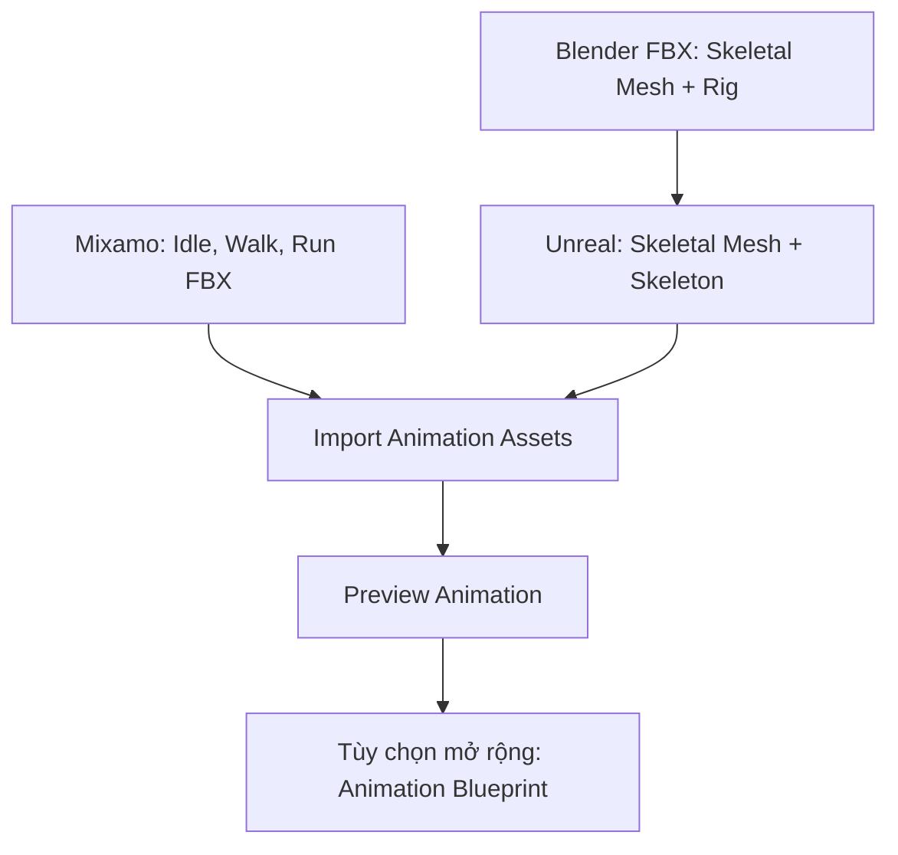

# Bài 12 — Import và kiểm tra nhân vật trong Unreal Engine

> **Mục tiêu:** tạo skeletal mesh và các animation assets, kiểm tra động tác trực tiếp trong engine. **Nguồn:** 34:04–36:09.

## 1. Bối cảnh video

Tác giả tạo một dự án Unreal Engine từ **Third Person Template**. Tiếp đó import tệp nhân vật có rig xuất từ Blender ở **default pose**, rồi import các file animation từ Mixamo. Ví dụ có thể kéo skeletal mesh hoặc animation vào scene để xem; việc tạo controller đầy đủ để chuyển Idle ↔ Run **không được trình bày chi tiết** trong video.

## 2. Quy trình thực hành

1. Tạo hoặc mở project theo Third Person Template.
2. Tạo thư mục nội dung `Characters/Dino/` gồm `Meshes`, `Materials`, `Textures`, `Animations`.
3. Import FBX từ Blender; kiểm tra import là **Skeletal Mesh**, skeleton, material slots và hướng nhìn.
4. Mở Skeletal Mesh để so tỷ lệ, texture, shading và hierarchy xương.
5. Import các FBX hoạt hình, chọn **skeleton đã import** nếu clip tương thích.
6. Mở từng animation asset để chạy thử Idle/Walk/Run.
7. Kéo asset vào level để kiểm tra scene và chụp minh chứng.

## 3. Sơ đồ asset

## 4. Phân biệt phạm vi video và bài mở rộng

**Được video cho thấy:** nhập rig/skeletal mesh; nhập animation và xem nhân vật chạy một clip.

**Ngoài phạm vi video nhưng cần cho gameplay đầy đủ:** tạo **Animation Blueprint**, state machine, blend transitions giữa idle/walk/run, kết nối Character Controller, root motion/retarget phù hợp và đánh giá hiệu năng trong level thực tế.

## 5. Kiểm lỗi khi import

| Biểu hiện | Điểm kiểm tra |
|---|---|
| Animation không bám nhân vật | Skeleton/retarget, cấu trúc xương, root bone |
| Tư thế T/A-pose thay vì clip | Chưa gán animation hoặc sai asset |
| Màu/normal lạ | Material setup, Normal format, import textures |
| Nhân vật quá to/nhỏ | Scale khi export FBX/đơn vị Blender ↔ Unreal |
| Trục quay ngược | Forward/up axes trong FBX exporter |
| Chân trượt | In-place/root motion và tốc độ di chuyển |

## 6. Bài tập

Chụp ảnh màn hình thư mục asset trong Unreal, skeletal mesh từ 2 góc nhìn và hai animation (Idle, Run). Viết 5 dòng mô tả đâu là phần kiểm tra đã thực hiện, đâu là tính năng gameplay còn chưa dựng.
