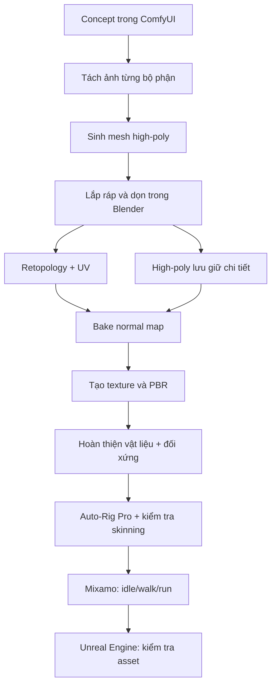

# Khóa học AI 3D Game-Ready: Từ hình ảnh ý tưởng đến Unreal Engine

> **Dự án xuyên suốt:** tạo một nhân vật **khủng long máy phong cách steampunk**, được tách bộ phận, tối ưu lưới, phủ vật liệu PBR, tạo rig và nhập vào Unreal Engine.  
> **Nguồn:** bản chép lời video dài ~36 phút do người học cung cấp; đây là giáo trình **tự biên soạn** theo mạch hướng dẫn, không phải lời chép nguyên văn hay cam kết các bước chạy chính xác ở mọi phiên bản phần mềm.

## 1. Kết quả đầu ra

Sau khóa học, người học có khả năng:

- Tạo ảnh concept rõ hình khối bằng **ComfyUI** với mô hình tạo ảnh được video gọi là **Qwen Image 2512**.
- Tách concept thành đầu, thân, tay, chân, đuôi bằng công cụ chỉnh sửa ảnh AI (video dùng **Nano Banana Pro**).
- Sinh mesh high-poly theo từng bộ phận và lắp ráp bằng **Blender**.
- Giảm số đa giác, retopology thành lưới quad, UV unwrap và bake **normal map**.
- Tạo texture và map PBR bằng workflow **Trellis 2**/công cụ thay thế.
- Rig nhân vật bằng **Auto-Rig Pro**, tạo animation bằng **Mixamo** và thử nghiệm trong **Unreal Engine**.

## 2. Lộ trình gồm 13 bài

| Bài | Chủ đề | Mốc video | Sản phẩm thực hành |
|---|---|---|---|
| [01](01-tong-quan-va-chuan-bi.md) | Tổng quan pipeline, chuẩn bị | 00:00–00:58 | Cấu trúc dự án |
| [02](02-tao-concept-comfyui.md) | Concept trong ComfyUI | 00:59–03:05 | Ảnh concept + ảnh upscale |
| [03](03-tach-bo-phan-nano-banana.md) | Tách ảnh thành bộ phận | 03:06–04:33 | Bộ ảnh đầu/thân/tay/chân/đuôi |
| [04](04-sinh-mesh-high-poly.md) | Sinh mesh high-poly | 04:34–06:16 | Các tệp FBX riêng |
| [05](05-lap-rap-blender.md) | Lắp ráp, biến đổi, tinh chỉnh | 06:17–11:13 | Bộ phận lắp ráp trong Blender |
| [06](06-retopology-va-uv.md) | Retopology và UV | 11:14–15:11 | Low-poly quad + UV |
| [07](07-bake-normal-map.md) | Bake chi tiết normal map | 15:12–20:10 | Normal maps 2K/4K |
| [08](08-texture-pbr-trellis.md) | Tạo texture bằng Trellis 2 | 20:11–22:40 | Base color và map PBR |
| [09](09-hoan-thien-vat-lieu-doi-xung.md) | Vật liệu và Mirror | 22:41–24:34 | Nhân vật hiển thị hoàn chỉnh |
| [10](10-rig-auto-rig-pro.md) | Rig thân, đuôi, hàm | 24:35–32:52 | Rig + FBX xuất |
| [11](11-animation-mixamo.md) | Idle, walk, run | 32:53–34:03 | Animation FBX |
| [12](12-nhap-unreal-engine.md) | Nhập Unreal Engine | 34:04–36:09 | Skeletal mesh + animations |
| [13](13-du-an-cuoi-khoa-va-qa.md) | Kiểm tra, sửa lỗi, dự án cuối | Tổng hợp | Báo cáo và bản nộp |

Tài liệu bổ trợ: [Sổ tay thuật ngữ và lưu ý phiên âm](PHU_LUC_THUAT_NGU.md).

## 3. Sơ đồ toàn khóa



## 4. Chuẩn bị

**Phần mềm/công cụ xuất hiện trong bản chép lời:** ComfyUI (cloud hoặc local), công cụ chỉnh sửa ảnh AI, dịch vụ AI image-to-3D, Blender, công cụ retopology/UV, workflow Trellis 2, Auto-Rig Pro, Mixamo và Unreal Engine.

**Lưu ý quan trọng:** Auto-Rig Pro được tác giả nói là tiện ích trả phí. Một số dịch vụ AI có yêu cầu tài khoản, giới hạn tính toán hoặc phiên bản khác nhau. Video không cung cấp đầy đủ link, bản cài hay cấu hình máy, vì vậy khóa học **không coi những thứ đó là có sẵn**.

Đề xuất cấu trúc lưu trữ dự án:

```text
AI_Dino_GameReady/
├── 01_reference/          # concept, ảnh từng bộ phận
├── 02_highpoly/           # đầu, thân, tay, chân, đuôi FBX
├── 03_blender/            # tệp blend bản gốc và checkpoint
├── 04_lowpoly_uv/         # quad FBX + UV
├── 05_bakes/              # normal map
├── 06_textures/           # base color, roughness, metallic
├── 07_rig_animation/      # rig FBX, idle, walk, run
├── 08_unreal/             # dự án/ảnh kiểm thử engine
└── reports/               # bảng lỗi và checklist
```

## 5. Quy tắc học và kiểm thử

1. **Đọc → làm → kiểm:** mỗi bài có phần kiến thức, thao tác, kết quả mong đợi, lỗi cần tránh và câu hỏi kiểm tra.
2. **Lưu theo checkpoint:** không xóa mesh high-poly khi đã có low-poly; hai bản có mục đích khác nhau.
3. **Không nhầm game-ready với nhìn đẹp:** game-ready còn cần topology đủ hợp lý, UV không vỡ, animation không biến dạng bất thường và nhập được vào engine.
4. **Thông tin chưa chắc chắn:** bản chép lời tiếng Việt có những tên bị nhận dạng sai (ví dụ "Confui", "Hanu 3D", "giàn leo", "Maxamo"). Tài liệu chuẩn hóa tên rất rõ khi có cơ sở ngữ cảnh; những chỗ thiếu cơ sở được ghi chú là cần đối chiếu giao diện thực tế.
5. **Thực hành mở rộng** ngoài video được gắn nhãn riêng, nhằm giúp kiểm tra và khắc phục lỗi chứ không được trình bày như lời tác giả video.

## 6. Đánh giá cuối khóa

Một bài hoàn thành khi có: concept đủ rõ, các bộ phận mesh, high/low poly được tổ chức, UV hợp lệ, normal map hoạt động, màu và PBR hợp lý, rig đầu/thân/chân/đuôi/hàm cơ bản, ít nhất ba animation và skeletal mesh/animation trong Unreal Engine. Xem bảng tiêu chí cụ thể ở [Bài 13](13-du-an-cuoi-khoa-va-qa.md).
