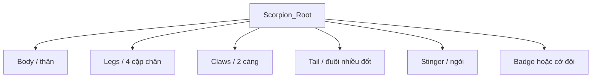

# Bài 01 — Tư duy game-ready và kế hoạch tạo sinh vật

## 1. Mục tiêu

- Giải thích được vì sao chất lượng **mesh đầu vào** ảnh hưởng trực tiếp đến rigging và animation.
- Biết tách các thành phần của sinh vật phi hình người thành một **bộ phận có chức năng**.
- Xác định danh sách animation và yêu cầu khi lên game trước lúc bắt đầu tạo model.

## 2. Tình huống trong video

Tác giả muốn tạo sinh vật **Scorpion** cho game RTS, không phải chỉ để render ảnh đẹp. Các clip được nhắc tới gồm `Idle`, `Walk`, `Run`, `Attack`, `Death`; về sau còn yêu cầu chuyển hướng trái/phải. Tác giả nhận thấy một mesh tạo liền khối, dù có nhiều đa giác, vẫn gây khó khi chia xương và gán trọng số.

> **Nguyên lý:** rigging là liên kết giữa hệ xương và hình học; vertex nào được xương nào điều khiển, với ảnh hưởng bao nhiêu, quyết định chất lượng biến dạng.

## 3. Phân rã sinh vật

Ví dụ cấu trúc cho bọ cạp giả tưởng:



| Nhóm | Tách riêng khi nào? | Yêu cầu chuyển động |
|---|---|---|
| Thân | Luôn nên có nhóm rõ | Là trụ quy chiếu cho chuyển động |
| Chân | Mỗi chân một object hoặc cụm quản lý riêng | Dậm đất, nâng chân, sải bước |
| Càng | Cần mở, kẹp hoặc đập | Pivot đúng bản lề |
| Đuôi | Có nhiều khớp uốn | Chuỗi xương nối nhau |
| Ngòi | Cần giật/đâm rõ | Khớp ở gốc ngòi |
| Huy hiệu | Thay đổi màu team | Có thể dùng object/material tách biệt |

**Lưu ý:** tách object giúp kiểm soát và rig dễ hơn nhưng không đồng nghĩa mọi vật phải để mesh rời mãi mãi. Cần kiểm tra khe hở và lựa chọn gộp mesh sau khi rig hoặc khi export tùy pipeline.

## 4. Xác định mức độ hoàn thiện

Phân biệt 3 mục tiêu:

1. **Concept-ready:** silhouette và kiểu dáng đạt ý tưởng.
2. **Rig-ready:** tỷ lệ, mesh, pivot, khớp và topology hỗ trợ biến dạng.
3. **Game-ready:** action chạy ổn, vật liệu hợp lý, file import chuẩn, hiệu năng đạt ngân sách của game.

Một asset đẹp trong viewport nhưng gãy chân khi chuyển động mới chỉ đạt bước 1.

## 5. Thực hành

Tạo tài liệu `scorpion_spec.md` với nội dung:

```markdown
# Scorpion — Character Spec
- Mục đích: đơn vị chiến đấu trong RTS
- Phong cách: low-poly stylized
- Danh sách bộ phận: thân; 8 chân; 2 càng; đuôi 5 đốt; ngòi; huy hiệu
- Action: Idle, Walk, Run, Attack, Death, TurnLeft, TurnRight
- Khi đánh: điểm va chạm ở cuối đuôi/ngòi; nhịp rõ khi nhìn xa
- Team color: vùng huy hiệu tách material
- Bản giao nộp: .blend + FBX/GLB + Unity prefab + video test
```

Số đốt và số object chỉ là cấu hình minh họa, không phải thiết kế bắt buộc của video.

## 6. Checklist và câu hỏi ôn tập

- [ ] Đã xác định góc nhìn và khoảng cách camera của game.
- [ ] Đã liệt kê bộ phận cần cử động độc lập.
- [ ] Đã xác định animation tối thiểu và khớp quan trọng.
- [ ] Đã chọn ngân sách polygon/texture theo thiết bị đích (không dùng một con số chung cho mọi game).

**Câu hỏi:** Vì sao việc giảm polygon nhưng vẫn giữ cấu trúc khớp tốt có thể giúp cả rigging lẫn hiệu suất game?

**Bài tiếp:** tạo các mesh theo danh mục đã chốt.
