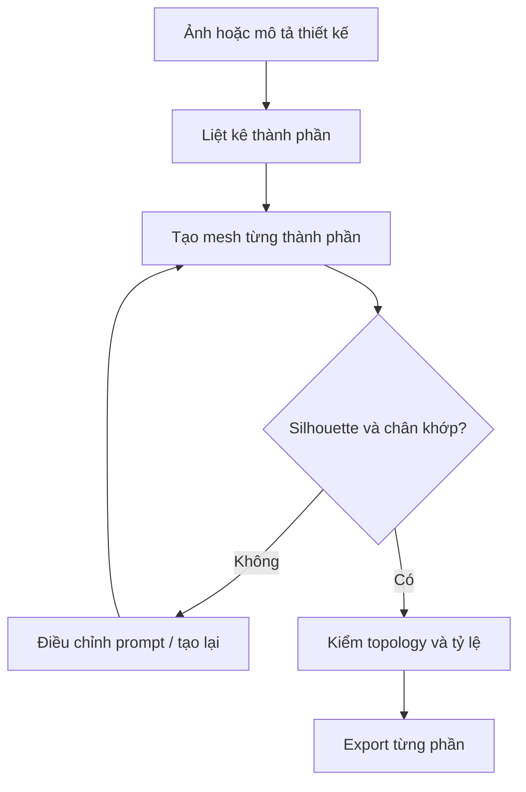

# Bài 02 — Tạo model từng bộ phận thay vì một khối AI duy nhất

## Mục tiêu

- Lập danh mục các lượt tạo AI 3D.
- Hiểu vai trò của **quad topology** và ngân sách polygon.
- Biết loại bỏ mesh lỗi trước khi mang vào Blender.

## 1. Vấn đề khi tạo toàn bộ sinh vật một lượt

Trong video, tác giả thử tạo nhân vật bọ cạp một lần và gặp tình trạng chân lỗi. Với model một khối lớn, các vùng nối chân/thân/đuôi có thể chồng lấn hoặc dính nhau; sửa weight ở vùng này tốn công.

Cách tác giả dùng: tạo riêng các bộ phận trong **Tripo P2**, ưu tiên low-poly và mặt tứ giác. Tác giả nêu ví dụ một chân với thiết lập khoảng **500** (transcript chưa làm rõ đây là số polygons hay tùy chọn nào), vì vậy **không áp dụng 500 như chuẩn cứng cho mọi chân**.

## 2. Quy trình tạo từng phần



**Trình tự khuyến nghị:** thân → 1 chân mẫu → 1 càng mẫu → các đốt đuôi → ngòi → phụ kiện. Nếu các chân đối xứng, có thể nhân bản/mirror một chân đạt chất lượng trong Blender, tiết kiệm lượt tạo.

## 3. Mẫu prompt tạo một bộ phận

```text
A single low-poly stylized scorpion front leg segment for an RTS game.
One isolated anatomical component only, clean silhouette, neutral pose,
no body, no other limbs, no floor, no decorative environment.
Simple surfaces suitable for further Blender editing and rigging.
Consistent red-brown armor styling, readable hinge locations.
```

Sau khi tạo, kiểm tra **mesh thực tế**: AI có thể không tuân thủ chính xác yêu cầu quad, số polygon hoặc độ sạch topology.

## 4. Kiểm đầu ra

| Tiêu chí | Đạt | Cần sửa |
|---|---|---|
| Silhouette | Đọc được ở góc nhìn game | Lẫn hình, thiếu đầu chi |
| Số phần | Chỉ có phần cần tạo | Dư nền, gộp vật thể thừa |
| Geometry | Không thủng, không tự cắt nặng | Non-manifold, mesh dính |
| Khớp | Vùng đặt xương có chiều dài hợp lý | Khớp bẹt, biến dạng khó |
| Mật độ | Phân bố polygon theo độ cong | Quá dày tại bề mặt phẳng |
| Chất liệu | Không lẫn ánh sáng cố định gây bẩn albedo | Bóng/đèn bị bake vào base color |

Video đề cập tùy chọn loại bỏ ánh sáng khỏi texture để có **albedo sạch**. Tên giao diện có thể đổi theo phiên bản phần mềm.

## 5. Bài thực hành

Tạo tối thiểu 5 **loại** phần: `Body`, `Leg`, `Claw`, `Tail_Segment`, `Stinger`. Có thể nhân bản ở Blender thay vì tạo lại 8 chân riêng biệt. Lưu những phiên bản hỏng vào thư mục `rejected` để đối chiếu tại sao chúng không rig tốt.

Cấu trúc gợi ý:

```text
project/
  source_ai/
    body.glb
    leg_source.glb
    claw_source.glb
    tail_segment.glb
    stinger.glb
  rejected/
  blender/
  unity/
```

## 6. Bài tập tự đánh giá

Giải thích trường hợp: một model độ phân giải cao được tạo nguyên khối nhưng phần gốc chân liền thân. Bạn sẽ sửa topology tại chỗ hay tạo lại chân độc lập? Nêu tiêu chí chọn.

**Kết quả đạt:** các part có thể định vị và thay thế độc lập, đủ độ sạch để bước sang Blender.
