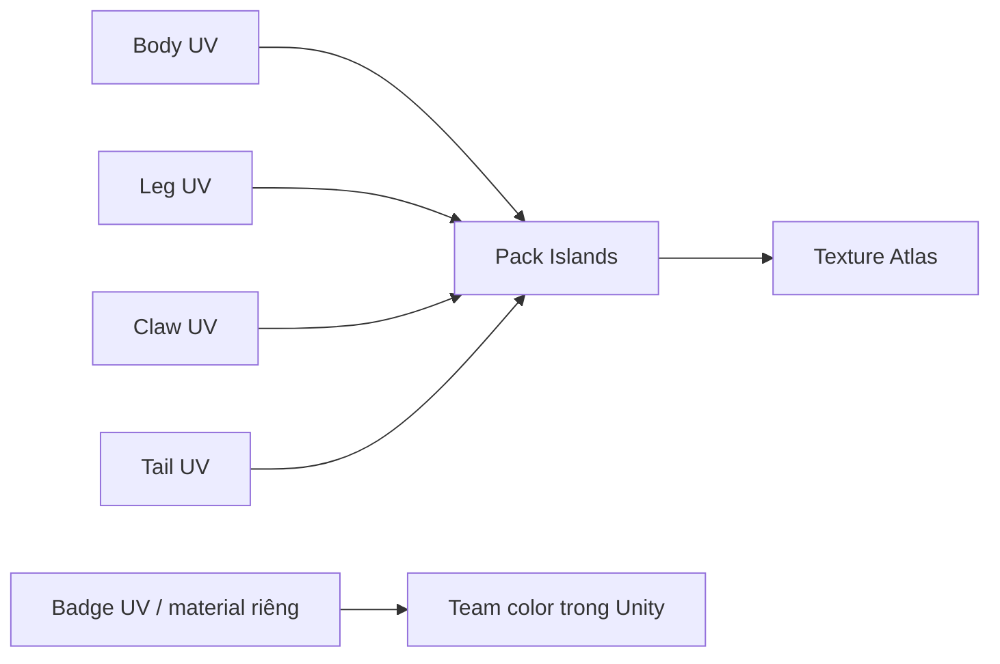

# Bài 04 — UV Mapping và một bộ texture dùng cho toàn sinh vật

## Mục tiêu

- Biết chỉnh UV seam tại vùng phù hợp.
- Hiểu nguyên lý gom các part vào chung **texture atlas**.
- Phân tách base color sạch và team-color material linh hoạt.

## 1. Từ video đến nguyên lý

Tác giả chỉnh lại các **seam** ở mesh Tripo, unwrap và pack các UV island vào **một texture chung**. Lý do: đối tượng là đơn vị RTS khá nhỏ trên màn hình, không cần nhiều texture riêng cho từng bộ phận. Ngoài ra có một biểu tượng/phụ kiện với vật liệu riêng để đổi màu đội.

## 2. Thực hành UV

1. Chọn mesh; vào Edit Mode và kiểm các UV map hiện có.
2. Chọn cạnh cần cắt và **Mark Seam**; đặt seam ở phía khuất hoặc mép nối hợp lý.
3. Chọn vùng mesh, dùng **U → Unwrap**.
4. Trong UV Editor, kiểm island không chồng nếu các phần cần texture riêng; UV chồng **có chủ đích** vẫn có thể dùng cho bộ phận đối xứng dùng chung texture.
5. Sắp UV vào vùng `0–1`, cân đối texel density, chừa padding hợp lý.
6. Nếu đổi từ nhiều vật liệu sang atlas mới, cần **bake hoặc vẽ lại** các kênh cần giữ; chỉ pack UV không tự động gom texture cũ.

## 3. Bản đồ chất liệu thường gặp

| Loại map | Vai trò | Lưu ý |
|---|---|---|
| Base Color / Albedo | Màu cơ bản | Tránh ánh sáng giả bị lưu sẵn, trừ khi cố ý phong cách stylized |
| Normal | Chi tiết bề mặt giả lập | Kiểm tra hướng normal/tangent giữa Blender–Unity |
| Metallic | Độ kim loại | Không dùng giống nhau cho mọi chất liệu |
| Roughness / Smoothness | Độ nhám/bóng | Unity shader có thể dùng smoothness, thường là chiều ngược roughness |
| Emission | Vùng tự phát sáng | Chỉ sử dụng nếu phù hợp hình ảnh/game |

## 4. Vật liệu màu đội (team color)

Video có nói tác giả thêm một đối tượng như biểu tượng/cờ với material riêng để đổi màu đỏ/xanh theo đội. Gợi ý: giữ một material `MAT_TeamBadge`, cấu hình shader nhận màu từ code hoặc `MaterialPropertyBlock` trong Unity, thay vì bake sẵn mọi phiên bản màu.

## 5. Bài tập

Tạo một atlas cho thân/chân/càng/đuôi; giữ huy hiệu ở material tách biệt. Chụp 3 bằng chứng: UV layout, material slot list và render góc RTS. Kiểm tra bằng cách đổi màu huy hiệu mà **không làm đổi màu toàn thân**.

**Câu hỏi:** Vì sao gộp UV có thể giúp việc quản lý texture đơn giản hơn nhưng không bảo đảm tự động giảm draw call trong mọi trường hợp?

**Đầu ra:** `scorpion_uv_v02.blend`, ảnh atlas và bản preview.
