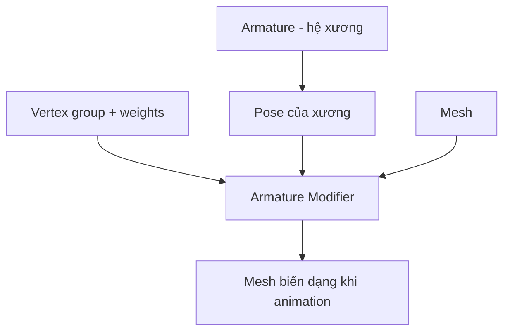

# Bài 05 — Armature và Weight Paint cho bọ cạp

## Mục tiêu

- Phân biệt **xương**, **parent**, **vertex group**, **weight** và **deformation**.
- Thiết kế rig cơ bản cho sinh vật 8 chân, 2 càng, đuôi uốn.
- Sửa lỗi gãy mesh, kéo nhầm đỉnh và mất đồng bộ do weight.

## 1. Rigging thực chất làm gì?

Tác giả mô tả rigging là **tạo xương và phân phối trọng số điều khiển geometry**. Nếu mesh có quá nhiều đỉnh thừa và tổ chức lộn xộn, weight painting có thể nhiễu hoặc khó sửa.



Một vertex có thể chịu ảnh hưởng nhiều xương. Nếu có trọng số khác 0 ở xương không liên quan, chân có thể bị kéo theo đuôi hoặc thân.

## 2. Bản đồ xương tối thiểu (đề xuất bổ sung)

```text
ROOT
└── BODY
    ├── LEG_L_01_BASE -> MID -> TIP
    ├── LEG_L_02_BASE -> MID -> TIP
    ├── LEG_L_03_BASE -> MID -> TIP
    ├── LEG_L_04_BASE -> MID -> TIP
    ├── LEG_R_01...04_BASE -> MID -> TIP
    ├── CLAW_L_BASE -> TIP
    ├── CLAW_R_BASE -> TIP
    └── TAIL_01 -> TAIL_02 -> TAIL_03 -> TAIL_04 -> TAIL_05 -> STINGER
```

Đây là rig minh họa, **không phải sơ đồ xương chính xác được công bố trong video**. Có thể thêm IK controller, pole target và bộ điều khiển chân để nâng cấp rig.

## 3. Các bước thao tác

1. Ở Object Mode, **Add → Armature**; bật `In Front` để quan sát xương xuyên mesh.
2. Vào Edit Mode đặt xương tại tâm khớp thực tế; đặt tên xương rõ.
3. Kiểm trục cuộn xương (**bone roll**) khi cần constraint và chuyển động nhiều hướng.
4. Chọn mesh, chọn armature sau cùng; **Ctrl+P → Armature Deform**. Với part cứng, cân nhắc parent trực tiếp vào bone hoặc weight 1.0 cho một bone thay vì làm méo giáp.
5. Đối với phần mềm cần biến dạng mềm, dùng Automatic Weights như **điểm khởi đầu**, sau đó kiểm thủ công.
6. Vào Weight Paint, chọn từng bone/vertex group, xóa ảnh hưởng ngoài ý muốn; dùng `Normalize All` và `Limit Total` nếu phù hợp pipeline.
7. Tạo `POSE_TEST` với chân/càng/đuôi gập mạnh hơn mức bình thường để nhìn lỗi; không chỉ kiểm pose đứng yên.

## 4. Khắc phục lỗi phổ biến

| Triệu chứng | Nguyên nhân có thể | Cách kiểm tra và sửa |
|---|---|---|
| Chân bên trái kéo cả đuôi | Weight nhầm ở tail vertices | Soi vertex group của chân, xóa weight sai |
| Giáp bị bóp mềm | Nhiều bone cùng ảnh hưởng | Gán cứng theo khớp hoặc tách plate cứng |
| Chân xoắn kỳ lạ | Bone roll / constraint sai | Kiểm hướng xương và pole target |
| Mesh không đi theo bone | Thiếu Armature Modifier hoặc vertex group | Kiểm modifier, parenting, tên bone |
| Nhấc thân làm chân xuyên đất | Không có IK/chỉnh bàn chân | Dùng IK/controller hoặc sửa keyframe chân |

## 5. Bài thực hành

Tạo pose test gồm `BodyUp`, `ClawOpen`, `TailCurl`, `LegLift_L01`, `LegLift_R01`. Với mỗi pose, xoay camera toàn cảnh và cận cảnh để ghi lại sự cố. Chỉ bắt đầu làm animation sau khi các khớp chính biến dạng ổn.

**Điểm đạt:** mọi phần đi theo xương đúng, không bị kéo nhầm, không xuất hiện lỗ lớn ở các khớp khi pose.
