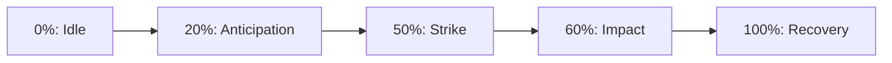

# Bài 06 — Tạo video tham chiếu chuyển động bằng AI

## Mục tiêu

- Biết tạo video mẫu cho `Idle`, `Walk`, `Run`, `Attack`, `Death`.
- Biết đánh giá chu kỳ, hướng camera và logic tiếp xúc mặt đất.
- Biết dùng video để **phân tích tư thế** thay vì coi video là animation rigged tự động.

## 1. Cách làm trong transcript

Tác giả tạo video mẫu bằng nền tảng video AI được ghi thành tên không chắc chắn trong bản transcript, chọn nhiều phiên bản và cung cấp chúng cho AI thao tác trong Blender. Tác giả cho biết có clip phải lặp tạo hai lần; động tác đi bộ được chọn tương đối nhanh, trong khi chạy/tấn công cần chỉnh.

Video được tạo có thể dài vài giây, nhưng animation tấn công trong game có thể ngắn hơn. Vì vậy phải **retime**/chọn lại đoạn quan trọng khi làm trong Blender.

## 2. Bảng yêu cầu tham chiếu

| Clip | Nội dung phải thấy | Tiêu chí loại bỏ |
|---|---|---|
| Idle | Thở, rung chân/đuôi nhẹ, giữ trọng tâm | Trượt chân liên tục |
| Walk | Mẫu bước rõ, nhịp chân phối hợp | Chân đổi số lượng, gãy khớp |
| Run | Tốc độ và nhịp dồn dập hơn walk | Cơ thể di chuyển phi lý |
| Attack | Chuẩn bị → tung đòn → va chạm → hồi | Không có anticipation/impact |
| Death | Mất lực, sụp xuống, tư thế kết | Chuyển động đột ngột, đối xứng giả |

## 3. Prompt tạo video tham chiếu

```text
A stylized giant scorpion seen from a stable three-quarter side view.
Full body always visible, neutral background, no camera cuts.
Perform one readable tail-sting attack: anticipate by curling the tail,
strike sharply toward a target in front, pause briefly at impact,
then recover to idle. Keep leg count and anatomy consistent.
Animation reference only, not a finished 3D rig.
```

Điều chỉnh nội dung động tác và tốc độ cho clip còn lại. Nên giữ góc camera không đổi và không để vật thể bị che khuất phần chân chính.

## 4. Chuyển video thành bảng pose

Ví dụ `Attack`:



Các tỷ lệ chỉ là ví dụ để mô tả nhịp, không trích từ timeline gốc. Với Action dài 1 giây ở 30 FPS, các mốc có thể được diễn giải xấp xỉ thành frame 1, 7, 16, 19, 31. Sau đó điều chỉnh theo motion thực tế.

## 5. Giới hạn cần nhớ

- Video AI có thể tự đổi số chân, hình dạng khớp hoặc vị trí tương đối giữa các phần.
- Video không cung cấp trực tiếp tọa độ xương 3D chính xác; suy luận pose từ camera một góc còn mơ hồ về chiều sâu.
- AI hỗ trợ dựng keyframe cần được kiểm tra theo khung hình tại Blender.
- Không mặc định động tác trong video phù hợp với vật lý va chạm hay gameplay.

## 6. Bài tập

Tạo 2 mẫu video `Attack` và 1 mẫu `Walk`; chọn clip tốt nhất và viết `pose_sheet.md` ghi điểm bắt đầu, tư thế cực trị, điểm chạm, tư thế kết. Đưa bản pose sheet cùng video vào thư mục `reference/`.

**Đầu ra:** video tham chiếu + sheet phân tích key poses.
