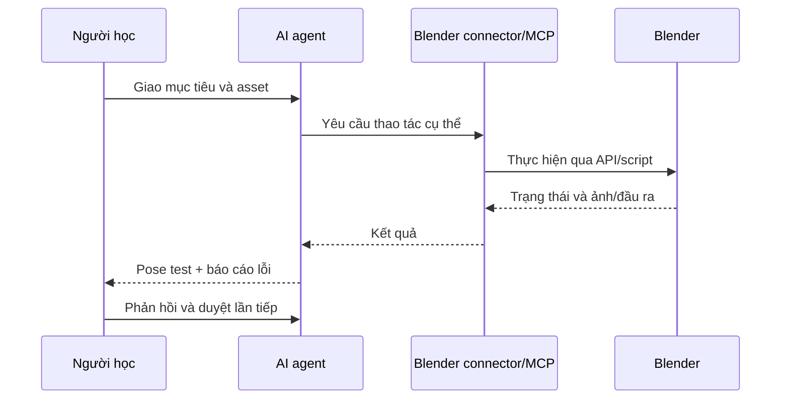

# Bài 07 — AI agent + Blender: giao việc theo từng phần có kiểm thử

## Mục tiêu

- Hiểu luồng trao đổi giữa người làm game, AI và Blender.
- Viết yêu cầu rig/animation rõ mục tiêu, phạm vi, tiêu chí nghiệm thu.
- Biết thiết kế quy trình kiểm thử, sao lưu và giới hạn quyền cho AI.

## 1. Mô hình vận hành được thuật lại

Video mô tả sử dụng một giao diện AI dòng lệnh kết hợp kết nối điều khiển Blender bằng MCP. AI có thể nhận biết file dự án được cho phép, dựng rig và các Action, sau đó chạy kiểm tra. Tác giả phản hồi thêm khoảng hai vòng để tinh chỉnh animation.

Tên model, giao diện và bản MCP trong transcript có thể không chính xác hoặc khác nhau giữa môi trường. **Không mặc định AI có quyền thao tác Blender chỉ vì được yêu cầu bằng lời**: phải cài đặt và cấu hình công cụ tương thích.



## 2. Workflow an toàn

1. Sao lưu `*.blend` trước khi cho agent thay đổi.
2. Giới hạn agent trong **bản sao thư mục dự án**, không cấp quyền vào dữ liệu khác.
3. Yêu cầu **liệt kê kế hoạch**: định danh object, các bone, action và thao tác được phép.
4. Làm một Action hoặc một nhóm bone mỗi lần, không giao cả dự án bằng một yêu cầu mơ hồ.
5. Sau mỗi bước: kiểm render/pose, đếm bone, xem action có keyframe hay không.
6. Chỉ khi vượt kiểm thử mới commit phiên bản và chuyển phần tiếp theo.

> Transcript có nhắc tới cách chạy bỏ qua phê duyệt quyền. Khóa học **không khuyến nghị tắt cơ chế cấp quyền**: hành động tự động trên file dự án có thể gây hỏng dữ liệu hoặc ảnh hưởng hệ thống.

## 3. Prompt rig cơ sở

```text
You are assisting inside a duplicated Blender project.
Goal: create an armature for a low-poly stylized scorpion.
Do not delete or replace existing meshes, UVs, or materials.
First inspect the object hierarchy and report your rigging plan.
Create BODY, 8 leg chains, 2 claw chains and a jointed tail.
Bind each geometry part to its intended bone groups.
Produce 5 diagnostic poses and report any deformed/missing objects.
Ask for confirmation before destructive operations or bulk changes.
Save under a new versioned .blend filename.
```

## 4. Prompt animation theo từng Action

```text
Create an animation Action named ATTACK on the existing rig.
Use the attached reference only for pose timing and movement intent.
Include anticipation, strike, impact and recovery.
Keep feet plausibly grounded until the deliberate body lunge.
Animate the tail and stinger without stretching anatomy unintentionally.
Show key poses at 0%, 25%, 55%, 70%, 100% and report changes.
Do not edit other actions. Save to a new Blender file version.
```

## 5. Lập kiểm thử tự động/bán tự động

| Nhóm | Câu hỏi xác nhận |
|---|---|
| Tính toàn vẹn | Object gốc và vật liệu có bị mất không? |
| Rig | Bone cần thiết có tồn tại? Không trùng tên? |
| Bind | Có Armature Modifier và vertex groups đúng? |
| Action | Có keyframe đúng bones và range? |
| Playback | Loop có giật? Chân có xuyên sàn? |
| Export | File import sang Unity còn xương/clip? |

## 6. Bài tập

Viết 3 yêu cầu tách biệt: (1) phân tích mesh, (2) tạo rig và pose tests, (3) tạo riêng `IDLE`. Với mỗi bước, ghi **đầu vào, hành động được phép, sản phẩm cần trả, điều kiện dừng**.

**Sản phẩm:** `ai_workflow.md` và bản sao `.blend` đã kiểm thử.
