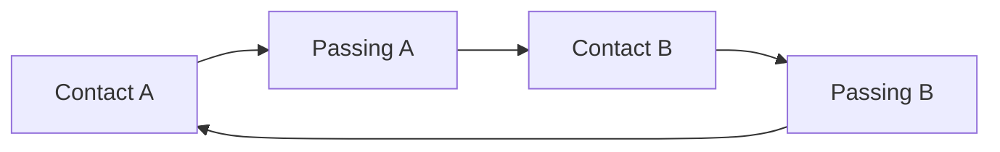

# Bài 08 — Animation di chuyển và vòng lặp tự nhiên

## Mục tiêu

- Tạo một vòng lặp chuyển động không bị giật tại biên.
- Phân biệt nhịp đi, chạy, đứng yên và quay người.
- Biết kiểm tra chân, thân, đuôi theo camera RTS.

## 1. Các Action trong video

Tác giả cho biết walk sớm đạt kết quả mong muốn; run và chuyển hướng đòi hỏi tinh chỉnh. Idle có chuyển động nhỏ của càng, cờ/phụ kiện và chân. Tác giả đặc biệt để ý **sự khác nhau về cách đặt chân** khi quay, tránh mô phỏng quay bằng xoay cả khối quá cứng.

## 2. Cấu trúc animation loop

Đối với sinh vật nhiều chân, không nhất thiết theo mẫu hai chân tiêu chuẩn. Có thể thử phân nhóm chân theo nhịp xen kẽ; luôn xác định chân nào **đang tì đất** và chân nào **đang swing**.

## 3. Thiết lập trong Blender

1. Vào **Dope Sheet → Action Editor**; tạo Action `IDLE`, `WALK`, `RUN`, `TURN_L`, `TURN_R`.
2. Chọn FPS dự án thống nhất (ví dụ 30 FPS). Ví dụ minh họa: `WALK` 24 frame, `RUN` 16 frame; các con số này **không phải thông số lấy từ video**.
3. Đặt pose đầu, giữa, cuối; tạo chuyển động cơ thể lên xuống theo nhịp đặt chân.
4. Với clip loop, đối chiếu pose frame đầu và cuối, tránh giật vị trí/rotation khi lặp.
5. Kiểm tra chân dưới góc side và góc camera gameplay; sửa foot sliding bằng cách đảm bảo chân tì giữ nguyên vị trí không gian trong pha contact.
6. Nếu sử dụng root motion, thống nhất cách engine tiêu thụ root motion; RTS có thể chọn in-place để NavMesh/AI điều khiển vị trí đơn vị.

## 4. Phân biệt ba trạng thái

| Trạng thái | Đặc trưng | Lỗi cần tránh |
|---|---|---|
| Idle | Vi chuyển động, không dịch gốc | Nhân vật lắc quá mạnh liên tục |
| Walk | Chân lần lượt trụ/nhấc, sải đều | Trượt chân, chân cùng pha thiếu tự nhiên |
| Run | Nhịp nhanh, lực thân rõ hơn | Chỉ tăng tốc clip walk mà không đổi cảm giác lực |

## 5. Chuyển hướng

Trong video, người làm dự án yêu cầu animation rẽ trái/phải ngay cả khi không đưa video tham chiếu mới. Để kiểm được bản chuyển hướng, cần quan sát chân phía trong và phía ngoài cua: độ sải, vị trí bàn chân và hướng thân có thể khác nhau.

Một phương án đơn giản trong Unity là blend `Walk` và `Turn` theo vận tốc góc. Nếu clip rẽ không lặp đẹp, dùng nó như **turn-in-place** trong phạm vi góc phù hợp thay vì lặp vô hạn.

## 6. Bài tập và nghiệm thu

Tạo 5 Action: `Idle`, `Walk`, `Run`, `TurnLeft`, `TurnRight`. Quay viewport preview từng Action; kiểm ba vòng liên tiếp với walk/run và chuyển từ idle sang walk, walk sang run.

- [ ] Không nhảy pose đầu/cuối khi lặp.
- [ ] Thân, chân, càng và đuôi phối hợp tự nhiên.
- [ ] Góc nhìn game vẫn đọc được hướng chuyển động.
- [ ] Không có bone bị lệch hoặc chân xuyên mesh không chủ đích.

**Sản phẩm:** `scorpion_locomotion_v03.blend`.
