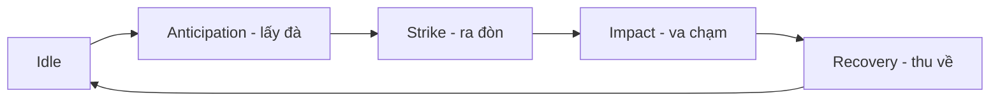

# Bài 09 — Animation chiến đấu: đọc rõ, có lực, có cảm xúc

## Mục tiêu

- Tổ chức nhịp `Attack` theo các pha chuyển động rõ ràng.
- Sửa animation bằng phản hồi cụ thể theo key pose.
- Tạo `Death` tự nhiên, tránh đối xứng máy móc.

## 1. Vấn đề tác giả đã sửa

Trong lần đầu, tác giả thấy `Attack` quá đơn giản. Phản hồi tiếp theo gồm:

- Đuôi tiến sát thân hơn ở pha lấy đà.
- Tư thế phần thân có độ nhô/lên xuống nhằm tạo silhouette mạnh.
- **Phóng đại kích thước hoặc độ rộng cảm nhận của phần đuôi trong một vài khung hình** tại lúc va chạm, nhằm để cú đánh đọc rõ khi nhân vật nhỏ trên màn hình.
- Đối với `Death`, chân nằm quá đối xứng: cần phá đối xứng để tư thế sụp có cảm giác ngẫu nhiên hơn.

**Lưu ý kỹ thuật:** việc phóng đại ở vài khung hình là thủ pháp stylization, không phải yêu cầu bảo toàn giải phẫu. Trong Blender có thể thực hiện bằng scale control bone/keyframe hoặc shape key có kiểm soát; phải tránh làm lỗi mesh và export.

## 2. Chia pha Attack



Một Action tốt nên cho người chơi nhận ra **đòn đánh sắp xảy ra**, khoảnh khắc chạm và khi nhân vật trở về điều khiển bình thường. Khi tốc độ game yêu cầu ngắn hơn video tham chiếu, giảm thời lượng các đoạn trung gian nhưng đừng xóa sạch anticipation/impact.

## 3. Key poses minh họa

Giả sử Attack 30 frame ở 30 FPS (1 giây) cho mục đích luyện tập:

| Frame | Pha | Ý đồ pose |
|---:|---|---|
| 1 | Ready | Đuôi cao vừa, càng cân bằng |
| 7 | Anticipation | Đuôi cuộn, thân dồn lực |
| 16 | Strike | Đuôi quất xuống, càng hỗ trợ |
| 19 | Impact | Dừng/nhấn mạnh cực ngắn, silhouette rõ |
| 25 | Recover | Thu đuôi, thân ổn định |
| 31 | Ready | Khớp trở lại pose gốc nếu cần loop |

Đây là **ví dụ biên soạn**, không phải frame được đo trong video.

## 4. Death: tư thế có chủ đích, không ngẫu nhiên bừa bãi

Tạo ba nhịp: `Loss of balance` → `Collapse` → `Resting pose`. Chọn một bên sụp trước để phá đối xứng; không để đuôi xuyên thân, không để chân đột nhiên biến mất. Cảnh game có thể dừng tại frame cuối thay vì quay về Idle.

## 5. Vòng lặp phản hồi

Một câu phản hồi chất lượng chỉ ra **vị trí + thời điểm + vấn đề + hành vi muốn thấy**. Ví dụ:

```text
In ATTACK, around the contact pose (roughly 55–65% of the action),
the tail silhouette is too thin from the RTS camera.
Increase the apparent thickness briefly, retain the stinger direction,
then smoothly restore original scale before recovery.
Do not alter the walk and run actions.
Show before/after screenshots at the same camera angle.
```

## 6. Bài thực hành

Tạo `Attack` và `Death`, sau đó ghi ít nhất **hai vòng review**: (1) review nhịp/silhouette, (2) review chân/đuôi và tính liên tục. So sánh phiên bản đầu và cuối bằng clip ở cùng tốc độ phát.

**Nghiệm thu:** cú tấn công đọc rõ ở kích thước gameplay; animation chết không đối xứng giả; không phá `Idle`/`Walk`/`Run`.
