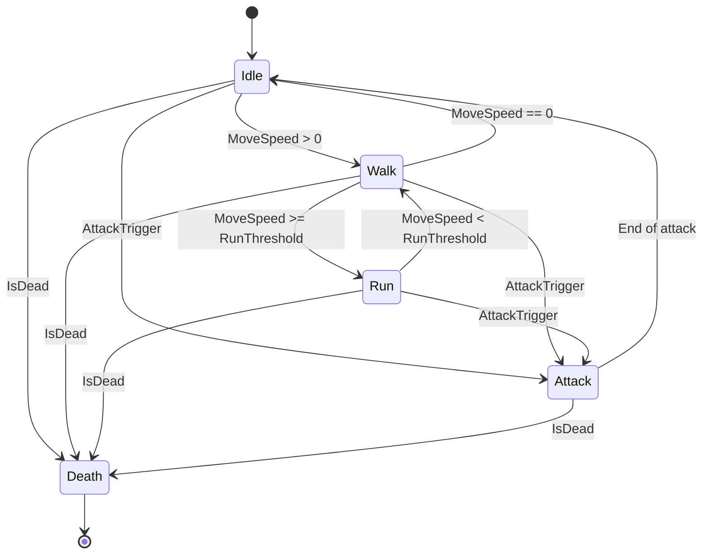

# Bài 10 — Export Blender → Unity và thử nghiệm trong game RTS

## Mục tiêu

- Xuất model đã rig cùng các animation được đặt tên rõ.
- Import vào Unity và kiểm `Rig`, `Animations`, `Materials`.
- Tạo Animator có các trạng thái và kiểm nhân vật tại sân thử.

## 1. Bối cảnh nguồn

Video cho thấy tác giả đã chuẩn bị nhân vật trong tài liệu dự án, có badge, chân dung, thông số đơn vị và một **unit playground** để thử animation. Khi đưa sinh vật vào game, tác giả kiểm chạy, tấn công và nhịp đánh; có nhắc một mốc đòn đánh **1,6 giây** của nhân vật trong game của họ. Đây là thông số gameplay của trường hợp minh họa, không phải luật animation chung.

## 2. Trước khi export

- Sao lưu bản `.blend` cuối.
- Xác định object mesh, armature và Action cần xuất; đặt tên nhất quán.
- Kiểm FPS, clip start/end, root transform, trục tiến của model.
- Chỉ giữ các control/deform bone thích hợp cho game runtime; tránh xuất helper không cần thiết.
- Kiểm texture đường dẫn và lựa chọn import materials; chuẩn bị texture atlas ngoài file nếu pipeline cần.

## 3. Export

Tùy phiên bản Unity và pipeline, có thể dùng FBX hoặc glTF/GLB qua importer phù hợp. Với pipeline Unity phổ biến, **FBX** thường thuận tiện để kiểm Rig/Animation trong Model Importer; GLB đòi hỏi importer/plugin tương thích tùy dự án.

Với FBX trong Blender, thử quy trình:

1. Chọn mesh + armature cần export.
2. **File → Export → FBX**.
3. Kiểm mục `Selected Objects`, `Armature`, `Bake Animation` và cách xuất Action/NLA phù hợp bản Blender đang dùng.
4. Export thử một clip, nhập Unity và xác nhận bone/clip trước khi xuất hàng loạt.
5. Lưu kèm texture, source `.blend` và bảng thông số import.

> Tùy phiên bản Blender/Unity, tên checkbox và cách chuyển các Action thành clip có thể thay đổi. Luôn xác nhận trực tiếp trên asset nhập vào Unity thay vì mặc định export một lần sẽ có đủ mọi clip.

## 4. Thiết lập Animator Controller



Nên kiểm `Has Exit Time`, transition duration và khả năng interrupt tùy gameplay. Khi điều khiển bằng code, đừng để State Machine tự động đánh lặp vô hạn nếu logic combat muốn cooldown.

## 5. Đoạn C# minh họa (không lấy trực tiếp từ video)

```csharp
using UnityEngine;

public class ScorpionAnimationController : MonoBehaviour
{
    [SerializeField] private Animator animator;
    private static readonly int MoveSpeed = Animator.StringToHash("MoveSpeed");
    private static readonly int AttackTrigger = Animator.StringToHash("AttackTrigger");
    private static readonly int IsDead = Animator.StringToHash("IsDead");

    public void SetMoveSpeed(float speed)
    {
        animator.SetFloat(MoveSpeed, Mathf.Max(0f, speed));
    }

    public void Attack()
    {
        animator.SetTrigger(AttackTrigger);
    }

    public void Die()
    {
        animator.SetBool(IsDead, true);
    }
}
```

Gắn script lên GameObject và tham chiếu đúng `Animator`. State và parameter phải khớp tên; việc khóa di chuyển, hit timing, cooldown, sát thương cần logic gameplay riêng, không tự có trong script trên.

## 6. Kiểm tại playground

Tạo cảnh test có mặt đất, camera RTS, một prefab Scorpion và một dummy enemy. Thực hiện chuỗi `Idle → Walk → Run → Attack → Death`; quan sát:

- Tốc độ di chuyển trong game so với tốc độ chuyển động chân.
- Hướng trục, vị trí trên mặt đất và tỷ lệ so với nhân vật khác.
- Điểm va chạm của ngòi có trùng với thời điểm gây sát thương không.
- Màu badge có đổi theo đội mà không làm ảnh hưởng albedo của toàn thân không.
- Vật liệu, texture atlas, bone hierarchy và clip có đủ sau import không.

## 7. Nhiệm vụ

Xuất asset, dựng Unity prefab, thử một chuỗi animation bằng Animator. Chụp Inspector của file model, Animator graph và một video scene test ngắn.

**Sản phẩm:** `Scorpion.prefab`, controller, FBX/GLB và biên bản test.
