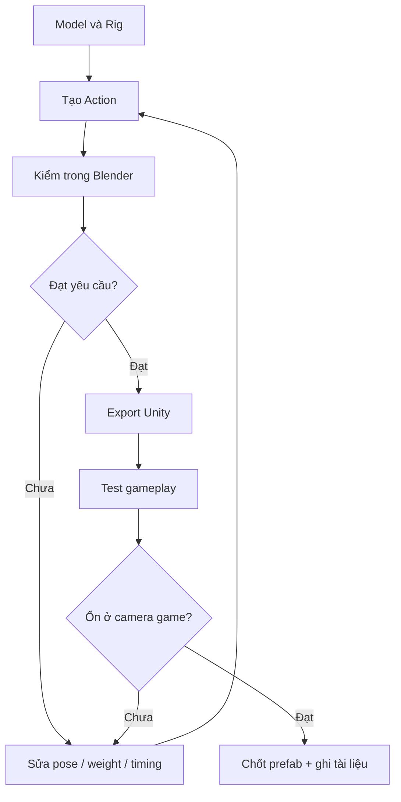

# Bài 11 — Kiểm tra game-ready và bài cuối khóa

## Mục tiêu

- Dùng checklist để chứng minh asset **thực sự hoạt động trong game**.
- Phân loại lỗi trước khi sửa để không phá thành phần đang ổn.
- Đóng gói dự án đủ tài liệu tái hiện.

## 1. Vòng lặp phát triển

Video cho thấy quy trình không dừng ở việc AI tạo xương và chuyển động lần đầu: tác giả xem clip, chỉ ra lỗi attack/death, sửa qua vài vòng, xuất Unity, dùng playground test lại. Bài học tổng quát là **chạy thử trong bối cảnh thật**, không chỉ tin vào viewport của AI hoặc Blender.



## 2. Checklist nghiệm thu

### Mesh và vật liệu

- [ ] Không có chân/đuôi thiếu hoặc mesh đính thừa.
- [ ] Face normals ổn, silhouette rõ ở camera gameplay.
- [ ] Object/bone/material tên nhất quán.
- [ ] UV không sai lệch; atlas và badge hoạt động đúng.
- [ ] Đã kiểm tra số tam giác và bộ nhớ texture theo ngân sách dự án.

### Rigging

- [ ] Bone chains đủ cho chân/càng/đuôi.
- [ ] Không kéo nhầm vertices khi gập khớp.
- [ ] Cấu trúc rig không tự phá khi chỉnh root/body.
- [ ] Các transform còn nhất quán sau export/import.

### Animation

- [ ] Idle không trôi vị trí.
- [ ] Walk và Run lặp không giật.
- [ ] Chân không trượt rõ rệt trong pha chạm đất.
- [ ] Attack có lấy đà, ra đòn, va chạm và hồi thế.
- [ ] Death chuyển thành tư thế kết tự nhiên.
- [ ] Turn/đổi hướng phù hợp điều khiển của game.
- [ ] Unity phát được tất cả clip dự kiến.

### Game integration

- [ ] Animator parameter và trạng thái đúng.
- [ ] Đòn đánh đồng bộ với gameplay hit event.
- [ ] Badge/team color đổi được.
- [ ] Prefab tạo mới không lỗi missing material / missing script.
- [ ] Có video bằng chứng trong cảnh test.

## 3. Dự án cuối khóa: Scorpion trong một cảnh RTS

**Yêu cầu:** tạo bọ cạp (hoặc sinh vật phi hình người khác có ít nhất hai loại chi và một chuỗi khớp) với:

- Mô hình tổ chức thành từng phần dễ sửa.
- Rig điều khiển chân + bộ phận tấn công đặc trưng.
- Tối thiểu 5 clip `Idle`, `Walk`, `Run`, `Attack`, `Death`.
- Một bản preview hoạt ảnh trong Blender và một cảnh test trong Unity.
- Một trang ghi rõ lỗi gặp phải, cách sửa, quyết định về polygon/texture.

## 4. Thang đánh giá 100 điểm (đề xuất)

| Hạng mục | Điểm tối đa | Dấu hiệu đạt |
|---|---:|---|
| Mesh và silhouette | 20 | Cấu trúc rõ, hình khối đọc tốt |
| UV, vật liệu, tối ưu | 15 | Không lỗi texture, hợp pipeline |
| Rig và weight | 25 | Khớp biến dạng đúng ở các pose test |
| Animation | 25 | Nhịp rõ, loop ổn, attack/death thuyết phục |
| Unity và bàn giao | 15 | Prefab/Animator hoạt động và có chứng cứ |
| **Tổng** | **100** | **>= 80: đạt khuyến nghị** |

Ngưỡng này do khóa học tự đặt, không phải thước đo được công bố trong video.

## 5. Cấu trúc nộp bài

```text
Scorpion_Final/
  README.md
  source_ai/
  blender/scorpion_final.blend
  exports/scorpion.fbx
  textures/
  reference/
  unity/Scorpion.prefab
  reviews/review_log.md
  evidence/idle_walk_run.mp4
  evidence/attack_death.mp4
  evidence/unity_playground.mp4
```

**Báo cáo một trang:** bạn đã tạo từng part ra sao, gặp mesh lỗi nào, sửa weight ở đâu, video tham chiếu giúp gì, Unity test phát hiện điều gì, và bạn sẽ cải tiến gì nếu có thêm thời gian.
