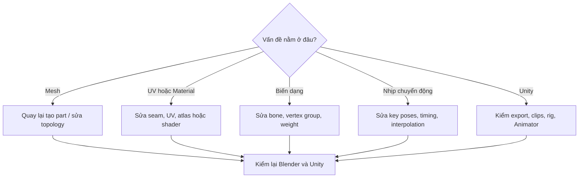

# Phụ lục — Từ điển và mẫu yêu cầu AI

## 1. Thuật ngữ cốt lõi

| Thuật ngữ | Nghĩa sử dụng trong khóa học |
|---|---|
| Mesh | Tập đỉnh, cạnh, mặt tạo hình học 3D |
| Topology | Cách các đỉnh/cạnh/mặt được kết nối |
| Low-poly | Hình học số polygon tương đối thấp phù hợp mục tiêu |
| Quad | Mặt có 4 cạnh; thường dễ chỉnh edge flow khi modeling |
| UV Map | Tọa độ trải bề mặt mesh lên ảnh 2D |
| Seam | Cạnh cắt tạo đường mở UV |
| Texture Atlas | Một ảnh chứa texture cho nhiều bề mặt/vật thể |
| Albedo/Base Color | Màu vật liệu trước hiệu ứng chiếu sáng |
| Armature | Hệ xương trong Blender |
| Vertex Group | Nhóm vertices, thường dùng lưu trọng số cho xương |
| Weight Painting | Thiết lập mức độ ảnh hưởng của từng xương lên mesh |
| Rig | Cấu trúc xương và điều khiển chuyển động |
| Bone Roll | Hướng quay dọc trục xương, quan trọng với constraint |
| FK / IK | Điều khiển thuận / nghịch chuỗi khớp |
| Action | Tập keyframe biểu diễn animation trong Blender |
| NLA | Hệ thống phối/tổ chức animation trong Blender |
| Root Motion | Dữ liệu chuyển động gốc nhân vật được engine sử dụng |
| In-place | Clip chân/thân chuyển động nhưng nhân vật không tịnh tiến trong không gian |
| Anticipation | Pha lấy đà chuẩn bị động tác |
| Impact | Pha chạm mục tiêu/đòn đánh đạt đỉnh |
| Recovery | Pha hồi về trạng thái điều khiển được |
| MCP | Cơ chế kết nối để một AI client có thể gọi công cụ tương thích |
| Game-ready | Mức sẵn sàng thực tế của asset trong môi trường game đích |

## 2. Bộ prompt tái sử dụng

### A. Kiểm lỗi model đầu vào

```text
Inspect the selected low-poly creature assets in Blender.
Report: mesh objects, polygon counts, normals, non-manifold areas,
UV maps, materials, transforms and suspicious intersections.
Do not edit anything until the inspection report is approved.
```

### B. Sửa Weight Paint

```text
Inspect leg L_02 deformation at the diagnostic pose.
Identify vertices weighted to unrelated bones.
Only fix affected vertex groups; preserve other limbs and all Actions.
Show the result at straight, mid-bend and full-bend poses.
```

### C. Kiểm vòng lặp Walk

```text
Review the WALK Action from the RTS camera angle.
Compare start and end poses. Identify foot sliding, penetrations,
wrong gait phase, unnatural body bounce and tail popping.
Propose frame-specific changes before editing.
```

### D. Bàn giao Unity

```text
Prepare an export checklist for the scorpion asset.
Verify the named Actions IDLE, WALK, RUN, ATTACK and DEATH,
root transform, deform bones, textures and missing dependencies.
Do not overwrite the final source .blend file.
Produce a report listing items still requiring manual verification in Unity.
```

## 3. Mẫu bảng đánh giá clip

```markdown
# Animation Review Log
- Clip: ATTACK
- Phiên bản: v02
- Camera: RTS isometric
- Điểm tốt: silhouette rõ, có anticipation
- Lỗi: ở khoảng 55% đuôi quá mảnh; chân trái trượt
- Sửa: tăng độ rộng cảm nhận ngòi trong 3 frame quanh impact;
  cố định chân đang chống đất; giữ nguyên các clip khác
- Kết quả test: đạt / chưa đạt
```

## 4. Các điểm dễ hiểu nhầm khi xem transcript

1. Việc dùng AI + Blender không có nghĩa **mọi loại sinh vật** đều rig đúng tự động ngay lần đầu.
2. Cụm ghi thành tên AI model/agent và tên nền tảng video trong transcript có thể bị nhận dạng sai; nội dung khóa học tập trung vào quy trình có thể áp dụng mà không phụ thuộc thương hiệu.
3. Một thiết lập cỡ `500` cho chân trong video không đồng nghĩa đó là chuẩn polygon cho dự án khác.
4. Video tham chiếu là tài liệu về **ý đồ chuyển động và nhịp**, không phải file mocap 3D sạch hay action có sẵn.
5. Tối ưu atlas hữu ích nhưng hiệu năng còn phụ thuộc shader, batching, LOD, thiết bị và lượng đơn vị trên màn hình.
6. Thời gian hoàn thành được người làm video kể lại phụ thuộc dự án, chất lượng đầu vào, máy và công cụ; không nên xem là bảo đảm.

## 5. Sơ đồ kiểm tra và quyết định sửa lỗi



---

*Khóa học được biên soạn từ transcript người học cung cấp, kết hợp bài tập và kỹ thuật bổ sung để học có thể thực hành. Phần bổ sung không được trình bày như phát biểu chắc chắn của tác giả video.*
