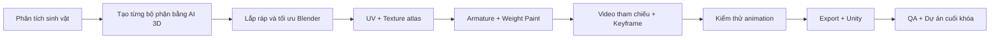

# Khóa học: Biến sinh vật 3D do AI tạo thành nhân vật sẵn sàng cho game

> **Ca thực hành xuyên suốt:** dựng một sinh vật dạng **bọ cạp/Scorpion** theo kiểu low-poly, chia thành nhiều bộ phận; rig và tạo các clip `Idle`, `Walk`, `Run`, `Attack`, `Death`; đưa vào Unity để kiểm tra.

## Bạn sẽ làm được gì?

Sau khóa học, người học có thể:

1. Chia sinh vật phi hình người thành các cụm có thể tạo bằng AI 3D riêng lẻ.
2. Tổ chức mesh, chỉnh tỷ lệ, UV và texture atlas để thuận lợi cho rig/game runtime.
3. Thiết kế bộ xương (armature), gán trọng số vertex và kiểm tra biến dạng.
4. Sử dụng video chuyển động làm **tham chiếu**, không nhầm video 2D với dữ liệu hoạt ảnh 3D đã rig.
5. Viết yêu cầu rõ ràng để AI hỗ trợ thao tác Blender qua các công cụ có quyền truy cập hợp lệ.
6. Hoàn thiện các Action trong Blender, xuất FBX/GLB phù hợp và kết nối Animator trong Unity.
7. Đánh giá chất lượng có tiêu chí và sửa lỗi theo vòng lặp.

## Lộ trình

## Danh sách bài học

| Tệp | Bài học | Sản phẩm của bài |
|---|---|---|
| `01-tong-quan-va-ke-hoach.md` | 01. Kiến trúc quy trình | Bản thiết kế nhân vật + danh mục animation |
| `02-tao-model-tung-bo-phan.md` | 02. Tạo mô hình với Tripo | Bộ mesh thân, chân, đuôi, càng... |
| `03-lap-rap-va-topology.md` | 03. Blender: lắp ráp và tổ chức mesh | Tệp `.blend` có cấu trúc, tỷ lệ đúng |
| `04-uv-va-texture-atlas.md` | 04. UV, texture và tối ưu vật liệu | UV sạch + atlas cho sinh vật |
| `05-rigging-va-weight-paint.md` | 05. Rig cho sinh vật phi hình người | Armature + skinning ổn định |
| `06-video-tham-chieu-ai.md` | 06. Tạo video tham chiếu chuyển động | Bộ clip tham chiếu có tiêu chí |
| `07-ai-blender-mcp-workflow.md` | 07. Phối hợp AI với Blender | Prompt điều khiển, kế hoạch kiểm thử |
| `08-animation-di-chuyen.md` | 08. Idle, Walk, Run, Turn | Action lặp và chuyển hướng |
| `09-animation-chien-dau.md` | 09. Attack, Death và polish | Action có nhịp, lực và điểm chạm |
| `10-dua-vao-unity.md` | 10. Xuất asset, Animator, kiểm thử game | Prefab Unity có animation |
| `11-qa-va-du-an-cuoi-khoa.md` | 11. Checklist và bài tổng kết | Bản giao nộp game-ready |
| `12-thuat-ngu-prompt-templates.md` | Phụ lục: thuật ngữ và mẫu prompt | Bộ mẫu có thể tái sử dụng |

## Công cụ và dữ liệu đầu vào

- **Blender**: lắp ráp, chỉnh mesh, UV, rig, animation và export.
- **Tripo / công cụ tạo 3D bằng AI**: tạo bộ phận riêng. Video đề cập Tripo P2 như công cụ tác giả sử dụng; không phải yêu cầu bắt buộc.
- **Công cụ tạo video AI**: cung cấp clip gợi ý nhịp chuyển động; phiên bản/nhãn công cụ trong transcript có thể bị nhận dạng sai, nên không xem là khẳng định sản phẩm.
- **AI agent + giao diện điều khiển Blender**: tùy chọn. Không bắt buộc cho phần rig/animation cơ bản.
- **Unity**: đưa sinh vật vào cảnh, cấu hình Animator và test chiến đấu.

## Cách học

Mỗi bài có bốn phần: **mục tiêu → giải thích → thực hành → tiêu chí nghiệm thu**. Làm theo thứ tự, lưu một phiên bản `.blend` mới sau mỗi mốc lớn, và lưu cảnh test Unity riêng với game chính.

**Thời lượng gợi ý:** 10–16 giờ thực hành, phụ thuộc độ phức tạp của sinh vật. Đây là ước lượng cho lộ trình tự học, không phải số liệu từ video.

## Phân biệt nguồn và phần bổ sung

- **Từ transcript**: ca làm bọ cạp cho game RTS; tạo từng phần bằng Tripo, ưu tiên low-poly/quad; lắp ráp Blender; chỉnh UV và gom texture; dùng video tham chiếu; AI hỗ trợ rig/animation; lặp phản hồi và kiểm thử Unity.
- **Biên soạn bổ sung**: thao tác Blender/Unity từng bước, đề xuất đặt tên, kiểm tra trọng số, nguyên tắc vòng lặp, tiêu chuẩn xuất file, prompt mẫu và bảng kiểm. Đây là hướng dẫn thực hành mở rộng, không phải lời thoại nguyên văn.
- **Lưu ý độ tin cậy**: transcript có lỗi dịch/nhận dạng tên công cụ và thời lượng; không suy diễn mọi chức năng AI đều luôn tự động hoạt động hay chắc chắn hoàn tất trong một lần chạy.

**Nguồn học:** transcript video tiếng Việt người học cung cấp (mốc khoảng 00:00–15:20).
