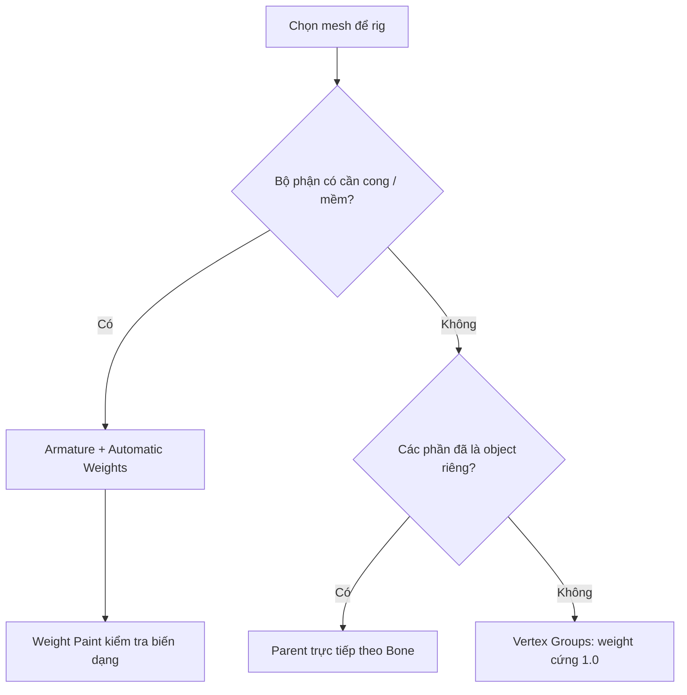

# Bài 01 — Hiểu Rigging và chọn phương pháp

**Thời lượng gợi ý:** 20–25 phút · **Độ khó:** Nhập môn

## Mục tiêu

- Giải thích `Armature`, `Bone`, `Mesh`, `Parent`, `Vertex Group`.
- Chọn được rig biến dạng hoặc rig cứng dựa trên cấu trúc mô hình.

## 1. Rigging là gì?

Rigging là giai đoạn tạo **bộ xương điều khiển** cho mô hình. Animator tác động lên xương; mesh chuyển động theo những quan hệ đã thiết lập. Nếu cơ thể cong mềm, xương có thể chia sẻ ảnh hưởng lên cùng vùng đỉnh. Nếu mô hình là robot lắp từ nhiều mảnh cứng, bộ phận thường cần quay theo khớp mà không bị méo.

## 2. Hai phong cách rig trong phần nguồn

| Tiêu chí | Rig biến dạng (Deforming) | Rig cứng (Rigid) |
|---|---|---|
| Hình học | Da, tay, chân, đuôi, cành cần uốn | Giáp, bánh răng, piston, vỏ robot |
| Cách liên kết | Armature Modifier + weights 0–1 | Parent trực tiếp tới Bone hoặc gán weight 1.0 |
| Ưu điểm | Chuyển động tự nhiên, mềm | Mảnh cơ khí giữ nguyên hình dạng |
| Rủi ro | Méo vai, khuỷu, đầu gối do weight/topology | Trục xoay/sắp xếp parent sai, vật thể tách rời |

## 3. Ví dụ áp dụng

**Nhân vật thỏ hoạt hình:** thân, tay, chân có thể dùng deform; mắt kính/mũ cứng dùng bone parenting. **Robot ngựa:** các tấm giáp có thể rigid; ống mềm hoặc đuôi vải có thể deform. Đây là lựa chọn thiết kế, không phải luật tuyệt đối.

## 4. Thực hành nhanh

1. Mở Blender và nhập một mô hình đang có.
2. Trong Outliner, xem mô hình gồm **một Mesh Object** hay nhiều Mesh Object.
3. Xác định ba vùng cần uốn và ba vùng cần giữ cứng (nếu có).
4. Ghi vào bảng kế hoạch:

| Bộ phận | Uốn cong? | Cách rig dự kiến |
|---|---|---|
| Thân | ... | ... |
| Cánh tay / chân | ... | ... |
| Giáp / phụ kiện | ... | ... |

## 5. Câu hỏi tự kiểm tra

1. Vì sao dùng automatic weights cho bánh răng cứng có thể cho kết quả xấu?
2. Mesh một object có bắt buộc phải rig deform không?
3. Hai cách làm rig cứng được nhắc tới trong nguồn là gì?

**Đáp án gợi ý:** 1. Nhiều xương cùng ảnh hưởng dẫn tới méo. 2. Không, có thể chia vùng theo Vertex Groups. 3. Bone parenting hoặc weight cứng theo nhóm đỉnh.

**Hoàn thành khi:** mô hình được phân loại được các bộ phận deform và rigid.
