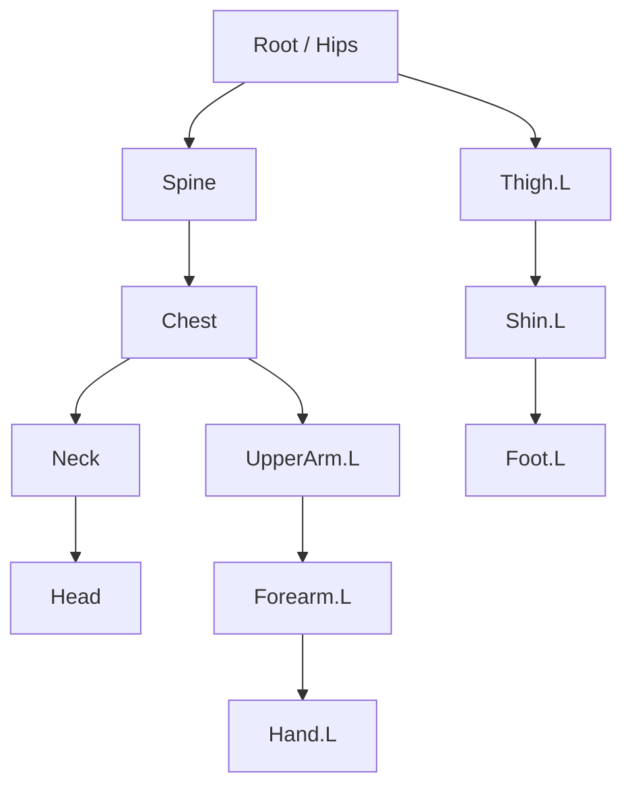

# Bài 02 — Dựng bộ xương đầu tiên

**Thời lượng gợi ý:** 35–45 phút

## Mục tiêu

Tạo cấu trúc xương từ thân đến tứ chi, biết phân biệt Head/Tail, quan hệ cha–con, tên `.L` / `.R` và thao tác đối xứng.

## 1. Thêm Armature và làm xương luôn hiện

1. Trong **Object Mode**, nhấn `Shift + A` → **Armature** (hoặc Add → Armature).
2. Chọn Armature → **Object Data Properties** (biểu tượng người que/xương, tùy giao diện).
3. Trong **Viewport Display**, bật **In Front** để thấy xương xuyên qua mesh. Nếu In Front xuất hiện trong Object Properties của phiên bản đang dùng, bật ở vị trí đó.
4. Chọn Armature → `Tab` để vào **Edit Mode**.

> *Edit Mode* chỉnh chiều dài/vị trí/xếp nhánh xương (rest pose). *Pose Mode* dùng để kiểm thử hoặc hoạt hình mà không thay rest pose.

## 2. Chỉnh xương và quan hệ phân cấp

- Xương có **Head** (đầu/gốc) và **Tail** (đuôi). Chọn đầu/đuôi rồi `G` để di chuyển.
- Chọn **Tail** → `E` (Extrude) tạo xương con liền mạch.
- `Shift + D` (Duplicate) nếu cần xương mới rời chỗ rồi thiết lập cha–con sau.
- Chọn xương con, chọn xương cha sau cùng → `Ctrl + P`: **Connected** hoặc **Keep Offset**.
- `Alt + P` để ngắt/xóa quan hệ cha–con trong Edit Mode khi phù hợp.

Sơ đồ chỉ thể hiện một nửa trái để dễ đọc. Tùy dự án mà Root, Hips và Spine có cấu trúc khác.

## 3. Bố trí đối xứng

1. Đặt xương trục (Spine/Head) gần mặt phẳng giữa của mô hình.
2. Chỉ dựng một phía cơ thể, chẳng hạn phía `.L` (trái **của nhân vật**, không phải trái người xem).
3. Đặt tên xương `UpperArm.L`, `Forearm.L`, `Thigh.L`...; có thể dùng `Ctrl + F2` **Batch Rename** cho nhiều xương, nhưng kiểm tra hậu tố sau đổi tên.
4. Trong Armature Edit Mode, chọn xương phía `.L`, dùng **Armature → Symmetrize** (thường tìm qua `F3` → gõ *Symmetrize*). Kết quả là bộ xương tương ứng `.R`.
5. Bật hiển thị tên xương trong tùy chọn Viewport Display nếu cần kiểm tra.

**Vì sao `.L`/`.R` quan trọng?** Blender nhận quy ước tên này cho các tác vụ đối xứng như Pose Paste Flipped và Symmetrize.

## 4. Snap khi đặt xương

Nguồn gợi ý dùng snapping để áp sát hoặc canh xương với mô hình. Có thể bật nam châm trong Viewport và chọn Snap To (Vertex/Face...) phù hợp; giữ `Ctrl` có thể kích hoạt snap trong các thao tác di chuyển tùy thiết lập. Không snap vào bề mặt một cách máy móc nếu xương cần nằm ở tâm khớp bên trong mesh.

## 5. Bài tập

Dựng xương cho người đơn giản gồm Hips, Spine, Chest, Head, hai tay, hai chân. Bảo đảm chiều trái phải đúng; xoay thử ở Pose Mode để xác định điểm khớp.

**Kiểm tra:** xương hai bên đối xứng; không có xương con ngoài ý muốn; rest pose khớp vị trí vai/khuỷu/hông/gối.

**Lỗi thường gặp:** dùng Pose Mode để chỉnh rest pose; nhầm Head và Tail; đặt tên `.L` ở sai phía; Symmetrize nhân đôi xương trục.
