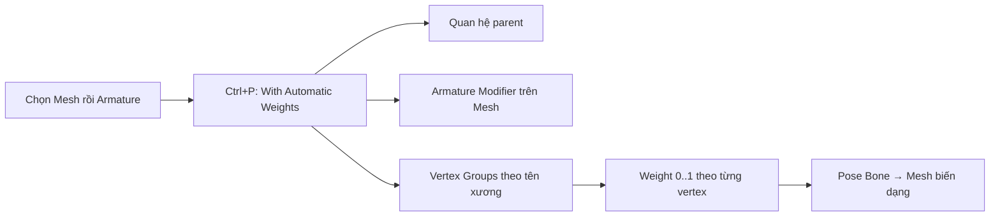

# Bài 03 — Automatic Weights và Vertex Groups

**Thời lượng gợi ý:** 25–35 phút

## Mục tiêu

Biết tạo quan hệ Armature Deform với Automatic Weights, giải thích Weight 0–1, hiểu nơi lưu dữ liệu và cách kiểm thử.

## 1. Gán xương tự động

1. Đảm bảo nhân vật ở tư thế nghỉ; Armature ở đúng vị trí.
2. Trong **Object Mode**, chọn **Mesh** trước.
3. Giữ `Shift` chọn **Armature** cuối cùng → Armature là *active object*.
4. Nhấn `Ctrl + P` → **Armature Deform → With Automatic Weights**.
5. Có nhiều Mesh Objects? Chọn toàn bộ các mesh cần biến dạng, rồi chọn Armature cuối cùng. Mỗi mesh có thể được gán quan hệ/deform độc lập.

**Điều diễn ra sau thao tác**

> Ảnh hưởng trong hệ thống deform thông thường phụ thuộc vào tên group trùng bone và cờ **Deform** của bone. Armature Modifier là thành phần quan trọng để mesh chuyển theo pose.

## 2. Đọc ý nghĩa weight

Weight gần `1.0`: xương ảnh hưởng mạnh tới đỉnh. Weight `0`: không ảnh hưởng. Vùng khuỷu tay thường cần hai xương chia sẻ ảnh hưởng để chuyển tiếp mềm, trong khi mảng giáp cứng thường không cần pha trộn.

## 3. Kiểm thử

1. Chọn Armature → vào **Pose Mode** (`Ctrl + Tab` trong nhiều keymap).
2. Chọn xương cẳng tay, dùng `R` xoay nhẹ.
3. Quan sát khuỷu, vai và bộ phận gần đó.
4. Lặp lại với đùi, cẳng chân, cổ.
5. Nếu cần đưa về tư thế mặc định: chọn xương và dùng `Alt + R` để xóa rotation trong Pose Mode (đối với các xương chỉ xoay).

## 4. Nếu muốn làm lại phần gán weight

- Kiểm tra **Armature Modifier** và các **Vertex Groups** trong Object Data Properties.
- Khi muốn reset toàn bộ, sao lưu trước rồi xóa nhóm đỉnh sinh tự động/quan hệ cũ và làm lại một cách có kiểm soát.
- Tránh xóa nhầm vertex groups dùng cho những hệ thống khác (mask, data transfer...).

## 5. Bài tập

Thực hiện Auto Weights trên một người low-poly có đủ vòng cạnh ở khớp. Tạo ít nhất 3 pose thử và chụp hình đối chiếu.

**Tự kiểm:** Automatic Weights có tạo ra xương mới không? Weight lưu ở đâu? Nếu chỉ thấy xương cử động mà mesh đứng yên, nên kiểm tra những gì?

**Đáp án:** không tạo xương mới; weight lưu trong Vertex Groups; kiểm tra chọn parent/Armature Modifier, tên nhóm và Deform của xương.
