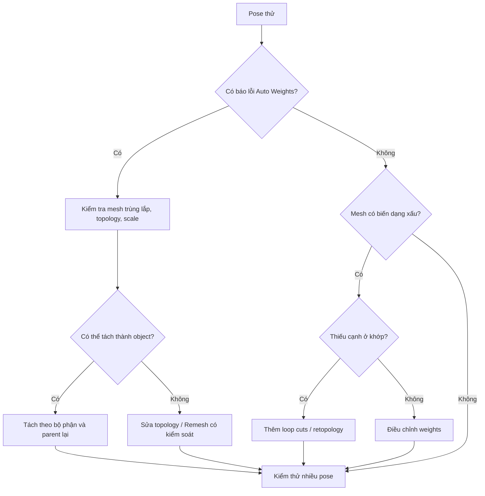

# Bài 04 — Sửa lỗi gán trọng số và biến dạng

**Thời lượng gợi ý:** 35–50 phút

## Mục tiêu

Phân biệt lỗi khi tính weights và lỗi khi deform; chọn biện pháp sửa phù hợp.

## 1. Hai nhóm lỗi chính trong nguồn

### A. `Bone Heat Weighting: Failed to Find Solution`

Lỗi này có thể phát sinh với mesh phức tạp, nhiều lớp chồng lấn hoặc hình học bất thường. Phụ đề nêu ba hướng: **remesh**, chỉnh sửa các vùng trùng nhau, hoặc **tách mesh thành nhiều object** rồi thử gán lại.

### B. Biến dạng không mong muốn

Nếu mesh không đủ cạnh tại vùng cần uốn, xương không tạo được đường cong mượt. Ví dụ hình lập phương chỉ có 8 đỉnh khó uốn như ống mềm. Cần tạo **loop cuts** ở vùng khớp hoặc sửa ảnh hưởng bằng Weight Paint.

## 2. Sơ đồ chẩn đoán

## 3. Quy trình sửa có thể lặp lại

1. **Lưu một phiên bản backup** trước khi remesh hoặc xóa vertex group.
2. Kiểm tra vị trí Armature, rest pose, scale của object và hướng khớp.
3. Với lỗi tính weight: thử từng mesh đơn giản; tìm mặt/đỉnh chồng, geometry hỏng, ngăn nhiều lớp mesh lồng nhau gây nhiễu.
4. Với lỗi gập góc: thêm edge loop đúng hướng và đảm bảo lưới có đủ topology.
5. Với lỗi chảy màu sang bộ phận bên cạnh: chuyển sang Weight Paint, điều chỉnh hoặc gán cứng.
6. Test lại bằng tư thế xoay mạnh vừa phải, so với kết quả ban đầu.

## 4. Bổ sung kỹ thuật (không phải nguyên văn phụ đề)

- Với mô hình AI-generated, có thể có mảnh bên trong, bề mặt tự giao, đường nối hở; thao tác Remesh có thể làm **mất chi tiết/UV**, nên chỉ làm trên bản sao.
- `Merge by Distance` chỉ có ích với đỉnh trùng gần nhau, không thay thế quy trình sửa lưới tổng quát.
- Tránh thêm Subdivision Surface rồi cho rằng đã bổ sung topology gốc cần thiết cho weight; kiểm tra **cage/base mesh**.

## 5. Bài tập sửa lỗi

Chủ động tạo một ống ít cạnh, gán weights rồi thử uốn. So sánh trước/sau khi thêm loop cuts. Sau đó chọn một mesh có nhiều bộ phận chồng lấp, thử tách ra trước khi gán.

**Nộp:** 2 cặp ảnh Before/After và ghi rõ nguyên nhân giả định, thao tác sửa, kết quả.
