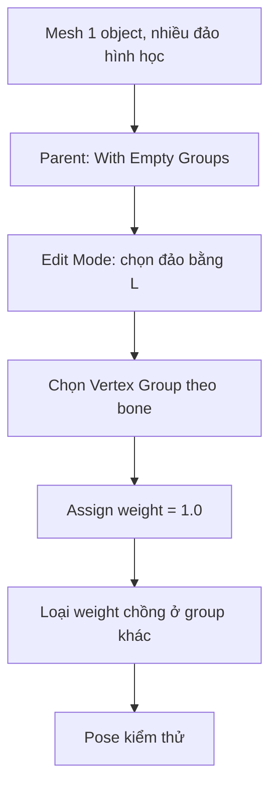

# Bài 07 — Điều khiển các phần cứng nằm chung một mesh

**Thời lượng gợi ý:** 35–50 phút

## Mục tiêu

Dùng Armature Deform → Empty Groups, gán từng đảo hình học cho bone bằng weight 1.0, tránh weight chồng chéo.

## 1. Vì sao cần cách này?

Nếu robot có nhiều cụm hình học **rời nhau nhưng ở chung một Mesh Object**, Bone Parenting trực tiếp không đủ chi tiết: cả object chỉ có một bone cha. Ta cần gán nhóm đỉnh riêng cho mỗi bone, với ảnh hưởng cứng (`1.0` hoặc `0.0`).

## 2. Thực hiện Empty Groups

1. Chọn mesh → `Shift` chọn Armature → `Ctrl + P` → **Armature Deform → With Empty Groups**.
2. Mesh nhận Armature Modifier và các Vertex Groups trống được đặt tên theo bone có thể deform.
3. Chọn mesh → **Edit Mode**.
4. Đảm bảo đang chọn đúng nhóm đỉnh (`Object Data Properties → Vertex Groups`).
5. Trỏ chuột lên một đảo hình học tách rời, nhấn `L` để chọn phần liên kết dưới con trỏ (khi ở chế độ chọn hình học phù hợp).
6. Nhập **Weight = 1.0** → **Assign**. Nếu đảo từng có weight cũ ở nhóm khác, dùng **Remove** ở các nhóm đó hoặc công cụ cleanup trước khi Assign.
7. Lặp lại cho từng đảo cần điều khiển.

## 3. Mẹo thu nhỏ đảo hình học từ phụ đề

Nguồn mô tả một **mẹo thử nghiệm**: trong Edit Mode, đặt pivot thành **Individual Origins**, thu kích thước của các đảo theo tỉ lệ `0.1`, gán Automatic Weights, rồi Edit Mode phóng lại `10` lần. Ý tưởng là giảm giao thoa khi tính weight cho các mảng gần nhau.

**Cảnh báo:** Đây không phải thay thế chuẩn cho gán thủ công. Chỉ thử trên **bản sao**, kiểm tra transform, modifier, seam, trọng số và topology sau thao tác. Kết quả phụ thuộc loại mesh; có thể không phù hợp mesh kết dính hoặc các đảo chưa tách biệt thật sự.

## 4. Quantize weights

Nguồn nhắc đến **Weights → Quantize**, với mức chia để đưa weight về gần dạng nhị phân `0/1`. Tuy nhiên việc Quantize độc lập có thể khiến tổng weights không còn như kỳ vọng; kiểm tra các nhóm khác và kết quả pose. Nếu yêu cầu tuyệt đối cứng, **Assign 1.0 trên đỉnh được chọn**, rồi xóa ảnh hưởng các bone không liên quan, thường dễ kiểm soát hơn.

## 5. Bài tập

Tạo 1 mesh có 3 cube tách rời. Tạo 3 bone, parent Empty Groups, gán từng cube trọng số 1.0 vào một bone, test xoay cả 3 bone; cube không méo.

**Điều kiện đạt:** mỗi đỉnh nằm đúng nhóm; không bị trộn sang bone lân cận.
