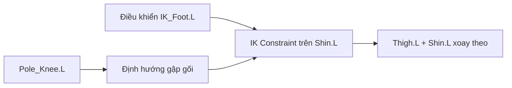

# Bài 09 — Inverse Kinematics (IK) cho chân

**Thời lượng gợi ý:** 45–60 phút

## Mục tiêu

Tạo target để điều khiển vị trí bàn chân, IK Constraint cho chuỗi hai khớp và pole target để quyết định hướng gập gối.

## 1. FK và IK khác gì?

- **FK (Forward Kinematics):** xoay từng xương đùi, cẳng chân, bàn chân.
- **IK (Inverse Kinematics):** di chuyển target ở chân, hệ thống tính toán các góc khớp phù hợp.

## 2. Chuẩn bị xương điều khiển

1. Trong **Armature Edit Mode**, thêm bone `IK_Foot.L` gần cổ chân/bàn chân; có thể duplicate/extrude rồi điều chỉnh vị trí.
2. Chọn `IK_Foot.L` → bỏ quan hệ cha–con không mong muốn (`Alt + P` khi phù hợp), tránh controller bị kéo theo chính chain cần điều khiển.
3. Trong **Bone Properties**, tắt **Deform** cho bone controller để nó không làm biến dạng mesh trực tiếp.
4. Nên parent controller đến một xương điều khiển tổng (Root) nếu thiết kế rig cần di chuyển toàn thân.

## 3. Tạo IK Constraint

1. Sang **Pose Mode**.
2. Chọn bone kết thúc chuỗi cần giải IK (thường là `Shin.L` trong cấu trúc đơn giản).
3. Trong **Bone Constraints**, thêm **Inverse Kinematics**.
4. Đặt **Target = Armature**, **Bone = IK_Foot.L**.
5. Đặt **Chain Length = 2** để ảnh hưởng chủ yếu Shin + Thigh trong rig chân hai đoạn. Chọn 3 khi cấu trúc thật sự cần thêm đoạn thứ ba.
6. Kéo `IK_Foot.L` và xem cẳng chân/đùi xoay theo.

> Phụ đề nhắc một lối tắt thêm IK; vì phím tắt phụ thuộc phiên bản, cách qua **Bone Constraints** phía trên là lựa chọn dễ kiểm tra nhất.

## 4. Pole Target cho hướng gập đầu gối

1. Vào Edit Mode tạo bone `Pole_Knee.L` phía trước gối theo hướng chân cần gập.
2. Tắt **Deform**, bảo đảm pole không bị gắn vào chain theo cách gây vòng phụ thuộc.
3. Trong IK Constraint của `Shin.L`, đặt **Pole Target = Armature** và **Pole Bone = Pole_Knee.L**.
4. Nếu hướng gập gối bị xoắn hoặc ngược, chỉnh **Pole Angle** (thường dùng góc ±90° tùy bone axes) và hướng bone ở rest pose.
5. Với chân thẳng tuyệt đối, solver đôi khi khó xác định hướng gập; đặt khớp gối lệch nhẹ theo hướng mong muốn trong Edit Mode.

## 5. Đối xứng

Đặt tên `.L` từ đầu, dựng cấu trúc controller và constraint đúng phía; **Symmetrize** có thể hỗ trợ sao chép xương/thiết lập đối xứng trong nhiều trường hợp. **Luôn kiểm tra** target, pole bone, Pole Angle và hướng gập ở bên `.R` sau nhân bản.

## 6. Debug nhanh

| Hiện tượng | Kiểm tra trước tiên |
|---|---|
| Chân gập ngược | Pole position, Pole Angle, rest bend |
| Kéo foot mà không đổi | Constraint target, IK enabled, chain length |
| Xương giật/khó kiểm soát | Quan hệ parent controller và vòng phụ thuộc |
| Controller làm méo mesh | Tắt Deform / xóa weight của controller |
| Bên phải sai | Tên `.L`/`.R`, trục bone, target sau Symmetrize |

## 7. Bài tập

Tạo hai IK Foot Target và hai Pole Knee Target. Đặt chân trái lên bậc thấp và chân phải ở mặt đất. Ghi lại ảnh Pose Mode và Constraints panel.

**Hoàn thành khi:** kéo chân theo target, gối gập đúng và hai bên độc lập.
