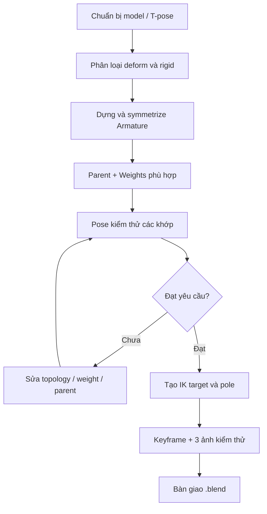

# Bài 10 — Mini project: hai mẫu rig, một bộ kiểm thử

**Thời lượng gợi ý:** 90–120 phút

## Yêu cầu

Chọn **ít nhất một** trong hai đề; làm cả hai để luyện rig hỗn hợp.

### Đề A. Nhân vật organic

Tạo/nhập mesh người đơn giản ở T-pose, gắn Armature với bone theo trục cơ thể, sử dụng Automatic Weights, chỉnh một vùng khớp bằng Weight Paint, tạo hai keyframes, dựng IK chân.

### Đề B. Robot nhiều mảnh

Tạo robot từ một số mesh cứng. Dùng Bone Parenting cho các mảnh tách object hoặc Empty Groups weight 1.0 với một mesh nhiều đảo; dựng một chuỗi IK 2 xương cho chân; kiểm tra không có mảng vỏ bị uốn.

## Chuỗi sản xuất đề xuất



## Bảng kiểm thử bắt buộc

| ID | Trường hợp thử | Đạt khi |
|---|---|---|
| T01 | Xoay vai ±45° | Không kéo lệch vùng thân ngoài ý muốn |
| T02 | Gập khuỷu ~90° | Không rách hoặc méo nghiêm trọng |
| T03 | Gập gối với IK | Pole kiểm soát hướng gập |
| T04 | Xoay torso/cổ | Mô hình đi theo bone phù hợp |
| T05 | Mirror Pose | Bên trái/phải hoạt động tương ứng |
| T06 | Robot rigid (nếu có) | Các tấm giáp giữ hình dạng |
| T07 | Playback 1–40 frames | Keyframes thực sự điều khiển rig |

## Đầu ra cần nộp

- `rig-final.blend`: file Blender có mesh, armature, ít nhất một Action/keyframe.
- `01-rest-pose.png`, `02-pose-test.png`, `03-ik-test.png`.
- `bao-cao.md`: cách rig đã chọn, ít nhất 2 lỗi đã gặp/cách xử lý, những chỗ cần cải thiện.

## Thang điểm /100

| Hạng mục | Điểm |
|---|---:|
| Cấu trúc xương, tên bone, đối xứng | 20 |
| Mesh đi theo bone đúng | 25 |
| Chất lượng biến dạng/rigid | 20 |
| IK và pole target | 20 |
| Hoạt ảnh và báo cáo kiểm thử | 15 |

## Mẫu báo cáo

```markdown
# Báo cáo rigging
- Mô hình: ...
- Blender: ...
- Phương pháp: Deform / Rigid / Hybrid
- Tổng bone: ...
- Những lỗi gặp phải: ...
- Cách khắc phục: ...
- Kiểm thử: T01...T07
- Hướng nâng cấp: ...
```

**Gợi ý tiếp theo (ngoài video gốc):** thử thêm hand IK, controller custom shapes, facial rigs, constraints nâng cao hoặc chuẩn bị xuất game engine.
