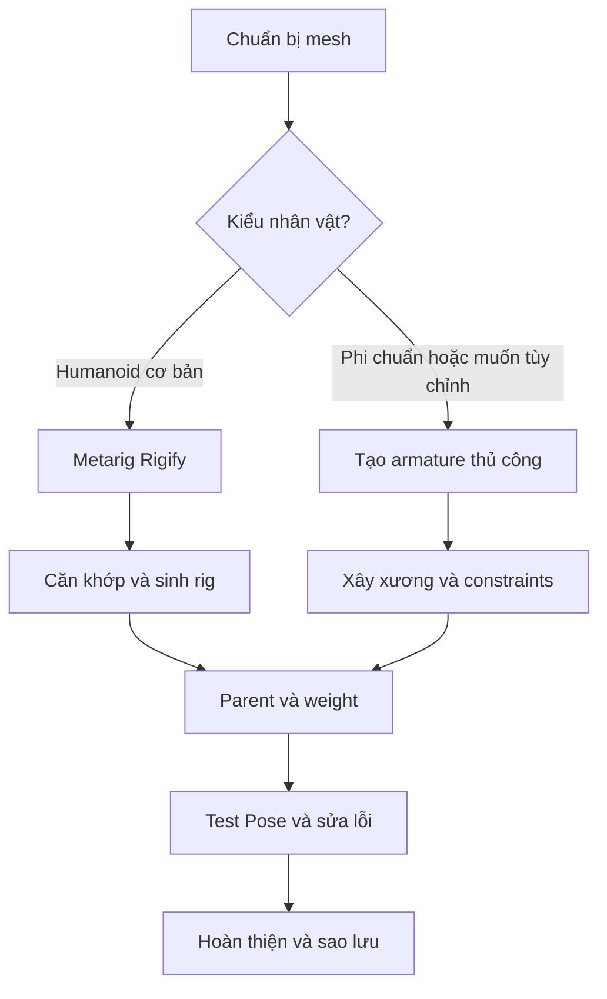

# Bài 00 — Nhập môn rigging và lộ trình học

> **Nguồn đối chiếu:** bản ghi video đính kèm, đoạn **00:00–01:10**. Đây là bài giảng tự biên soạn từ transcript, có hệ thống hóa quy trình và thêm ví dụ để tự học; không phải lời thoại nguyên văn.

## Mục tiêu học tập

- Giải thích vai trò của rigging trong pipeline 3D.
- Phân biệt mesh, armature, bone, constraint, weight và pose.
- Lựa chọn giữa Rigify và bộ rig tự dựng.

## 1. Rigging thực sự là gì?

Một mesh 3D có thể đứng yên rất đẹp nhưng chưa thể diễn hoạt theo cách điều khiển được. **Rigging** là quá trình tạo hệ xương và các cơ chế điều khiển để biến dạng mesh thành tư thế mong muốn. Trong Blender, một rig hoàn chỉnh thường có:

| Thành phần | Chức năng | Ví dụ |
|---|---|---|
| Mesh | Hình học hiển thị | Đầu, thân, quần áo, tóc |
| Armature | Đối tượng chứa hệ xương | `Character_Armature` |
| Deform bone | Tác động đến các đỉnh của mesh | `forearm.L` |
| Control bone | Điều khiển hệ xương, thường không trực tiếp biến dạng mesh | `IK_foot.L` |
| Vertex group / weight | Xác định mức ảnh hưởng xương lên từng đỉnh | Cân trọng lượng khuỷu tay |
| Constraint | Quy tắc điều khiển giữa các xương/đối tượng | IK, Copy Rotation, Shrinkwrap |

## 2. Hai con đường trong video nguồn

- **Quy trình A — Rigify:** dùng metarig hình người, căn xương, tạo control rig và gán trọng lượng tự động. Phù hợp với nhân vật humanoid khi cần kết quả nhanh.
- **Quy trình B — Custom rig:** tự dựng armature, đặt tên, tạo xương phụ, thiết lập IK, sửa weight và biến dạng. Dùng khi nhân vật cách điệu hoặc có những bộ phận đặc biệt như lông, tóc, trang phục.

## 3. Chuẩn bị môi trường

1. Mở Blender, chuẩn bị nhân vật ở **rest pose** rõ tay/chân (T-pose hoặc A-pose phù hợp).
2. Chọn mesh, kiểm tra các bộ phận: thân, tay, chân, mắt, miệng, quần áo, tóc.
3. Sao lưu tập tin `.blend` ban đầu. Với bộ phận cần chỉnh nhiều, duplicate Collection và ẩn bản gốc.
4. Thực hành chuyển đổi **Object Mode**, **Edit Mode** (`Tab`) và **Pose Mode** (`Ctrl+Tab` khi chọn armature).
5. Dùng góc nhìn trước `Numpad 1`, cạnh `Numpad 3`, trên `Numpad 7`; bật **In Front** và **X-Ray** khi cần.

> **Giới hạn:** Nguồn là transcript video, trong đó người hướng dẫn nói đang dùng Blender 4.1. Tên nút và vị trí menu có thể khác trên các bản mới; nội dung này được biên soạn lại, không phải bản chép giao diện chính thức của Blender.

## Bài thực hành

- Mở một nhân vật có ít nhất 3 mesh riêng (ví dụ thân, tóc, quần áo).
- Ghi tên các mesh trong Outliner, xác định phần nào cần deform và phần nào cần control riêng.
- Lưu file `00_character_backup.blend`.

## Câu hỏi tự kiểm tra

1. **Mesh có chuyển động độc lập chỉ nhờ đổi sang Pose Mode không?**

   

Xem đáp án

   Không. Mesh phải được liên kết và có trọng số/quan hệ thích hợp với armature.

   

2. **Tại sao vẫn nên học rig thủ công khi có add-on?**

   

Xem đáp án

   Để chẩn đoán lỗi, chỉnh đặc tính riêng và rig các hình dạng không thuộc mẫu có sẵn.

   

## Lỗi cần tránh

- Không thử trực tiếp trên bản gốc chưa lưu.
- Đặt rest pose quá ép sát người khiến chọn và căn xương khó.

---

[Nội dung khóa học](README.md) · [Bài tiếp theo](01-rigify-humanoid.md)
