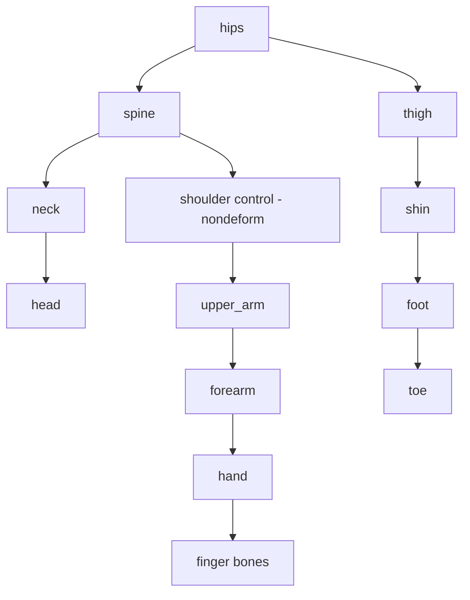

# Bài 03 — Tự dựng Armature: thân, tay, chân, ngón tay

> **Nguồn đối chiếu:** bản ghi video đính kèm, đoạn **10:28–13:40 và 14:25–16:02**. Đây là bài giảng tự biên soạn từ transcript, có hệ thống hóa quy trình và thêm ví dụ để tự học; không phải lời thoại nguyên văn.

## Mục tiêu học tập

- Thêm xương đơn và Extrude thành các chuỗi.
- Parent xương bằng Keep Offset.
- Phân biệt xương điều khiển và xương deform.

## 1. Khởi tạo armature sạch

1. Trong Object Mode, `Shift+A → Armature → Single Bone`.
2. Bật **In Front**, **Names**, **Axes** tại Object Data Properties; tắt bớt khi viewport rối.
3. `Tab` vào Edit Mode, chuyển sang góc trước (`Numpad 1`), X-Ray (`Alt+Z`).
4. Căn xương đầu tại hông; chọn đầu hoặc đuôi xương → `E` để **Extrude** xương tiếp theo.

## 2. Chuỗi thân và đầu

Xây chuỗi tối thiểu: `hips → spine → neck → head`. Với lưng dài có thể Subdivide xương thân để điều khiển tinh hơn. Đặt mỗi joint vào vùng thực sự xoay khi nhân vật nghiêng lưng, cúi cổ hoặc gật đầu.

## 3. Tay, bàn tay và ngón

- Từ thân trên, dựng xương vai; nếu chỉ dùng làm **helper control**, tắt tùy chọn **Bone Properties → Deform**.
- Dựng chuỗi `upper_arm → forearm → hand` với khớp khuỷu rõ ràng.
- Nhân bản các xương ngón bằng `Shift+D`, đặt tại giữa tiết diện từng ngón và căn theo hướng uốn.
- Chọn xương ngón, chọn xương bàn tay **sau cùng**, dùng `Ctrl+P → Keep Offset` để parent nhưng không nối đầu–đuôi.
- Dùng Top View để xác minh các đốt không bị chệch khỏi ngón.

## 4. Chân, bàn chân và gót

Chuỗi gợi ý: `thigh → shin → foot → toe`. Xương **heel control** có thể nhân bản và tắt Deform vì phục vụ thao tác chân sau này. Dùng Side View để đặt điểm gót và mũi bàn chân.

## 5. Kiểm tra trước khi rig

- Xương control thực sự có `Deform` tắt hay chưa?
- Xương parent đúng chuỗi chưa? `Keep Offset` dùng cho quan hệ không muốn nối trực tiếp.
- Từng bone có nằm **bên trong** bộ phận nó cần điều khiển không?
- Một chuỗi IK dự kiến có **độ gập nhẹ** tại khuỷu/gối chưa?

## Bài thực hành

- Tự dựng armature cho một nhân vật 2 tay, 2 chân.
- Tạo ít nhất một xương ngón, một xương gót non-deform.
- Chụp ảnh armature ở 3 hướng Front, Top, Side; ghi rõ parent của 6 xương bất kỳ.

## Câu hỏi tự kiểm tra

1. **Keep Offset khác Connected như thế nào?**

   

Xem đáp án

   Keep Offset giữ quan hệ cha-con nhưng không bắt đầu con tại đuôi xương cha.

   

2. **Vì sao tắt Deform ở xương điều khiển?**

   

Xem đáp án

   Để nó không trực tiếp nhận trọng số biến dạng trong binding tự động.

   

## Lỗi cần tránh

- Extrude từ sai đầu/đuôi gây chiều hướng lộn xộn.
- Nhầm parent control tạo vòng lặp ngay từ đầu.

---

[Nội dung khóa học](README.md) · [Bài trước](02-topology-deform.md) · [Bài tiếp theo](04-ten-bone-roll-doi-xung.md)
