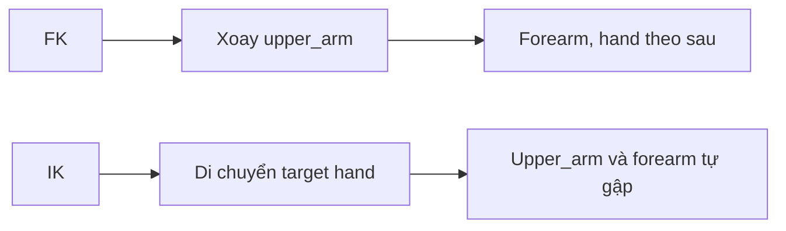

# Bài 05 — Hiểu FK, IK và tổ chức Bone Collections

> **Nguồn đối chiếu:** bản ghi video đính kèm, đoạn **19:13–21:07**. Đây là bài giảng tự biên soạn từ transcript, có hệ thống hóa quy trình và thêm ví dụ để tự học; không phải lời thoại nguyên văn.

## Mục tiêu học tập

- Phân biệt FK với IK trong tạo dáng.
- Biết hạn chế của Auto IK.
- Tạo Bone Collections để quản lý armature phức tạp.

## 1. FK và IK: cùng tạo dáng, khác cách điều khiển

| Cơ chế | Ý tưởng | Phù hợp |
|---|---|---|
| **FK — Forward Kinematics** | Xoay bone cha; các bone con đi theo | Vung tay, chuyển động xoay tự do, dựng pose đơn giản |
| **IK — Inverse Kinematics** | Di chuyển xương mục tiêu để chuỗi xương tự điều chỉnh | Đặt tay vào vật, giữ chân trên mặt đất |

Ví dụ FK: xoay bắp tay → cẳng tay và bàn tay di chuyển theo. IK: di chuyển control bàn chân → đùi, gối, cẳng chân phải tự xử lý góc khớp.

## 2. Auto IK chỉ là công cụ phụ

Trong Pose Options có thể bật **Auto IK** cho nhu cầu thử pose nhanh. Video nguồn cảnh báo đây không thay thế constraint IK được cấu hình đầy đủ khi đi vào animation. Để đánh giá kỹ thuật IK thật, cần **target**, **chain length** và nếu cần **pole target**.

## 3. Reset pose trước khi chỉnh rig

Trong Pose Mode, chọn các bone cần đặt lại:

- `Alt+G`: xóa Pose Location.
- `Alt+R`: xóa Pose Rotation.
- `Alt+S`: xóa Pose Scale.

Thao tác này đặt lại **pose transform**, không tự động đảo ngược mọi thay đổi Edit Mode hoặc constraint.

## 4. Bone Collections

Video minh họa các nhóm `Arms`, `Legs`, `Face`, `Clothes`, `IK`, `Mechanism`. Vào Object Data Properties → **Bone Collections**:

1. Tạo collection mới bằng `+`, đặt tên có ý nghĩa.
2. Trong Edit/Pose Mode chọn bone liên quan và **Assign**.
3. Sử dụng biểu tượng mắt để ẩn và sao/ngôi sao để xem riêng nhóm (tùy giao diện).
4. Một bone có thể thuộc nhiều collections; bỏ gán khỏi nhóm không phù hợp nếu viewport bị rối.
5. Xương phục vụ cơ chế mà người animate không cần chọn thường ở nhóm `Mechanism` riêng.

> **Phân biệt:** Bone Collections khác Collections của Outliner chứa đối tượng; đây là cấu trúc để nhóm **bone bên trong armature**.

## Bài thực hành

- Tạo 5 Bone Collections: Body, Arms, Legs, IK, Mechanism.
- Gán ít nhất 2 bone cho Arms, 2 cho Legs.
- Bật/tắt chúng và thử một tư thế FK, ghi cái gì di chuyển và cái gì không.

## Câu hỏi tự kiểm tra

1. **Nếu muốn bàn chân giữ một vị trí ổn định khi thân di chuyển, nên xem xét FK hay IK?**

   

Xem đáp án

   IK.

   

2. **Ẩn xương trong Bone Collection có xóa constraint không?**

   

Xem đáp án

   Không, chỉ ảnh hưởng hiển thị/chọn bone.

   

## Lỗi cần tránh

- Dùng Auto IK rồi kết luận đã hoàn tất rig animation.
- Nhóm bone sai khiến chọn nhầm control và deform bone.

---

[Nội dung khóa học](README.md) · [Bài trước](04-ten-bone-roll-doi-xung.md) · [Bài tiếp theo](06-xuong-mat-toc-quan-ao.md)
