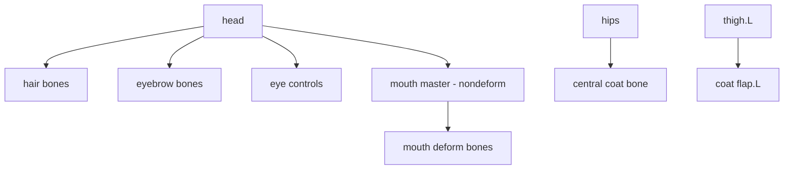

# Bài 06 — Dựng xương cho mặt, tóc và quần áo

> **Nguồn đối chiếu:** bản ghi video đính kèm, đoạn **21:13–27:41**. Đây là bài giảng tự biên soạn từ transcript, có hệ thống hóa quy trình và thêm ví dụ để tự học; không phải lời thoại nguyên văn.

## Mục tiêu học tập

- Tạo bone điều khiển lông mày, mắt, miệng.
- Dùng bone phụ cho các lọn tóc và vạt áo/lông.
- Thiết lập parent và Symmetrize cho chi tiết nhân vật.

## 1. Khuôn mặt: bone nhỏ, điều khiển rõ

Bắt đầu từ xương đầu, nhân bản bone và đặt tại lông mày, vùng mắt, miệng. Nếu khuôn mặt cần đối xứng, bố trí và đặt tên phần một bên trước; sau đó Symmetrize.

- **Lông mày:** bone ngắn theo hướng điều khiển biểu cảm.
- **Mắt:** bone gần bề mặt mắt; về sau có thể áp ràng buộc Shrinkwrap để nó không xuyên hoặc trôi khỏi bề mặt.
- **Miệng:** các bone vùng khóe miệng và một **mouth master control** để di chuyển nhóm.
- **Bone điều khiển nhóm:** tắt **Deform** nếu chỉ truyền transform.

Tạo quan hệ parent: chọn các bone mặt, chọn xương head sau cùng → `Ctrl+P → Keep Offset`. Riêng bone miệng có thể parent vào control miệng, rồi control miệng parent tới head.

## 2. Tóc: mỗi lọn một hoặc nhiều bone

1. Trong Object Mode chọn các mảnh tóc và armature; dùng **Local View** (`/` trên numpad hoặc `Numpad /`) để cô lập đối tượng cần làm.
2. Trong Edit Mode của armature, nhân bản bone đầu, căn ở giữa mỗi lọn tóc.
3. Có thể bật **Snapping → Volume / Vertex** và giữ `Ctrl` khi di chuyển để căn chính giữa hoặc trùng các vertex tham chiếu.
4. Dùng `Subdivide` với lọn dài nếu cần nhiều đoạn uốn.
5. Parent các bone tóc về `head`, phân nhóm `Face / Hair`.

Khi tóc chia nhiều mesh, có thể `Ctrl+J` nối các đối tượng trước khi binding/painting nếu điều đó giúp thao tác; không bắt buộc phải nối tất cả.

## 3. Quần áo / vạt lông / áo khoác

Các phần đung đưa nằm tách khỏi chân có thể cần **bone deform riêng**. Trong nguồn, người hướng dẫn đặt bone quanh các vạt áo/lông, đặt tên và nhóm `Clothes`, dùng Symmetrize hai bên.

Quy trình cơ bản:

1. Tạm tắt Subdivision ở viewport để nhìn rõ vertex thực tế.
2. Duplicate bone gần vị trí cần hỗ trợ (ví dụ vùng đùi).
3. Dùng Vertex Snap cho đầu/đuôi bone khớp với phần vạt.
4. Chỉnh bone roll thống nhất, đặt tên `coat_flap_01.L`, `coat_flap_02.L`...
5. Parent bone theo phần cơ thể tương ứng (đùi hoặc hông), không để vạt dưới chân bị kéo ngược khi nhân vật đi.
6. Group các bone vào `Clothes`.

## 4. Sơ đồ parent mẫu

> Các chi tiết xương mặt và tóc rất đặc thù model. Nguồn chỉ minh họa một rig tùy chỉnh, không đưa ra bộ facial rig tiêu chuẩn cho mọi nhân vật.

## Bài thực hành

- Thêm 2 bone tóc, 2 bone lông mày và 2 bone vạt áo.
- Tạo mouth control non-deform; parent đúng hierarchy.
- Thử xoay đầu: tóc và chi tiết mặt phải theo đầu mà không bị bật ra vị trí lạ.

## Câu hỏi tự kiểm tra

1. **Vì sao vạt áo sát chân nên cân nhắc parent vào thigh?**

   

Xem đáp án

   Để vạt áo có chuyển động nền theo chân khi chân cử động.

   

2. **Một mouth master control có cần tự deform miệng không?**

   

Xem đáp án

   Không nhất thiết; nó có thể chỉ điều khiển các bone con.

   

## Lỗi cần tránh

- Tóc chồng nhiều lớp: Auto Weights gán nhầm bone kế bên.
- Bone mặt đặt lệch quá xa khỏi bề mặt khiến kiểm soát biểu cảm khó.

---

[Nội dung khóa học](README.md) · [Bài trước](05-fk-ik-va-bone-collections.md) · [Bài tiếp theo](07-ik-chan.md)
