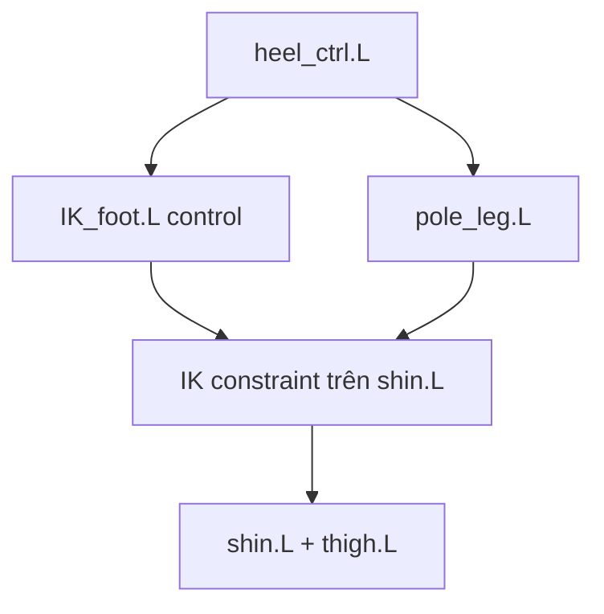

# Bài 07 — Thiết lập IK chân, gót và pole target

> **Nguồn đối chiếu:** bản ghi video đính kèm, đoạn **27:48–32:59**. Đây là bài giảng tự biên soạn từ transcript, có hệ thống hóa quy trình và thêm ví dụ để tự học; không phải lời thoại nguyên văn.

## Mục tiêu học tập

- Tạo chân IK có target và chain length phù hợp.
- Dùng pole target để giữ hướng gối.
- Tránh dependency cycle khi parent controller.

## 1. Chuẩn bị trước khi thêm IK

Đảm bảo chuỗi bên trái `thigh.L → shin.L → foot.L` có độ gập nhẹ của gối. Tạo bone điều khiển bằng cách duplicate bone bàn chân, đổi tên `IK_foot.L` và **tắt Deform**. Xương IK target không được parent ngược về chính chuỗi nó đang điều khiển.

## 2. Tạo constraint IK

1. Chọn `IK_foot.L` và `shin.L` để `shin.L` là bone nhận constraint (active) trong **Pose Mode**.
2. Dùng **Pose → Constraints → Add IK** / `Shift+I` nếu keymap có hỗ trợ.
3. Trong **Bone Constraints**, chỉ định Target là armature và Bone là `IK_foot.L`.
4. Chỉnh **Chain Length = 2** để constraint tác động lên `shin` và `thigh`, không kéo cả cột sống.
5. Di chuyển IK target: chân sẽ gập theo vị trí target.

## 3. Gót chân và Copy Rotation

Dựng `heel_ctrl.L`, thường non-deform. Parent `IK_foot.L` vào `heel_ctrl.L` bằng Keep Offset để dễ điều khiển hướng chân. Nếu muốn bone bàn chân thực hiện cùng hướng quay với IK control, thêm **Copy Rotation** cho foot theo bone điều khiển, rồi kiểm tra Owner/Target Space.

## 4. Pole Target cố định hướng đầu gối

Đầu gối có thể lật hướng khi kéo IK target qua vùng nhạy cảm. Video xử lý bằng bone `pole_leg.L`:

1. Thêm bone ngoài phía trước gối, clear parent nếu đang nối trong chuỗi deform (`Alt+P` → Clear Parent).
2. Parent pole vào `heel_ctrl.L` khi phù hợp với thiết kế điều khiển.
3. Trong IK constraint của `shin.L`, chọn **Pole Target = Armature**, **Pole Bone = pole_leg.L**.
4. Chỉnh **Pole Angle** (nguồn minh họa khoảng 90°) cho gối hướng đúng. **Không dùng 90° như hằng số bắt buộc**: góc đúng phụ thuộc bone roll và hệ trục cụ thể.
5. Kiểm tra khi di chuyển chân lên/xuống và xoay gót.

## 5. Kiểm tra lỗi cơ chế

- **Dependency cycle:** IK target bị parent vào bone deform nằm trong chuỗi IK — đổi lại parent lên root/body phù hợp.
- **IK kéo cả thân:** chain length mặc định quá dài → đặt 2.
- **Gối gập ngược:** chỉnh pole direction, pole angle và hướng cong ban đầu.
- **Xương đi theo sai:** kiểm tra xương nhận constraint có đúng `shin` không.

Sau khi setup bên trái, reset pose rồi mới Symmetrize sang bên phải; xóa bone bên phải cũ nếu nó làm trùng cấu trúc.

## Bài thực hành

- Tạo bộ chân IK hai bên.
- Nâng nhân vật bằng bone hông: bàn chân giữ ổn định theo IK target.
- Di chuyển chân sang 3 hướng và xác minh đầu gối không bất ngờ lật phía sau.
- Chụp ảnh phần Constraint với Chain Length = 2.

## Câu hỏi tự kiểm tra

1. **Chain Length 2 điều khiển những bone nào nếu IK đặt ở shin?**

   

Xem đáp án

   Thường là shin và thigh.

   

2. **Nếu gối lật khi chân vượt qua một điểm, nên kiểm tra gì?**

   

Xem đáp án

   Pole target, pole angle, bone roll và độ gập ban đầu.

   

## Lỗi cần tránh

- Parent IK target vào shin/thigh khiến vòng phụ thuộc.
- Sao chép trực tiếp Pole Angle từ video dù bone roll khác.

---

[Nội dung khóa học](README.md) · [Bài trước](06-xuong-mat-toc-quan-ao.md) · [Bài tiếp theo](08-ik-tay-root.md)
