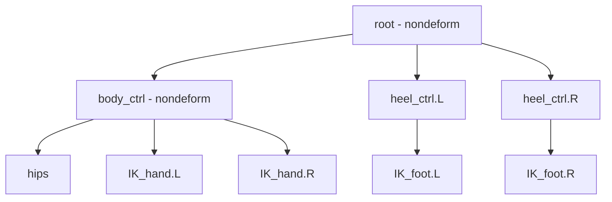

# Bài 08 — IK tay, Root Bone và điều khiển toàn thân

> **Nguồn đối chiếu:** bản ghi video đính kèm, đoạn **33:05–36:21**. Đây là bài giảng tự biên soạn từ transcript, có hệ thống hóa quy trình và thêm ví dụ để tự học; không phải lời thoại nguyên văn.

## Mục tiêu học tập

- Thiết lập tay IK cho chuỗi bắp tay–cẳng tay.
- Tạo pole target khuỷu.
- Dùng root/body control để điều khiển nhân vật trong Pose Mode.

## 1. IK tay tương tự IK chân nhưng không hoàn toàn giống

1. Trong Edit Mode duplicate bone bàn tay, đổi tên `IK_hand.L`, **tắt Deform**.
2. `Alt+P` → Clear Parent nếu nó đang là bone con trong chuỗi deform.
3. Trong Pose Mode, đặt **IK constraint** lên `forearm.L` với target `IK_hand.L`.
4. **Chain Length = 2**, gồm `forearm` và `upper_arm`.
5. Kéo target sang ngang/đưa về trước để thử chuyển động cánh tay.

Tạo `pole_arm.L` ngoài khuỷu và gán vào Pole Target của constraint. Thay đổi Pole Angle đến khi khuỷu hướng đúng, tránh trường hợp vòng gập đi qua thân.

## 2. Root Bone để di chuyển cả nhân vật

Khi không có bone root, một số IK target có thể giữ nguyên vị trí độc lập khiến chuyển động toàn thân khó điều khiển. Tạo `root` non-deform, rồi dựng `body_ctrl` non-deform nếu cần thêm một cấp điều khiển.

Cấu trúc minh họa:

Cấu trúc này chỉ là một lựa chọn có cơ sở từ video. Trong rig khác, target tay có thể theo root thay vì body_ctrl để hỗ trợ khóa tay vào thế giới; hãy chọn dựa trên hành vi animation mong muốn.

## 3. Sự khác biệt khi di chuyển

- **Di chuyển `hips`:** phần thân biến đổi, nhưng IK hand/foot có thể giữ target tại chỗ.
- **Di chuyển `body_ctrl`:** thân và các target tay được parent theo nó cùng di chuyển.
- **Di chuyển `root`:** toàn bộ rig đi theo một control gốc.

## 4. Tùy biến giao diện bone

Nguồn minh họa **B-Bone Display** và tùy chọn **B-Bone Scale** để làm control dễ chọn hơn trong viewport. Trong một số giao diện Blender, display type có tên `B-Bone` và thông số scale/size nằm ở Bone Properties. Đây là **kích cỡ hiển thị bone**, không đồng nghĩa thay đổi mesh hoặc weight.

## Bài thực hành

- Tạo IK cho cả hai tay và pole khuỷu.
- Tạo `root` + `body_ctrl`, đặt quan hệ parent có chủ đích.
- Test ba thao tác `hips`, `body_ctrl`, `root` và viết ngắn khác biệt.

## Câu hỏi tự kiểm tra

1. **Tại sao root thường đặt non-deform?**

   

Xem đáp án

   Root điều khiển tổng thể chứ không nên trực tiếp kéo mesh.

   

2. **IK tay đặt constraint vào hand bone hay forearm để Chain Length 2 kiểm soát upper_arm+forearm?**

   

Xem đáp án

   Đặt vào forearm.

   

## Lỗi cần tránh

- Target IK tay parent sai gây khóa chuyển động không như mong muốn.
- Tạo root nhưng bỏ sót các control không có parent.

---

[Nội dung khóa học](README.md) · [Bài trước](07-ik-chan.md) · [Bài tiếp theo](09-binding-va-modifiers.md)
