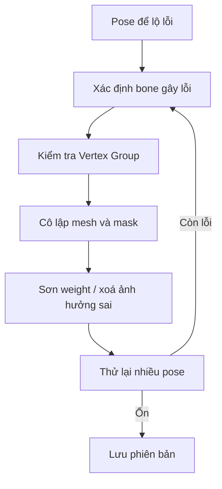

# Bài 10 — Weight Paint: Auto Normalize, mặt nạ và sửa kéo méo

> **Nguồn đối chiếu:** bản ghi video đính kèm, đoạn **39:19–44:16**. Đây là bài giảng tự biên soạn từ transcript, có hệ thống hóa quy trình và thêm ví dụ để tự học; không phải lời thoại nguyên văn.

## Mục tiêu học tập

- Đọc Weight Paint theo vertex groups của bone.
- Sơn weight có Auto Normalize và đối xứng.
- Dùng masking để xử lý tóc, áo và các mesh chồng lớp.

## 1. Ý nghĩa trọng số

Mỗi đỉnh có thể bị nhiều deform bone ảnh hưởng. Weight gần `1` thể hiện ảnh hưởng mạnh; weight `0` nghĩa là bone không tác động lên đỉnh đó. Khi bàn tay kéo nhầm cổ áo hoặc bone miệng kéo vạt áo, vấn đề thường nằm ở **vertex group/weight** sai.

## 2. Thiết lập Weight Paint

1. Chọn mesh cần sửa; giữ armature sẵn để chọn bone theo Pose Mode/Weight Paint workflow của phiên bản Blender.
2. Chuyển sang **Weight Paint**.
3. Bật **Auto Normalize** (nếu khả dụng): khi tăng weight bone này, Blender cân lại tổng mức ảnh hưởng của các bone deform liên quan.
4. Bật các chế độ mirror/đối xứng phù hợp nếu mesh và tên bone đối xứng.
5. Chọn đúng bone/vertex group, chỉnh **Weight**, **Strength**, **Radius** (phím `F` đổi kích cỡ brush trên keymap mặc định).
6. Tạo pose chẩn đoán để thấy mesh kéo méo; rồi sửa ở vị trí đó.

## 3. Sơn trong mesh nhiều lớp

Video minh họa tóc gần nhau gây gán sai bone. Cách xử lý:

- Dùng **Local View** cô lập tóc và armature.
- Trong Edit Mode của mesh, di chuột lên island và nhấn `L` để **Select Linked** nếu muốn chọn riêng lọn tóc.
- Quay lại Weight Paint và bật **Face/Vertex Selection Masking** để chỉ sơn trong vùng đã chọn.
- Chọn bone tóc tương ứng, sơn weight cho vùng cần điều khiển.
- Chọn bone không nên ảnh hưởng, đặt weight 0 hoặc giảm dần và sơn để loại ảnh hưởng sai.
- Kiểm tra pose, lặp lại cho các lọn khác.

## 4. Brush xuyên bề mặt

Tùy chế độ **Front Faces Only** và **Falloff Shape** (Spherical/Projected...), brush có thể sơn xuyên đến mặt sau hoặc chỉ mặt trước. Với bộ phận dày hoặc hai mặt sát nhau, cần quan sát cả mặt khuất và cách projection hoạt động.

## 5. Quy trình sửa có kiểm chứng

## 6. Mẹo dành cho quần áo và tóc

- Với vật thể cứng, việc gán weight gần 1 cho đúng bone có thể hợp lý.
- Với đoạn tóc mềm, chuyển tiếp trọng số ở gần gốc và giữa lọn thường giúp ít gãy hơn.
- Khi chỉnh lưỡi giày/vạt áo, đặt Strength thấp và tô nhiều lần có thể dễ kiểm soát hơn một nét mạnh.
- **Auto Normalize không tự nhận biết anatomy**: nếu chọn sai bone vẫn có thể sơn sai.

## Bài thực hành

- Tạo chủ đích một lỗi bone tay kéo cổ áo bằng weight; sau đó sửa.
- Với 3 lọn tóc chồng nhau, đặt tên 3 group và mask từng lọn để loại weight chéo.
- Chụp pose thử trước/sau và ảnh Weight Paint ở bone đã sửa.

## Câu hỏi tự kiểm tra

1. **Auto Normalize có thay thế việc chọn đúng bone không?**

   

Xem đáp án

   Không; nó chỉ hỗ trợ cân đối ảnh hưởng.

   

2. **Phải làm gì khi muốn sơn đúng một lọn tóc giữa nhiều lọn?**

   

Xem đáp án

   Chọn island/face trong Edit Mode và bật selection masking ở Weight Paint.

   

## Lỗi cần tránh

- Mask trống dẫn đến không sơn được; kiểm tra vùng được chọn.
- Làm mượt vô tội vạ che giấu weight sai ở vertex xa xương.

---

[Nội dung khóa học](README.md) · [Bài trước](09-binding-va-modifiers.md) · [Bài tiếp theo](11-bbone-va-loi-deformation.md)
