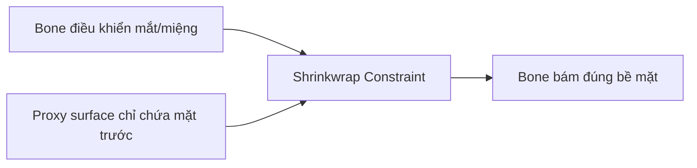

# Bài 12 — Shrinkwrap Constraint để giữ điều khiển mặt trên bề mặt

> **Nguồn đối chiếu:** bản ghi video đính kèm, đoạn **52:00–55:59**. Đây là bài giảng tự biên soạn từ transcript, có hệ thống hóa quy trình và thêm ví dụ để tự học; không phải lời thoại nguyên văn.

## Mục tiêu học tập

- Thiết lập Shrinkwrap cho bone điều khiển mắt/miệng.
- Tạo surface proxy cho constraint.
- Tránh điều khiển bị snap sang mặt phía sau.

## 1. Vấn đề xuất phát từ đâu?

Khi di chuyển bone mắt hoặc khóe miệng, control có thể **trôi khỏi bề mặt**. Video dùng **Bone Constraint → Shrinkwrap** để đưa bone control bám sát một mesh mục tiêu, đồng thời cho phép định hướng theo mặt nghiêng của bề mặt.

## 2. Thiết lập trực tiếp

1. Trong Pose Mode chọn bone điều khiển mắt.
2. Mở **Bone Constraints → Add Bone Constraint → Shrinkwrap**.
3. Đặt **Target** là mesh bề mặt mắt (hoặc bản proxy).
4. Thử di chuyển bone; chỉnh trục align / track để bone xoay theo hướng phù hợp.
5. Nếu control bị xuyên quá sâu, điều chỉnh **Offset/Distance** tùy tham số constraint phiên bản Blender.
6. Kiểm tra pose mặc định. Nguồn nhắc thao tác **Apply Pose as Rest Pose** khi muốn trạng thái được căn chỉnh thành mặc định — đây là thao tác thay đổi rest pose, nên phải sao lưu và đánh giá hệ quả với mesh/skinning trước khi dùng.

## 3. Tránh snap sang mặt sau: tạo proxy surface

Để constraint không bám nhầm phần mắt ở phía sau, tạo một mesh riêng dùng làm **mặt dẫn hướng**:

- Duplicate mesh mắt và miệng; cô lập bản copy.
- Loại bỏ mặt sau hoặc vùng không muốn bone được phép bám.
- Join những mảng bề mặt cần thiết nếu muốn dùng một target.
- Đặt tên như `Face_Shrinkwrap_Proxy`.
- Ẩn proxy khỏi render; **giữ nó có thể được hệ constraint đánh giá** theo hành vi Blender của phiên bản đang dùng.
- Đổi Target Shrinkwrap của các bone mặt sang proxy.

## 4. Vì sao cần proxy?

Với mesh kín như quả cầu mắt, thuật toán tìm điểm gần nhất có thể chọn vị trí ở mặt sau hoặc vùng không mong muốn khi control đi xa. Xóa các mặt dư của proxy làm **giảm miền hình học có thể snap**, nên điều khiển dự đoán được hơn.

## 5. Ranh giới kỹ thuật

Nguồn nói đến Shrinkwrap ở **hai nơi khác nhau**: modifier của mesh mắt (có thể xung đột deformation) và bone constraint cho control mặt (giữ control bám bề mặt). Không nhầm hai cơ chế này.

## Bài thực hành

- Gắn Shrinkwrap cho bone mắt trên mặt cầu đơn giản.
- Quan sát lỗi khi đưa control vòng ra phía sau.
- Tạo proxy chỉ có nửa mặt trước và so sánh hành vi; lưu ảnh 2 trạng thái.

## Câu hỏi tự kiểm tra

1. **Shrinkwrap modifier của mesh có giống Shrinkwrap bone constraint không?**

   

Xem đáp án

   Không; cái đầu biến đổi hình học mesh, cái sau điều khiển biến đổi của bone.

   

2. **Proxy mặt trước giải quyết vấn đề gì?**

   

Xem đáp án

   Hạn chế vùng snap, tránh bám sai lên bề mặt phía sau.

   

## Lỗi cần tránh

- Ẩn hoặc xóa proxy theo cách khiến constraint mất target.
- Apply Pose as Rest Pose mà chưa lưu bản dự phòng.

---

[Nội dung khóa học](README.md) · [Bài trước](11-bbone-va-loi-deformation.md) · [Bài tiếp theo](13-pose-doi-xung-va-hoan-thien.md)
