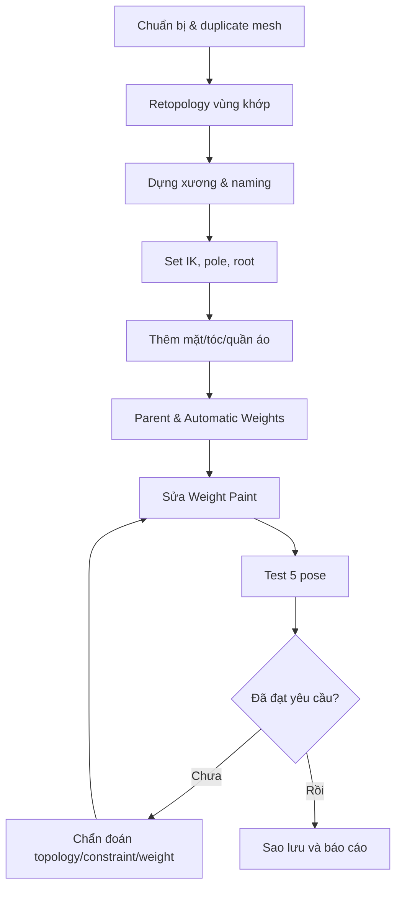

# Đồ án cuối khóa — Rig một nhân vật cách điệu

## Đề bài

Chọn **một nhân vật hình người hoặc thú nhân hình cách điệu** có thân, hai tay, hai chân, ít nhất 2 lọn tóc hoặc tai, một lớp quần áo và chi tiết khuôn mặt. Mục tiêu là **rig tạo dáng được**, không yêu cầu sản xuất animation clip hay export game engine (những bước đó nằm ngoài nguồn hiện tại).

## Yêu cầu sản phẩm

- File `final_rig.blend` có mesh gốc và các bản backup rõ ràng.
- Armature đặt tên đúng `.L`/`.R`, phân biệt non-deform controls.
- Chân và tay có IK target, chain length hợp lý và pole target.
- Root/body controller chạy được; có ít nhất 4 Bone Collections hữu ích.
- Tóc/quần áo hoặc vạt lông được điều khiển qua bone phù hợp.
- Weight Paint không kéo nhầm các mesh xa xương điều khiển.
- Một bộ **5 pose**: neutral, giơ tay, bước đi, ngồi khuỵu, biểu cảm cười.
- Báo cáo `BAO_CAO_KET_QUA.md`: ảnh trước/sau, 3 lỗi gặp phải, cách chẩn đoán, giải pháp, những gì chưa đạt.

## Quy trình thực hiện



## Rubric tự chấm (100 điểm)

| Tiêu chí | Điểm tối đa |
|---|---:|
| Hệ bone, hierarchy, `.L/.R` | 20 |
| IK/FK, root, pole target | 25 |
| Weight và deformation chất lượng | 25 |
| Tóc/quần áo/khuôn mặt điều khiển được | 15 |
| File và báo cáo, test poses, sao lưu | 15 |

**Đạt:** từ 70/100, không lỗi dependency cycle, pose gập chân tay không sụp mesh nghiêm trọng. **Giỏi:** từ 90/100, có báo cáo minh chứng trước–sau và các vùng khó được xử lý có phương pháp.

## Mẫu báo cáo

```markdown
# Báo cáo Custom Rig
- Nhân vật: ...
- Phiên bản Blender: ...
- Số mesh / deform bones / controls: ...
- Bằng chứng 5 pose: ...

## Lỗi 1
- Triệu chứng: ...
- Nguyên nhân: ...
- Các bước sửa: ...
- Ảnh trước/sau: ...

## Những giới hạn còn lại
- ...
```

[Quay lại README](README.md)
