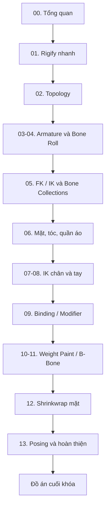

# Khóa học Blender Rigging — Từ cơ bản đến bộ rig tùy chỉnh

**Định hướng:** một giáo trình tiếng Việt để tự học rig nhân vật 3D trong Blender, từ Rigify đến xương tự dựng, IK/FK, Weight Paint, biểu cảm mặt và xử lý biến dạng. Khóa học dựa trên **một bản transcript video khoảng 59 phút 20 giây** người học cung cấp; tài liệu không tự nhận là giáo trình chính thức của Blender.

## Người học đạt được gì?

- Thiết lập rig nhanh cho nhân vật dạng người bằng Rigify.
- Xây armature riêng cho nhân vật cách điệu có mắt, tóc, miệng, vạt áo.
- Cài IK tay/chân với Pole Targets, thêm control Root/Body.
- Sửa biến dạng bằng topology, modifier stack, B-Bones và Weight Paint.
- Kiểm tra rig bằng bộ pose mẫu, quản lý xương và xuất file `.blend` sẵn sàng bước tiếp sang animation.

## Lộ trình đề xuất

## Danh sách bài học

| Bài | Tên bài | Mốc tham chiếu transcript |
|---:|---|---|
| 00 | [Nhập môn rigging và lộ trình học](00-nhap-mon-rigging.md) | 00:00–01:10 |
| 01 | [Rig nhanh nhân vật hình người với Rigify](01-rigify-humanoid.md) | 00:50–07:26 |
| 02 | [Chuẩn hóa topology trước khi rig](02-topology-deform.md) | 04:10–05:39 và 07:31–10:20 |
| 03 | [Tự dựng Armature: thân, tay, chân, ngón tay](03-armature-tu-dung.md) | 10:28–13:40 và 14:25–16:02 |
| 04 | [Đặt tên xương, Bone Roll và đối xứng trái–phải](04-ten-bone-roll-doi-xung.md) | 13:40–18:57 |
| 05 | [Hiểu FK, IK và tổ chức Bone Collections](05-fk-ik-va-bone-collections.md) | 19:13–21:07 |
| 06 | [Dựng xương cho mặt, tóc và quần áo](06-xuong-mat-toc-quan-ao.md) | 21:13–27:41 |
| 07 | [Thiết lập IK chân, gót và pole target](07-ik-chan.md) | 27:48–32:59 |
| 08 | [IK tay, Root Bone và điều khiển toàn thân](08-ik-tay-root.md) | 33:05–36:21 |
| 09 | [Bind mesh, tổ chức đối tượng và Modifier Stack](09-binding-va-modifiers.md) | 36:33–39:14, 42:57–46:30 |
| 10 | [Weight Paint: Auto Normalize, mặt nạ và sửa kéo méo](10-weight-paint.md) | 39:19–44:16 |
| 11 | [B-Bones và xử lý biến dạng ở áo khoác, chân, giày](11-bbone-va-loi-deformation.md) | 44:16–52:00 |
| 12 | [Shrinkwrap Constraint để giữ điều khiển mặt trên bề mặt](12-shrinkwrap-facial.md) | 52:00–55:59 |
| 13 | [Tạo dáng đối xứng, kiểm tra và đóng gói rig](13-pose-doi-xung-va-hoan-thien.md) | 56:00–59:20 |

## Tài liệu bổ trợ

- [Từ điển thuật ngữ Blender Rigging](PHU_LUC_TU_DIEN.md)
- [Bảng tra lỗi và cách sửa](PHU_LUC_XU_LY_LOI.md)
- [Đồ án cuối khóa: Rig một nhân vật cách điệu](DO_AN_CUOI_KHOA.md)
- [Ghi chú về nguồn và giới hạn](NGUON_VA_GIOI_HAN.md)

## Cách học

1. Học lần lượt Bài 00 → Bài 05, thực hành cùng file `.blend` của riêng bạn.
2. Hoàn thiện IK (Bài 07–08) trước khi tinh chỉnh weight và modifier ở các bài sau.
3. Mỗi bài đều có **mục tiêu → kiến thức → quy trình → thực hành → tự kiểm tra → lỗi cần tránh**.
4. Lưu phiên bản khác nhau: `rig_v01.blend`, `rig_v02.blend`, `rig_before_modifier_apply.blend`.
5. Bài có sơ đồ Mermaid: dùng Markdown viewer hỗ trợ Mermaid (ví dụ VS Code + extension) để hiển thị; nếu viewer không hỗ trợ, xem văn bản quy trình ngay bên cạnh.

## Chuẩn bị

**Công cụ:** Blender (người hướng dẫn trong transcript nhắc Blender 4.1), máy đủ chạy Blender, nhân vật 3D có mesh rõ ràng. **Yêu cầu đầu vào:** biết chọn object, di chuyển `G`, xoay `R`, scale `S`, vào Edit Mode và lưu file. **Thời lượng gợi ý:** 10–18 giờ gồm thực hành, tùy độ phức tạp của nhân vật.

## Lưu ý kiểm chứng

Các mốc thời gian là tham chiếu từ transcript, **không phải link tới video gốc**. Một số câu trong transcript bị nhận dạng giọng nói sai (`rifi`, `quả tạ`, `chăm sóc`...), đã được chuẩn hóa thành thuật ngữ Blender thông dụng (`Rigify`, `weight`, `parent`). Hướng dẫn có bổ sung thao tác giải thích để người đọc dễ thực hành; với UI khác phiên bản, ưu tiên tên chức năng thay vì vị trí nút.
