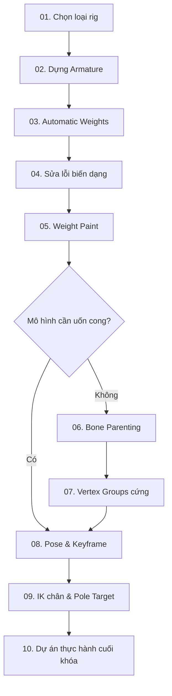

# Khóa học Blender Rigging — Từ xương cơ bản đến IK

> **Đối tượng:** Người mới bắt đầu Blender, người có nhân vật 3D hoặc mô hình AI sinh ra (Meshy, Tripo...) cần gán xương, kiểm soát biến dạng và làm hoạt ảnh đơn giản.  
> **Hình thức:** 10 bài học Markdown, làm theo từng bước, có sơ đồ Mermaid, bài tập và checklist.  
> **Giới hạn:** Nội dung gốc là lời thoại/phụ đề nhận dạng tự động, có vài đoạn dịch sai. Khóa học diễn giải lại quy trình, không giả định là bản chép chính xác từng thao tác. Tên menu/phím tắt có thể khác theo phiên bản Blender/keymap.

## Kết quả đầu ra

Sau khóa học, người học có thể:

1. Chọn rig **biến dạng mềm (deforming)** hoặc **cứng theo bộ phận (rigid)**.
2. Tạo Armature, sắp xếp xương, đặt tên `.L`/`.R`, đối xứng xương.
3. Parent mesh vào Armature bằng Automatic Weights hoặc Empty Groups.
4. Chẩn đoán lỗi automatic weight, mesh chồng lấn, thiếu topology.
5. Sửa ảnh hưởng xương bằng Weight Paint và Vertex Groups.
6. Tạo pose, keyframe cơ bản, thử Auto IK và thiết lập IK chân kèm pole target.
7. Hoàn thành một nhân vật/robot mẫu có rig kiểm thử được.

## Lộ trình học

## Danh sách bài học

| Bài | Tệp | Trọng tâm | Mốc nguồn |
|---|---|---|---|
| 01 | [Hai phương pháp rigging](01-hai-phuong-phap-rigging.md) | Deform vs rigid | 00:15–00:29 |
| 02 | [Armature và đối xứng xương](02-armature-va-doi-xung.md) | Tạo, extrude, đặt tên, symmetrize | 00:29–01:55 |
| 03 | [Gán xương bằng trọng số tự động](03-automatic-weights.md) | Parent & vertex groups | 01:55–02:34 |
| 04 | [Khắc phục lỗi rig tự động](04-khac-phuc-loi-rig.md) | Heat weighting, chồng lấn, topology | 02:34–03:14 |
| 05 | [Weight Paint cơ bản](05-weight-paint.md) | Brush, normalize, mirror, smooth | 03:15–05:32 |
| 06 | [Rig cứng: bone parenting](06-bone-parenting.md) | Gắn object trực tiếp vào bone | 05:34–06:04 |
| 07 | [Rigid weights bằng Vertex Groups](07-rigid-vertex-groups.md) | Empty Groups, Assign 1.0, lượng tử | 06:04–07:30 |
| 08 | [Pose và hoạt ảnh](08-pose-keyframe-autoik.md) | Pose Mode, keyframe, Mirror Pose, Auto IK | 07:30–08:03 |
| 09 | [Dựng IK cho chân](09-ik-chan-pole-target.md) | IK target, chain length, pole angle | 08:05–09:38 |
| 10 | [Dự án cuối khóa](10-du-an-cuoi-khoa.md) | Checklist bàn giao và kiểm thử | Tổng hợp |

Tài liệu kèm theo: [Bảng thuật ngữ & phím tắt](11-thuat-ngu-va-phim-tat.md).

## Chuẩn bị trước khi bắt đầu

- Blender phiên bản hiện đại, sử dụng keymap mặc định.
- Một mesh hình người ở T-pose/A-pose và một mô hình nhiều bộ phận (robot là lựa chọn phù hợp).
- Lưu bản gốc trước khi thay đổi topology hay áp dụng modifier; nên tạo file `.blend` riêng cho mỗi bài.
- Quy ước tên file: `rigging-bai-XX.blend`; tự chụp 2–3 hình ảnh kiểm thử để theo dõi tiến bộ.

## Phân bổ gợi ý

- Buổi 1: bài 01–03 (60–90 phút).
- Buổi 2: bài 04–05 (60–90 phút).
- Buổi 3: bài 06–08 (60–90 phút).
- Buổi 4: bài 09–10 (90–120 phút).

## Đánh giá

- **Đạt cơ bản:** có Armature hợp lệ, gắn mesh và tạo 3 pose không hỏng nghiêm trọng.
- **Đạt khá:** phân biệt đúng deform/rigid, xử lý được ít nhất 2 lỗi weight.
- **Đạt tốt:** tạo IK 2 chân, đặt pole target hợp lý, rig hoạt động khi đổi pose.

> **Về nguồn:** Bài học được biên soạn lại để dễ thực hành, dựa trên phần phụ đề được cung cấp, không phải giáo trình Blender chính thức. Phần **Ghi chú kỹ thuật** là giải thích/bổ sung để tránh nhầm lẫn do phụ đề nhận dạng sai.
