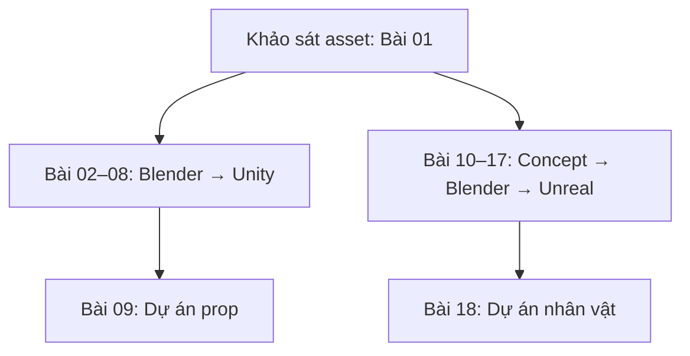

# Khóa học: Từ model AI đến tài sản 3D Game-Ready

**Chủ đề:** Blender · UV Mapping · Texture Baking · Decimate/Retopology · PBR · Emission · Unity · ComfyUI · Rigging · Mixamo · Unreal Engine  
**Ngôn ngữ:** Tiếng Việt · **Hình thức:** Tự học, mỗi bài là một file Markdown độc lập.  
**Nguồn biên soạn:** (A) Bản chép video 5:55 được người học dán trực tiếp; (B) file bản chép video 36:09 người học đính kèm.  
**Lưu ý:** Đây là giáo trình thực hành **biên soạn lại**, không phải transcript nguyên văn hay cam kết giao diện của phần mềm vẫn giống video. Các phần **bổ sung kỹ thuật** được đánh dấu khi cần.

## Kết quả đạt được

1. **Lộ trình A (bài 01–09):** Sửa một prop AI, giảm triangles, làm UV mới, bake Base Color, tạo emission và material Unity.
2. **Lộ trình B (bài 10–18):** Concept bằng AI, chia phần, tạo high-poly, retopology/UV, bake normal, tạo PBR, rig và dùng animation trong Unreal.

## Mục lục

| Bài | Tên | Thời lượng |
|---:|---|---:|
| 01 | [Khảo sát model và tiêu chí game-ready](01-khao-sat-model-ai-va-tieu-chi-game-ready.md) | 30′ |
| 02 | [Nhập model, origin, transform](02-nhap-model-dat-origin-va-transform.md) | 30′ |
| 03 | [Giảm polygon bằng Decimate](03-giam-poly-bang-decimate.md) | 35′ |
| 04 | [Tạo UV mới](04-tao-uv-moi-smart-uv-project.md) | 40′ |
| 05 | [Bake Base Color](05-bake-mau-goc-sang-uv-moi.md) | 55′ |
| 06 | [Tạo Emission mask](06-tao-emission-mask.md) | 35′ |
| 07 | [Unity material và Bloom](07-import-unity-vat-lieu-bloom.md) | 50′ |
| 08 | [Normal/metallic/roughness/VFX](08-normal-metallic-roughness-va-vfx.md) | 45′ |
| 09 | [Mini project prop Unity](09-mini-project-hoan-thien-prop-unity.md) | 90′ |
| 10 | [Concept với ComfyUI](10-concept-comfyui-va-hinh-tham-chieu.md) | 40′ |
| 11 | [Tách ảnh thành bộ phận](11-tach-bo-phan-nhan-vat-ai.md) | 40′ |
| 12 | [Sinh high-poly và lắp ráp](12-tao-high-poly-va-lap-rap-blender.md) | 55′ |
| 13 | [Retopology và UV nhân vật](13-retopology-lowpoly-va-uv.md) | 60′ |
| 14 | [Bake normal high-poly → low-poly](14-bake-normal-highpoly-sang-lowpoly.md) | 70′ |
| 15 | [Tạo texture PBR](15-tao-texture-pbr-comfyui-va-ghep-trong-blender.md) | 60′ |
| 16 | [Mirror, rig, skinning](16-mirror-rig-va-skinning.md) | 70′ |
| 17 | [Mixamo và Unreal](17-mixamo-va-import-unreal-engine.md) | 60′ |
| 18 | [Capstone nhân vật](18-capstone-nhan-vat-ai-game-ready.md) | 120′ |

**Tài liệu bổ trợ:** [Thuật ngữ và phím tắt](19-thuat-ngu-phim-tat.md) · [Xử lý lỗi thường gặp](20-xu-ly-loi-thuong-gap.md) · [Nguồn và phạm vi](21-nguon-va-pham-vi.md).

## Học thế nào?

- Có thể học **01 → 09** nếu chủ yếu làm vũ khí/đạo cụ cho Unity. Thực hành luôn trên một model AI duy nhất.
- Học **01 → 03 rồi 10 → 18** nếu mục tiêu là nhân vật game có xương và animation cho Unreal.
- Trước mỗi bài, lưu bản `.blend` kế thừa từ bài trước; sau bài chụp ảnh/ghi chú lỗi.

## Chuẩn bị
**Bắt buộc theo lộ trình:** Blender; Unity (A) hoặc Unreal Engine (B); ảnh concept hoặc model nguồn; trình vẽ texture.  
**Tùy chọn:** một dịch vụ tạo 3D bằng AI, ComfyUI, tool retopology, Photoshop/Krita/GIMP, Auto-Rig Pro, Mixamo.

## Quy tắc chất lượng
Số triangles và texture size phải theo **target platform, kích thước trên màn hình và tần suất xuất hiện**. Các mức `48K → <5K`, `ratio 0.1`, `2K/4K` trong nguồn chỉ là **ví dụ**, không phải tiêu chuẩn toàn cục.
