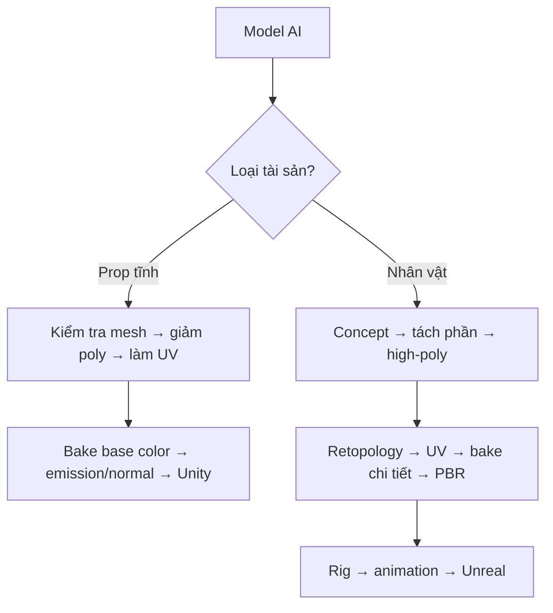

# Bài 01 — Khảo sát model AI và tiêu chí game-ready

> **Thời lượng gợi ý:** 30 phút · **Nguồn:** Video A 00:00–01:15; video B 00:00–00:32  
> **Hình thức:** Tự học có hướng dẫn, thực hành và tự kiểm tra.

## Mục tiêu
- Phân biệt **high-poly**, **low-poly**, **topology**, **UV**, **texture**, **material**, **rig** và **VFX**.
- Nhận diện lỗi thường gặp của mô hình AI: số tam giác cao, UV rối, chất liệu giống nhựa, chi tiết khó điều khiển.
- Thiết lập tiêu chí nghiệm thu cho **prop tĩnh** và **nhân vật chuyển động**.

## Bối cảnh
Ví dụ của video A là một đạo cụ sinh từ ảnh bằng công cụ AI, ban đầu khoảng **48.000 triangles**; đây là con số trong ví dụ chứ không phải giới hạn chung. Video B trình bày quy trình khác: tạo nhân vật cơ khí nhiều bộ phận, làm high-poly → retopology → rig → Unreal.

| Thành phần | Chức năng | Dấu hiệu cần sửa |
|---|---|---|
| Mesh/topology | Hình học của đối tượng | Mặt dư, lỗ, mặt chồng, méo khi uốn |
| UV map | Ánh xạ điểm trên mesh tới ảnh 2D | Đảo UV xếp chồng sai, biến dạng, lãng phí không gian |
| Base Color | Màu bề mặt, không gồm ánh sáng động | Vệt loang, vẽ khó kiểm soát |
| Normal map | Giả lập thay đổi hướng pháp tuyến khi chiếu sáng | Độ nổi giả, chiều ngược, nhiễu |
| Metallic/Roughness | Điều khiển kim loại và độ nhám | Vật liệu bị bóng nhựa |
| Emission | Các vùng tự phát sáng | Màu phát sáng sai vùng; thiếu Bloom |
| Armature/Skinning | Cho mesh đi theo xương | Khớp biến dạng, rách lưới, trọng số sai |

## Sơ đồ hai lộ trình

## Thực hành
1. Nhập một prop AI vào Blender; bật **Viewport Overlays → Statistics**.
2. Ghi lại số Objects, Vertices, Faces, Triangles, vật liệu, texture và UV layers.
3. Chụp 4 ảnh: hình dạng, wireframe, UV Editor, Material Preview.
4. Lưu `audit-before.blend` và ghi các điểm cần sửa vào `audit.md`.

## Tự kiểm tra
1. Giảm triangles có tự động làm topology phù hợp cho rig không? **Không.**
2. Normal map có thêm đa giác thực sự không? **Không.**
3. Tại sao prop và nhân vật có thể cần hai quy trình khác nhau? Vì nhân vật phải biến dạng ổn định ở khớp.

**Đầu ra:** Bảng đánh giá tài sản đầu vào và mục tiêu tối ưu.
