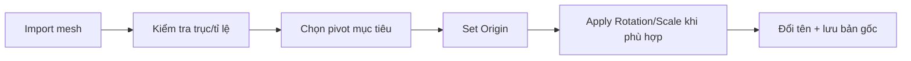

# Bài 02 — Nhập mô hình, đặt pivot/origin và quản lý transform

> **Thời lượng gợi ý:** 30 phút · **Nguồn:** Video A 00:44–00:58; video B 06:28–09:33  
> **Hình thức:** Tự học có hướng dẫn, thực hành và tự kiểm tra.

## Mục tiêu
- Nhập đúng định dạng OBJ/FBX/GLB và kiểm tra vị trí, hướng trục, tỷ lệ.
- Biết phân biệt **Origin**, **3D Cursor**, **World Origin** và **Geometry**.
- Giữ các mesh high/low trùng khít để bake.

## Quy trình trong Blender
1. `File → Import`, chọn tệp từ AI, xác nhận textures đã nạp và chuyển `Material Preview`.
2. Dùng `N` kiểm tra các giá trị Location, Rotation, Scale; xác định chân đế/tâm chuyển động mong muốn.
3. Đặt `3D Cursor` tại điểm mong muốn bằng `Shift+S` (menu Snap) hoặc nhập tọa độ trong `N` của 3D Cursor.
4. Chọn object → `Object → Set Origin → Origin to 3D Cursor`. Đây là thao tác **đổi gốc đối tượng**, không mặc định dời toàn bộ mesh.
5. Khi cần áp dụng tỉ lệ/rotation, ở Object Mode dùng `Ctrl+A → Rotation & Scale`; kiểm tra kết quả trước khi làm đối với rig hoặc mô hình có modifier.
6. Đổi tên rõ ràng (`Prop_High`, `Prop_Low`, `Head_High`, `Head_Low`) và chia Collections (`SOURCE`, `HIGH`, `LOW`, `EXPORT`).

## Vì sao origin quan trọng?
- Đạo cụ: gốc ở chuôi/điểm bám giúp gắn vào tay nhân vật trong game.
- Nhân vật: vị trí và quy ước trục hỗ trợ rig/export; transform của các bộ phận phải nhất quán.
- Bake: high-poly và low-poly phải chiếm cùng không gian, cùng scale; nếu không, tia chiếu có thể lấy sai bề mặt.

## Bài tập
Tạo hai bản sao cùng vị trí, đặt tên `Sword_High` và `Sword_Low`. Thay origin của từng bản theo đầu chuôi, xác nhận chúng không lệch nhau khi bật/tắt visibility.

## Lỗi thường gặp
- `Origin to Geometry` làm gốc chuyển về trọng tâm thay vì tay cầm.
- Apply transforms sau khi rig mà không xem hệ quả khiến xương/animation lệch.
- Nhập OBJ chỉ có mesh, thiếu các thiết lập texture hoặc xương so với FBX/GLB.

**Đầu ra:** Tệp Blender có model được định vị và đổi tên chuẩn.
