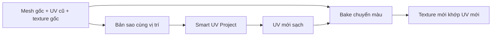

# Bài 04 — Tạo UV sạch bằng Smart UV Project

> **Thời lượng gợi ý:** 40 phút · **Nguồn:** Video A 01:16–02:18; video B 13:24–14:08  
> **Hình thức:** Tự học có hướng dẫn, thực hành và tự kiểm tra.

## Mục tiêu
- Hiểu khái niệm UV islands, seams, overlap, texel density và padding.
- Tạo UV mới mà **không phá mất vật liệu gốc**.
- Chuẩn bị low-poly làm đích bake texture.

## Quy trình của video A
1. Giữ `Prop_Original` chứa **UV và material gốc**.
2. `Shift+D` tạo `Prop_NewUV`, không di chuyển nó. Trên bản sao, tạo material mới và ảnh texture đích.
3. Chọn `Prop_NewUV` → `Tab` vào Edit Mode → `A` chọn toàn bộ faces.
4. `U → Smart UV Project`, điều chỉnh island margin thích hợp rồi xác nhận.
5. Mở `UV Editing` so sánh UV mới/cũ; kiểm tra các đảo UV không vượt ô 0–1, không đè lên nhau ngoài ý muốn.
6. Đặt tên UV map (`UV_Game`) và lưu.

**Lưu ý:** Smart UV không tự bảo đảm UV tối ưu. Với nhân vật/các phần có đường ráp rõ ràng, có thể đặt seams thủ công để kiểm soát chất lượng vùng nổi bật.

## Kiểm tra chất lượng
- Các cạnh quan trọng có bị cắt ở vị trí dễ lộ hay không?
- Có đảo UV quá nhỏ gây mờ chữ/hoa văn không?
- Khoảng cách đảo UV có đủ tránh bleed khi tạo mipmap không?
- Khi texture ô caro (checker), các ô có bị kéo dài rõ rệt không?

## Bài thực hành
Trên một vũ khí AI, tạo UV mới; so sánh checker texture trước/sau và giải thích tại sao một vùng dài có thể cần UV island riêng.

## 3 câu hỏi
1. UV mới có tự giữ màu của UV cũ không? **Không, phải chuyển/bake màu hoặc gán lại texture.**
2. Vì sao hai mesh phải trùng vị trí khi bake kiểu selected-to-active? Để tia chiếu khớp bề mặt.
3. UV mới có thể thay đổi hình dạng mesh không? **Không**, UV điều khiển cách ảnh 2D phủ lên mesh.
