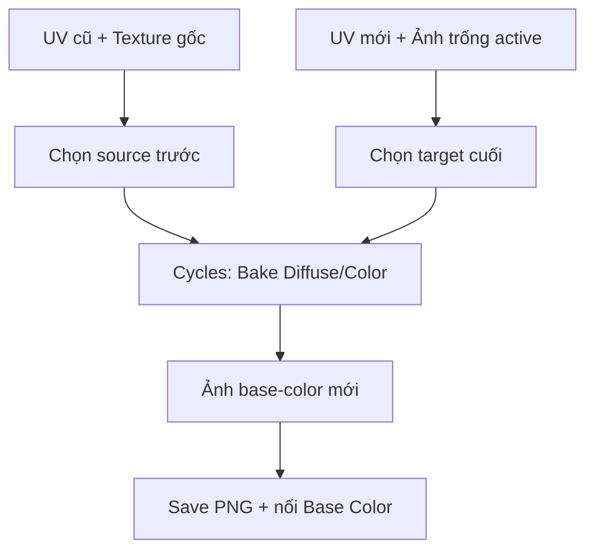

# Bài 05 — Bake Base Color/Diffuse từ UV cũ sang UV mới

> **Thời lượng gợi ý:** 55 phút · **Nguồn:** Video A 02:18–03:48  
> **Hình thức:** Tự học có hướng dẫn, thực hành và tự kiểm tra.

## Mục tiêu
- Chuyển màu của mesh AI sang bản UV mới mà không mất thiết kế ban đầu.
- Hiểu selected-to-active, bake margin, ray distance/cage và cách lưu ảnh bake.

## Chuẩn bị chính xác
- **Source (gốc):** `Prop_Original`, giữ shader/ảnh màu cũ.
- **Target (đích):** `Prop_NewUV`, đã unwrap, có material, có node `Image Texture` với ảnh trống mới (ví dụ `2048×2048`).
- Ở **Shader Editor của target**, chọn node `Image Texture` trống làm **active node**. Không cần nối node này trước khi bake.

## Các bước trong Blender
1. `Render Properties → Render Engine → Cycles`.
2. `Bake → Type: Diffuse`; nếu chỉ muốn màu cơ bản thì **chỉ bật Color**, tắt Direct và Indirect.
3. Bật `Selected to Active`, chọn Margin theo độ phân giải ảnh; điều chỉnh `Ray Distance/Extrusion` hoặc dùng Cage nếu các mặt khó khớp.
4. Trong Object Mode: **chọn source trước, chọn target cuối cùng để target là active**. Đây là yêu cầu kỹ thuật của selected-to-active (thứ tự lời chép tự động ở nguồn có thể gây nhầm).
5. Kiểm tra node ảnh bake trên **target** vẫn active → nhấn `Bake`.
6. Nối ảnh baked vào `Principled BSDF → Base Color`, so sánh hai mesh dưới cùng ánh sáng.
7. `Image Editor → Image → Save As` lưu tệp PNG; **bake chưa đồng nghĩa file ảnh đã lưu ra ổ cứng**.

## Khi kết quả bị đen/mờ
- **Đen:** node ảnh đích chưa active; UV sai; đối tượng active bị chọn nhầm; source material không hiển thị màu; khoảng chiếu không chạm mặt.
- **Mờ:** ảnh quá nhỏ, UV island quá nhỏ, source thấp độ phân giải hoặc ray distance quá lớn làm lệch bề mặt.
- **Vệt ở mép UV:** tăng bake margin/padding và tránh UV islands quá sát.

## Thực hành
Bake một texture Base Color 2K, lưu `prop_basecolor_2k.png`; chạy kiểm tra trên mesh đã giảm poly và ghi lại 2 lỗi đã/không gặp.

**Đầu ra:** Mesh có UV mới, texture được bake và PNG đã lưu.
