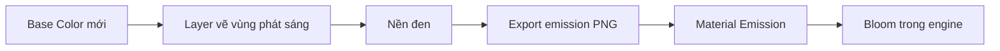

# Bài 06 — Tạo emission mask trong Photoshop hoặc công cụ vẽ

> **Thời lượng gợi ý:** 35 phút · **Nguồn:** Video A 03:59–04:46  
> **Hình thức:** Tự học có hướng dẫn, thực hành và tự kiểm tra.

## Mục tiêu
- Thiết kế vùng phát sáng có chủ đích thay vì để toàn bộ vật liệu sáng.
- Xuất texture emission khớp chính xác Base Color/UV mới.

## Các bước theo video A
1. Mở **Base Color đã bake** ở Photoshop (có thể dùng Krita/GIMP).
2. Chỉnh Brightness/Saturation nhẹ trên bản sao nếu màu nguồn bị xỉn; tránh làm mất độ tương phản và đánh đồng ảnh màu với mask.
3. Tạo layer trong suốt, dùng brush vẽ vùng phát sáng: viền lõi năng lượng, rune, mắt máy, khe giáp.
4. Thêm **layer đen phía dưới vùng phát sáng**. Pixel đen = mức emission bằng 0; pixel sáng = có emission.
5. Ẩn layer Base Color khỏi file mask khi xuất; **xuất riêng ảnh mask**, ví dụ `prop_emission.png`, đúng kích thước và bố cục UV.
6. Lưu tệp PSD/XCF có layer để chỉnh sau.

## Quy ước màu
| Giá trị | Ý nghĩa |
|---|---|
| Đen `#000000` | Không tự phát sáng |
| Trắng | Mặt nạ phát sáng tối đa (phụ thuộc cường độ shader) |
| Cam/xanh lam | Có thể mã hóa màu phát sáng nếu shader đọc emission RGB |

> Emission làm mặt sáng trong shader; **vầng hào quang lan ra ngoài** thường cần hiệu ứng Bloom/HDR ở engine.

## Ví dụ bố cục emission

## Bài thực hành
Tạo 2 mask cho cùng một vũ khí: **A tối giản** (chỉ lõi kiếm sáng) và **B phức tạp** (lõi + chữ rune). So sánh mức độ dễ đọc khi thu nhỏ ở xa.

## Tự kiểm tra
- Tại sao nền mask phải đen? Để những khu vực không vẽ không tự phát sáng.
- Tại sao phải dùng texture bake đã căn UV mới? Để vùng tô trùng với đúng chi tiết trên mesh export.
