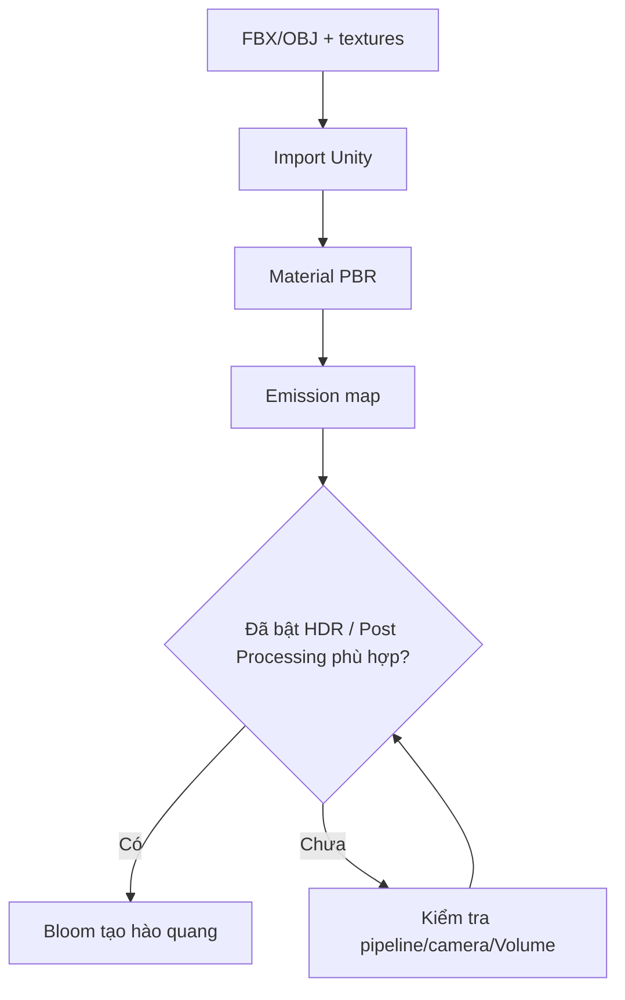

# Bài 07 — Đưa model vào Unity, gán PBR và Bloom

> **Thời lượng gợi ý:** 50 phút · **Nguồn:** Video A 03:48–05:09  
> **Hình thức:** Tự học có hướng dẫn, thực hành và tự kiểm tra.

## Mục tiêu
- Import FBX/OBJ, textures và dựng một material hoàn chỉnh.
- Tách **emission** khỏi **Bloom** và kiểm tra cấu hình render pipeline.

## Quy trình
1. Trong Blender, chọn mesh export → `File → Export → FBX` hoặc OBJ và lưu texture riêng. Kiểm tra scale, trục và apply transforms thích hợp.
2. Kéo tệp model/ảnh vào `Assets` của Unity. Tạo material và chọn shader theo pipeline (Built-in/URP/HDRP).
3. Gán `Base Color/Albedo` và, nếu có, `Normal` vào đúng slot.
4. Bật `Emission`, đặt màu/cường độ phù hợp và gán `prop_emission.png`.
5. Bật HDR nếu pipeline/camera cần để thể hiện emission mạnh, thiết lập Bloom bằng hệ thống hậu kỳ tương ứng.

## Phân biệt pipeline (phần bổ sung để tránh nhầm phiên bản)
| Pipeline | Cách làm Bloom phổ biến |
|---|---|
| URP | Tạo `Global Volume`, thêm override **Bloom**, bật Post Processing ở camera và thiết lập URP liên quan |
| HDRP | Dùng Volume Profile + Bloom, bảo đảm camera/pipeline được cấu hình đúng |
| Built-in đời cũ | Có thể dùng hệ thống post-processing riêng theo phiên bản dự án |

Video nguồn nói “cài gói post-processing”; thao tác này **phụ thuộc phiên bản Unity và render pipeline**, không phải bước luôn bắt buộc cho URP hiện đại.

## Sơ đồ

## Các lỗi dễ gặp
- Emission có màu trên bề mặt nhưng **không có glow**: thiếu Bloom, HDR, hoặc intensity chưa vượt ngưỡng.
- Texture bị bóng/vỡ: import sRGB sai cho ảnh dữ liệu hoặc material pipeline không phù hợp.
- Model quá sáng trắng: emission intensity hoặc exposure quá cao.

## Thực hành
Chụp 3 kết quả: không emission, có emission không Bloom, emission + Bloom. Viết một câu giải thích sự khác biệt giữa ba ảnh.
