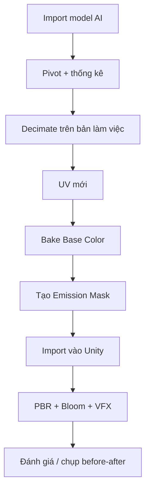

# Bài 09 — Mini project: biến đạo cụ AI thành prop Unity hoàn chỉnh

> **Thời lượng gợi ý:** 90 phút · **Nguồn:** Tổng hợp video A 00:00–05:55  
> **Hình thức:** Tự học có hướng dẫn, thực hành và tự kiểm tra.

## Đề bài
Chọn một **vũ khí/đạo cụ cơ khí sinh từ AI**. Mục tiêu là biến nó thành prefab Unity có UV sạch, texture được chuyển từ nguồn, emission rõ và VFX nhẹ.

## Yêu cầu bắt buộc
- Bản gốc được giữ nguyên, có ảnh wireframe và UV before.
- Bản tối ưu có silhouette gần bản gốc; ghi rõ số triangles trước/sau.
- Có `basecolor.png` và `emission.png` theo UV mới; ảnh đã lưu thực sự vào ổ đĩa.
- Material dùng đủ những kênh phù hợp; normal/PBR không gây cảm giác giả hoặc mất chi tiết.
- Unity prefab có ít nhất 2 trạng thái để so sánh: **Emission Off** và **Emission On**.

## Quy trình nghiệm thu


## Hồ sơ nộp
```text
Unity_Prop_Project/
├── blender/prop_work.blend
├── export/prop_game.fbx
├── textures/prop_basecolor.png
├── textures/prop_emission.png
├── textures/prop_normal.png        # nếu có
├── screenshots/before_after.png
└── README.md
```

## Thang đánh giá (100 điểm)
| Tiêu chí | Điểm |
|---|---:|
| Mesh được tối ưu mà không mất hình chính | 25 |
| UV và bake chính xác, không đen/mờ | 25 |
| Emission mask sạch và Bloom vừa phải | 20 |
| Vật liệu PBR và VFX hợp lý | 15 |
| Tổ chức file, ảnh so sánh, mô tả vấn đề | 15 |

## Phần nâng cao
Tạo phiên bản có **LOD0/LOD1** hoặc biến thể texture 1K và 2K; đo FPS/độ sắc nét trong cùng cảnh.
