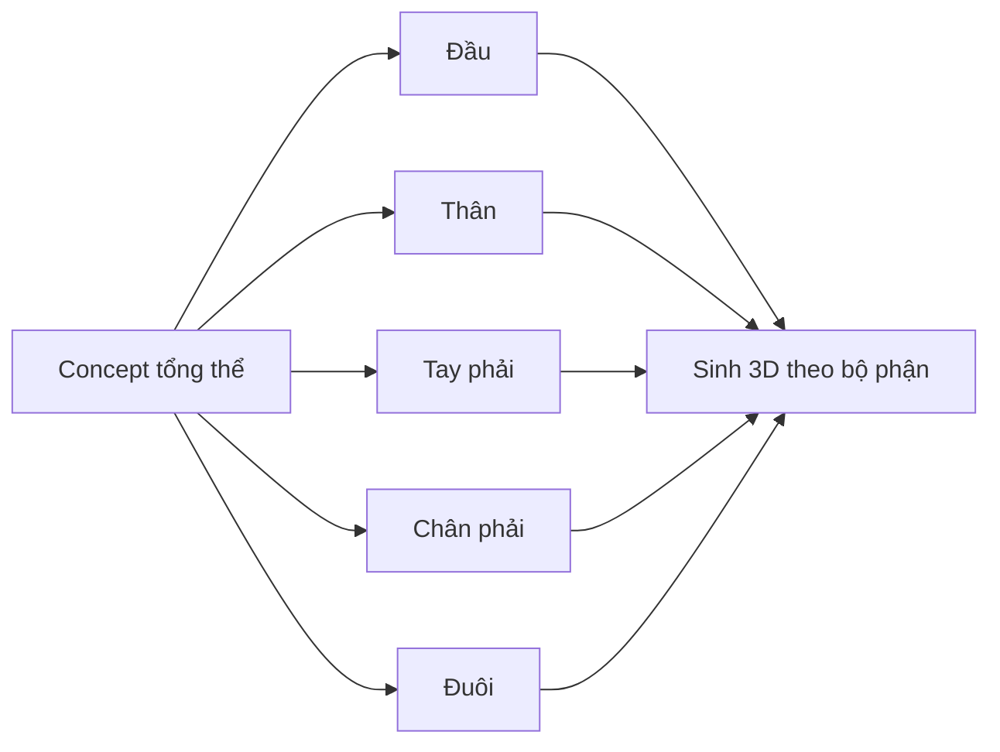

# Bài 11 — Tách ảnh concept thành đầu, thân, tay, chân, đuôi

> **Thời lượng gợi ý:** 40 phút · **Nguồn:** Video B 03:06–04:46  
> **Hình thức:** Tự học có hướng dẫn, thực hành và tự kiểm tra.

## Mục tiêu
- Tách từng bộ phận từ ảnh toàn thân để tăng độ rõ khi dựng 3D.
- Bảo đảm AI không thay đổi tỷ lệ, kiểu khớp và màu của bộ phận.

## Quy trình theo video B
1. Lưu concept chuẩn.
2. Sử dụng công cụ AI chỉnh ảnh (nguồn gọi **Nano Banana Pro** trên nền tảng `fal.ai` theo transcript) để tạo ảnh riêng cho đầu, torso, tay, chân, đuôi.
3. Ra lệnh rõ: “Chỉ hiển thị chân bên phải, giữ nguyên hình dạng thiết kế, góc máy và vật liệu; phóng to để lấp khung hình, nền trơn”.
4. Video gợi ý độ phân giải **2K** cho mỗi ảnh chi tiết.
5. So sánh mọi phần với ảnh tổng thể; nếu xuất hiện chi tiết lạ thì tạo lại, không vội đưa vào công cụ sinh 3D.

## Quy ước đặt tên
```text
references/
├── concept_master.png
├── head_ref.png
├── torso_ref.png
├── arm_R_ref.png
├── leg_R_ref.png
└── tail_ref.png
```

## Prompt mẫu cho tách phần
```text
Isolate only the right robotic leg from this exact reference character.
Preserve its original silhouette, armor pattern, color palette and joint structure.
Show the complete leg centered on a plain background, without adding parts.
High-resolution product-style view.
```

## Sơ đồ


## Câu hỏi kiểm tra
1. Tách bộ phận có bảo đảm topology đẹp không? **Không**, nhưng giúp phần đầu vào rõ hơn.
2. Tại sao có thể chỉ sinh một tay/chân? Để mirror khi thiết kế đối xứng.
3. Khi AI tự thêm phụ kiện, nên làm gì? Sửa prompt/ảnh tham chiếu trước khi tiếp tục.
