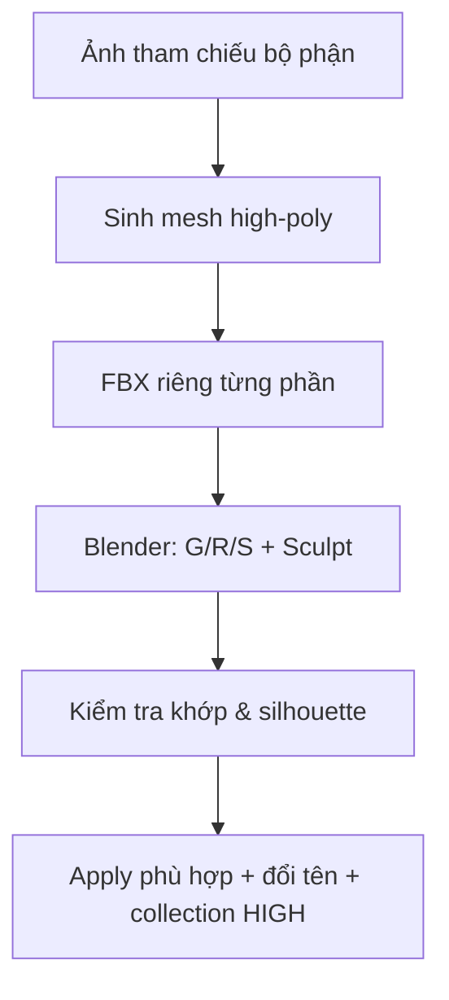

# Bài 12 — Sinh các bộ phận high-poly và lắp ráp trong Blender

> **Thời lượng gợi ý:** 55 phút · **Nguồn:** Video B 04:46–11:14  
> **Hình thức:** Tự học có hướng dẫn, thực hành và tự kiểm tra.

## Mục tiêu
- Sử dụng công cụ image-to-3D tạo các bộ phận nhiều chi tiết.
- Lắp ráp, căn tỷ lệ theo concept và quản lý collection high-poly.

## Quy trình từ nguồn
1. Nạp ảnh từng bộ phận vào công cụ tạo 3D; video nhắc **Hunyuan3D** hoặc **Trellis 2** là lựa chọn thay thế và minh họa dịch vụ 3D với chế độ chất lượng cao.
2. Với phần high-poly làm nguồn bake, có thể bỏ tạo texture ở bước này; ưu tiên **hình học và silhouette**.
3. Xuất các phần dưới dạng **FBX** và đặt tên nhất quán (`Head_High`, `Arm_R_High`...).
4. Trong Blender, nhập từng file, dùng `G` di chuyển, `R` xoay, `S` thay tỉ lệ. So đối chiếu concept liên tục.
5. Dùng Sculpt Mode (ví dụ Elastic Deform/Grab) để nắn điểm tiếp giáp bị hở, tránh bóp méo chi tiết gốc.
6. Giữ tay/chân một bên nếu muốn **Mirror** ở giai đoạn sau.
7. `Ctrl+A → Rotation & Scale` có kiểm soát; thống nhất origin của các phần để xuất/nhập trở lại không lệch.
8. Tạo collection `HIGH`; chỉ trước khi qua retopology mới cân nhắc giảm bớt triangles để tải nhanh hơn.

## Lưu ý về xuất nhập
Các model do AI gen theo từng phần không nhất thiết có cùng tỷ lệ/thế tọa độ; phải căn chỉnh **bằng mắt và theo concept**. Không được tự động coi công cụ gen là đã căn đồng bộ.

## Sơ đồ

## Bài tập
Lắp 5 thành phần: torso, head, arm_R, leg_R, tail. Chụp nhìn trước, cạnh, 3/4; tô màu đánh dấu nơi nối bị lỗi hoặc giao nhau.

**Đầu ra:** `character_high_assembled.blend` cùng danh mục các phần.
