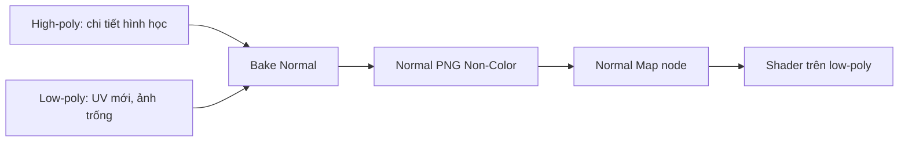

# Bài 14 — Bake normal chi tiết từ high-poly sang low-poly

> **Thời lượng gợi ý:** 70 phút · **Nguồn:** Video B 15:24–20:11  
> **Hình thức:** Tự học có hướng dẫn, thực hành và tự kiểm tra.

## Mục tiêu
- Giữ cảm giác nhiều chi tiết dù mô hình có ít polygon hơn.
- Nắm **normal baking** và cấu hình Non-Color cho ảnh dữ liệu.
- Biết hai quy trình được nhắc: selected-to-active và Multires bake.

## Phương án thực hành khuyến nghị: high → low (bổ sung kỹ thuật)
1. Đặt hai mesh high/low đúng vị trí; bảo đảm low có UV sạch.
2. Tạo ảnh `head_normal_2k.png` hoặc `4k` khi thật sự cần; đặt image color space là **Non-Color**.
3. Trong **material của low**, thêm node `Image Texture` chứa ảnh trống, **chọn node làm active**.
4. Đặt `Render Engine → Cycles`, `Bake Type → Normal`, bật **Selected to Active**.
5. Chọn `Head_High` trước → `Head_Low` cuối (low là active); thiết lập ray distance/cage khi cần, bake.
6. Lưu ảnh, nối `Image Texture (Non-Color) → Normal Map node → Principled BSDF.Normal`.
7. Kiểm tra ánh sáng từ nhiều phía; không nối ảnh normal **trực tiếp vào Base Color** khi làm vật liệu cuối.

## Quy trình Multires mô tả trong video B
Nguồn có phương án dùng **Shrinkwrap + Multiresolution** trên low-poly, tăng cấp subdiv để lấy chi tiết từ high, sau đó **Bake from Multires** (đoạn 17:06–19:55). Đây là phương án khác, đòi hỏi thứ tự modifier và thiết lập đúng; **không bật Selected to Active đồng thời một cách tùy tiện**. Học viên có thể chọn một phương án và kiểm thử bằng phần đầu trước khi nhân rộng.

## Chẩn đoán lỗi
- Normal bị lồi/lõm ngược: kiểm tra tangent space và chuẩn kênh Y theo engine.
- Có đốm đen: tia bake xuyên sang mặt bên cạnh; cân chỉnh cage/ray distance.
- Chi tiết không hiện: kiểm tra active image, mapping, node **Normal Map**, strength và ánh sáng.
- Seams dễ thấy: kiểm UV, normals split và padding ảnh.

## Thực hành
Bake một phần đầu và chụp ba ảnh: high-poly, low-poly không normal, low-poly có normal ở cùng góc sáng.
