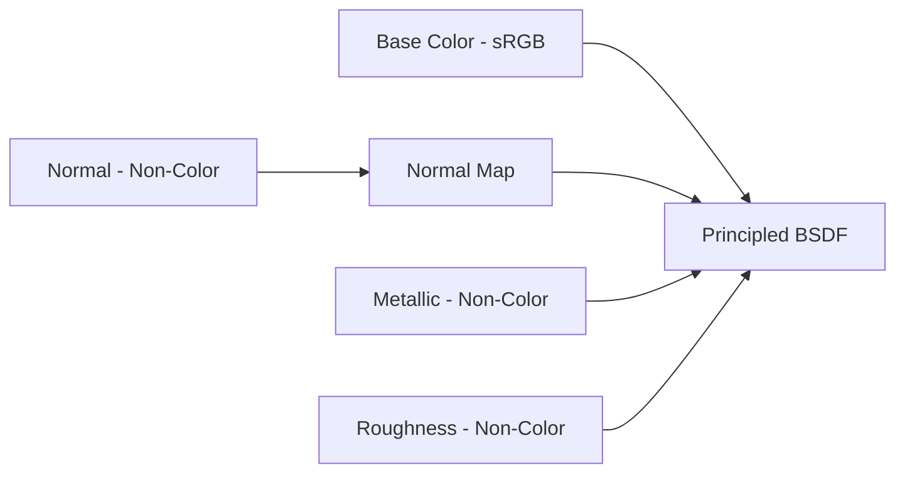

# Bài 15 — Tạo texture PBR và kết hợp với normal đã bake

> **Thời lượng gợi ý:** 60 phút · **Nguồn:** Video B 20:11–24:29  
> **Hình thức:** Tự học có hướng dẫn, thực hành và tự kiểm tra.

## Mục tiêu
- Tạo textures cho từng mesh đã retopo, bao gồm Base Color, Metallic và Roughness.
- Chuyển thông tin vật liệu giữa các bộ phận và xuất được file có texture ổn định.

## Quy trình trong video B
1. Video dùng **ComfyUI + Trellis 2** cho bước texturing; đồng thời nhắc một dịch vụ khác như phương án đơn giản hơn. Tên dịch vụ thay thế trong transcript không hoàn toàn rõ; không cần phụ thuộc vào một nhà cung cấp.
2. Export low-poly theo định dạng mà workflow chấp nhận: nguồn mô tả chuyển sang **OBJ** vì workflow đang dùng không đọc FBX tại bước đó.
3. Trong workflow texturing, trỏ đến tệp mesh, cấu hình lưu **Base Color, Metallic, Roughness**.
4. Chạy tạo texture; lấy kết quả mesh/textures trong thư mục output, nhập lại Blender.
5. Dùng cặp mesh chính xác, chuyển material/maps về bản low-poly đã giữ UV/baked normal nếu cần. **Không giả định UV mới do dịch vụ tạo giống UV đang dùng**; kiểm UV và bake/chuyển lại texture khi khác.
6. Kết hợp `Base Color` (sRGB), `Normal` (Non-Color), `Metallic/Roughness` (Non-Color) trong Shader Editor.

## Node cần nhớ

## Lưu ý packed texture
Nguồn mô tả một ảnh gộp dữ liệu với **kênh G cho roughness, B cho metallic** ở ví dụ cụ thể. Đây **không phải quy ước chung** của mọi công cụ. Trước khi nối `Separate Color → G/B`, cần kiểm tài liệu hoặc xem ảnh kênh thật.

## Bài tập
Làm texture cho đầu và đuôi, dùng cùng một HDRI/lighting để so sánh. Xác minh không có ảnh nào bị `Missing Files` trước khi export.

## Tự kiểm tra
1. Tại sao roughness không để sRGB? Vì đó là dữ liệu tuyến tính, không phải ảnh màu để hiển thị.
2. Nếu AI tạo UV khác, copy node sang mesh cũ có tự đúng không? **Không.**
