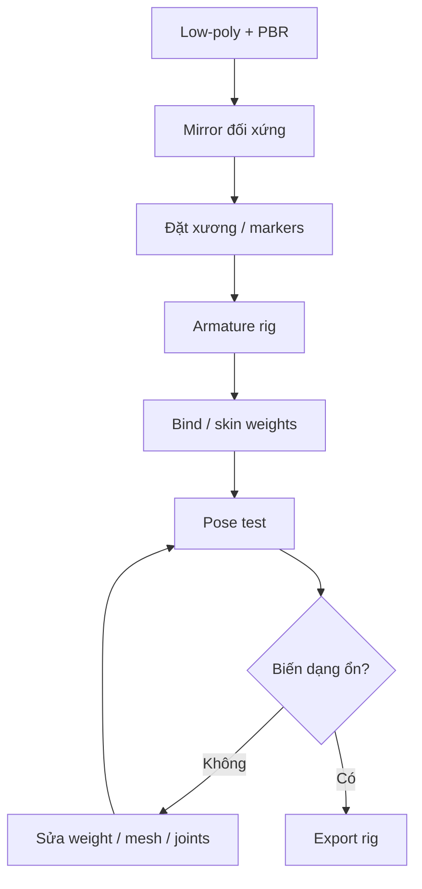

# Bài 16 — Mirror, Auto-Rig Pro, hàm, đuôi và skinning

> **Thời lượng gợi ý:** 70 phút · **Nguồn:** Video B 23:53–32:44  
> **Hình thức:** Tự học có hướng dẫn, thực hành và tự kiểm tra.

## Mục tiêu
- Mirror các phần đối xứng, gắn xương và kiểm tra skinning.
- Biết đặt markers, tạo rig, thêm tail chain/jaw bone và xử lý biến dạng.

## A. Mirror sau khi hoàn thiện đối xứng
1. Kiểm tra **Origin** và trục đối xứng; đưa mesh về hệ tọa độ chung.
2. Chọn tay/chân một phía → **Mirror Modifier**, cấu hình trục; bật tùy chọn phù hợp cho đường giữa.
3. Kiểm cả geometry lẫn hướng UV/mirror texture, tránh chi tiết bất đối xứng bị lật không mong muốn.

## B. Tạo rig theo ví dụ
1. Nguồn dùng **Auto-Rig Pro** (add-on có thể mất phí), chọn toàn bộ mesh nhân vật cần rig.
2. Thao tác `Smart`/landmark dự đoán vị trí joint; **kiểm từng marker thủ công** theo đầu gối, mắt cá, vai, cổ tay.
3. Tạo rig, điều chỉnh spine/leg chains phù hợp giải phẫu cơ khí.
4. Thêm chuỗi xương **tail** và một khớp **jaw** để mở miệng. Với phần máy cứng, có thể cần phân vùng geometry đi theo bone riêng thay vì skin mềm.
5. `Bind/Skin`: video chọn kiểu voxelize/volume-preserving; kết quả phụ thuộc mesh thực tế và phiên bản add-on.
6. Vào Pose Mode kiểm tra chân, tay, đuôi và hàm. Sửa weight painting khi mesh co, xuyên hoặc kéo nhầm.

## Quy trình thay thế
Không bắt buộc dùng Auto-Rig Pro: có thể rig thủ công bằng Blender Armature hoặc dùng dịch vụ auto-rig khác. Video cũng đề xuất Mixamo ở bước sau cho animation; **Mixamo không thay thế mọi chức năng rig động vật/đuôi/hàm**.

## Bài thực hành
Tạo 4 pose test: đứng trung tính, gập gối, uốn đuôi 45°, mở hàm. Lưu ảnh và ghi lỗi biến dạng nếu có.
