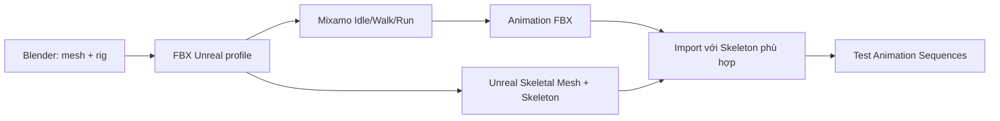

# Bài 17 — Xuất rig, lấy animation trên Mixamo và kiểm trong Unreal

> **Thời lượng gợi ý:** 60 phút · **Nguồn:** Video B 31:37–36:09  
> **Hình thức:** Tự học có hướng dẫn, thực hành và tự kiểm tra.

## Mục tiêu
- Xuất FBX có rig phù hợp đích sử dụng.
- Thêm Idle/Walk/Run và nhập đúng Skeleton trong Unreal Engine.
- Phân biệt animation preview với nhân vật gameplay có thể điều khiển.

## Theo quy trình video B
1. Kiểm tra xương, tên object, bind pose và ngăn transforms lệch trong Blender.
2. Export **FBX** từ Auto-Rig Pro với profile phù hợp **Unreal Engine**; video nhấn mạnh kiểm mục Unreal khi xuất. Cấu trúc skeleton cần khớp phiên bản target.
3. Đưa file đã rig vào **Mixamo** để thử **Walk, Run, Idle**; các animation chọn ở nguồn được tải về ở **30 FPS**.
4. Mở project Third Person trong Unreal, nhập **Skeletal Mesh** trước để tạo Skeleton.
5. Nhập từng animation, chọn **đúng Skeleton** của nhân vật hoặc cấu hình retarget nếu rig không tương thích.
6. Mở preview từng Animation Sequence, quan sát bàn chân, hướng di chuyển, root motion và các bộ phận phụ.

## Điều video chưa triển khai đầy đủ
Video minh họa chạy animation trên mesh, nhưng **không hướng dẫn đầy đủ Animation Blueprint, state machine, input gameplay, retargeting/IK và root motion**. Những phần này là bài nâng cao ngoài nguồn, không nên kết luận nhân vật đã điều khiển hoàn chỉnh chỉ vì animation preview chạy.

## Sơ đồ

## Bài thực hành
Import mesh và ba animation vào Unreal; chụp screenshot Skeletal Mesh Editor, Skeleton Tree và từng Animation Sequence. Ghi rõ chuyển động nào cần retarget hoặc weight-fix.

**Đầu ra:** Nhân vật hiển thị đúng trong Unreal và tối thiểu 3 animation xem trước.
