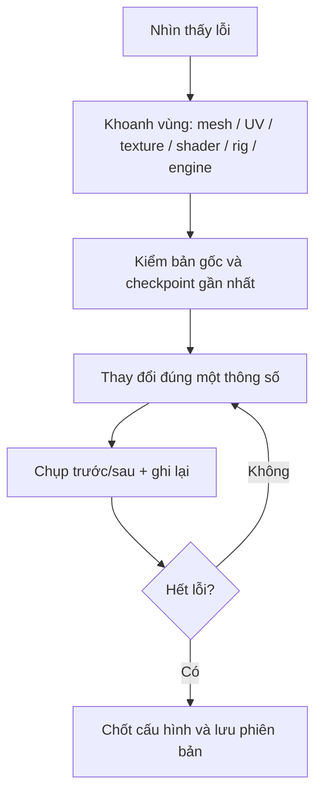

# Tài liệu bổ trợ — Chẩn đoán & xử lý lỗi

| Triệu chứng | Kiểm tra đầu tiên | Hướng xử lý |
|---|---|---|
| Bake đen hoàn toàn | Active object, active image node, bake type, Cycles | Chọn source trước/target cuối, chọn ảnh ở material target |
| Bake có vệt/nhiễu | Cage/ray distance, mesh đè, ray xuyên mặt | Điều chỉnh khoảng chiếu, thử cage, bake từng bộ phận |
| Bake bị mờ | Image resolution, texel density, UV padding | Tăng độ phân giải hợp lý, mở rộng UV quan trọng |
| Texture bị “bẻ cong” | UV chưa khớp ảnh mới | Tạo/bake ảnh ứng với đúng UV cần dùng |
| Normal lồi lõm ngược | Y/green channel, tangent space | Kiểm chuẩn OpenGL/DirectX và cấu hình engine |
| Normal map không tác dụng | `Normal Map node`, Non-Color, material slot | Nối node và tăng/giảm Strength |
| Material trông nhựa | Roughness/smoothness và phản chiếu | Điều chỉnh PBR theo vật liệu; kiểm environment |
| Không thấy Bloom | HDR, intensity, camera postprocess, Volume | Bật đủ thành phần theo Built-in/URP/HDRP |
| Model biến mất sau import | Scale, clipping, axis, mesh filter | Kiểm transform, camera, normals và render settings |
| Skin kéo nhầm mảng giáp | Weight paint, bone parenting | Sửa weights, tách/parent rigid pieces đúng bone |
| Mixamo animation lệch | Skeleton, bind pose, retargeting | Import theo Skeleton hợp lệ hoặc retarget |
| Mirror làm hỏng chi tiết | Origin, local axis, UV mirroring | Sửa gốc/trục, áp transform khi phù hợp |

## Quy trình debug tối thiểu

## Checklist trước export
- [ ] Không mất texture ngoài đường dẫn; ảnh bake được `Save As`.
- [ ] UV cuối đúng với texture cuối; material không gắn ảnh nhầm.
- [ ] Object names, Collections, pivots, tỉ lệ và trục được ghi chú.
- [ ] High-poly còn được lưu để sửa bake.
- [ ] Mức triangles, loại rig/animation, target engine được nêu trong README dự án.
