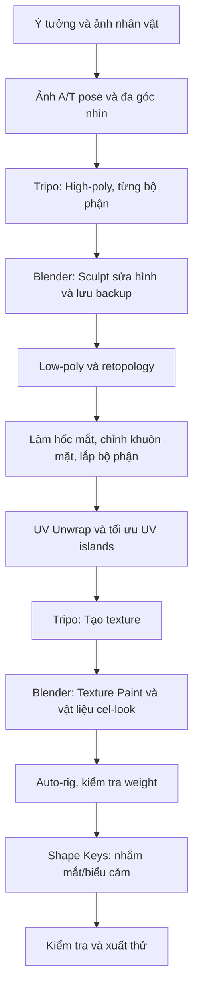

# Bài 01 — Tổng quan pipeline AI 3D và mục tiêu game-ready

> **Phân đoạn tham chiếu:** 00:00–02:29 trong bản ghi gốc.  
> **Đầu ra bài học:** sản phẩm/tài liệu theo mục tiêu và mục thực hành bên dưới.

## Bối cảnh và kết quả mong đợi
Bài thực hành lấy nhân vật **thỏ cách điệu (Lop)** làm ví dụ xuyên suốt. AI có thể tạo hình dáng 3D nhanh, nhưng **mesh mật độ cao, topology ngẫu nhiên và UV rối** khiến việc chỉnh sửa/hoạt hình khó khăn. Mục tiêu của khóa học là tạo một nhân vật **có thể thử rig và thực hiện chuyển động/biểu cảm đơn giản**, không cam kết game-ready trên mọi thiết bị.

## Quy trình đầy đủ

### Những công cụ xuất hiện trong tài liệu
| Công cụ | Vai trò | Ghi chú |
|---|---|---|
| ChatGPT / AI tạo ảnh | Thiết kế nhân vật, ảnh tham chiếu, ảnh có bóng đổ dễ đọc | Công cụ tạo ảnh là tùy chọn |
| Tripo AI | Image-to-3D, Smart Mesh, tạo texture | Chi phí credit thay đổi theo lựa chọn |
| Blender | Import, Sculpt, retopo, UV, paint, rig và sửa lỗi | Phần cốt lõi của khóa học |
| Auto Mirror / Quad Remesher / RetopoFlow | Đối xứng, tự remesh, retopology tay | Add-on có thể cần cài riêng; kiểm tra bản quyền |
| Claude Code + BlenderMCP | Trợ lý thao tác Blender qua kết nối | Không phải thao tác nào cũng tự chạy đúng |
| Auto-Rig Pro | Tạo rig trong ví dụ | Add-on trả phí; có thể thay bằng giải pháp khác |

## Nguyên tắc theo tài liệu
1. **Ưu tiên tính tái lập** thay vì tối giản số bước.
2. Sửa hình high-poly trước khi giảm poly, không kỳ vọng remesher sửa mọi lỗi.
3. Tách đầu, thân và các chi tiết để dễ canh và tái tạo riêng.
4. Tạo bản sao trước mỗi thao tác làm thay đổi dữ liệu mạnh: remesh, retopo, merge hoặc rig.
5. Giữ mức độ hoàn thiện phù hợp mục tiêu: khuôn mặt chỉ cần biểu cảm tối thiểu.

## Thực hành
Tạo thư mục dự án gồm `00_reference/`, `01_tripo_raw/`, `02_blender_work/`, `03_textures/`, `04_exports/`, `05_backups/`. Ghi vào `project_log.md`: concept, ảnh đã dùng, phiên bản Tripo/Blender, số mặt trước và sau khi tối ưu.

## Tự kiểm tra
- Vì sao model AI đẹp khi đứng yên nhưng chưa chắc rig được?
- Vì sao cần lưu bản high-poly gốc?
- Trình tự giữa UV Unwrap và tạo texture trong dự án này là gì?

---

**Tiếp theo:** Bài 02.
