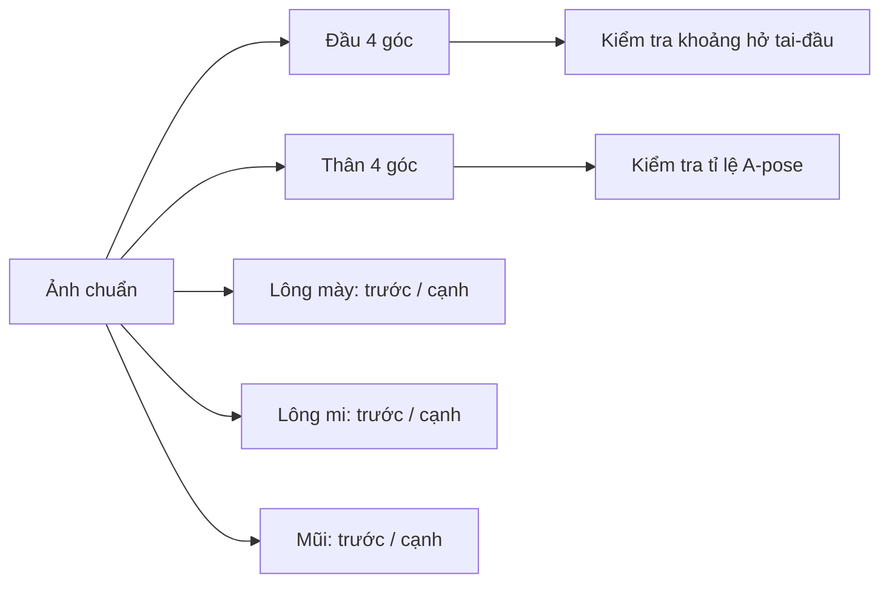

# Bài 03 — Chuẩn bị multiview và tách các bộ phận

> **Phân đoạn tham chiếu:** 04:16–07:21 trong bản ghi gốc.  
> **Đầu ra bài học:** sản phẩm/tài liệu theo mục tiêu và mục thực hành bên dưới.

## Mục tiêu
Chuẩn bị bộ **front / left / right / back** đủ dùng cho Tripo, tránh lỗi bộ phận dính nhau.

## Luồng thiết kế

## Các bước thực hành
1. Xuất **đầu** và **thân** thành hai tập đa góc nhìn riêng: đầu cần độ chính xác gương mặt, thân cần tỉ lệ khớp.
2. Với tai thỏ, cố ý tạo **khe hở nhỏ giữa tai và đầu** ở các ảnh nếu muốn tai là phần tách rời để rig/sửa. Tài liệu đưa ví dụ ảnh tai chạm đầu dẫn đến geometry dính khó khắc phục.
3. So sánh mặt trước/sau/trái/phải về **màu, kích thước, chiều dài tai, dáng chân và cổ**; chỉnh trước khi chuyển sang 3D.
4. Chuẩn bị góc trước và cạnh cho **lông mày, lông mi, mũi**; từng phần nhỏ có thể có tỉ lệ phóng đại trên ảnh để AI nhận dạng tốt hơn.
5. Mắt có thể tự dựng trong Blender bằng mesh đơn giản; video không đặt kỳ vọng Tripo sinh mắt hoàn hảo từ ảnh.
6. Lưu bộ hình theo tên: `head_front.png`, `head_left.png`, `head_right.png`, `head_back.png`, tương tự cho `body`.

## Kiểm tra ảnh đầu vào
- Các góc nhìn có cùng nhân vật, không bất ngờ xuất hiện phụ kiện.
- Các phần dự kiến tách rời không chạm nhau.
- Chi tiết mặt có vị trí tương ứng từ mọi góc.
- Không còn họa tiết nhiễu dễ bị AI biến thành **lỗ/rãnh mesh**.

## Thực hành
Tạo bảng đối chiếu 4 góc đầu và 4 góc thân. Khoanh 3 vị trí rủi ro giao nhau. Viết yêu cầu chỉnh ảnh trước khi sinh model.

## Tự kiểm tra
Vì sao ảnh đa góc nhìn đầu và thân nên độc lập? Vì sao ảnh tai nối đầu khiến hậu kỳ khó hơn?

---

**Tiếp theo:** Bài 04.
