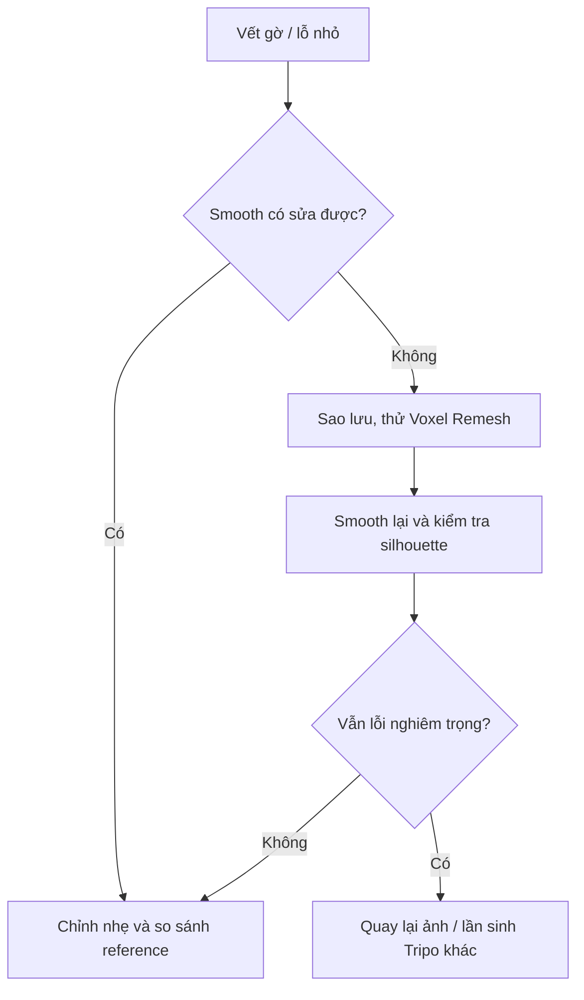

# Bài 07 — Sculpt đầu: Smooth, Voxel Remesh, mask và hốc mắt

> **Phân đoạn tham chiếu:** 20:26–35:04 trong bản ghi gốc.  
> **Đầu ra bài học:** sản phẩm/tài liệu theo mục tiêu và mục thực hành bên dưới.

## Mục tiêu
Loại bỏ rãnh/lỗ nhỏ và chi tiết không cần giữ bằng geometry, chuẩn bị cho low-poly và khuôn mặt có biểu cảm.

## Quy trình chi tiết
1. Chọn đầu, vào **Sculpt Mode**. Dùng **Smooth** với lực vừa phải để xóa gờ, nốt, nếp hỏng, vùng nhiễu quanh mắt/má.
2. Tạo đối xứng bằng **Mirror / Auto Mirror** hoặc bật **X symmetry** trong Sculpt. Trước khi Apply modifier, kiểm tra đường nối giữa hai nửa, transform và clipping.
3. Nếu Smooth không sửa được lỗ/gờ, sử dụng **Voxel Remesh**; bản ghi thử voxel size **0.002** hoặc **0.001** (theo scale của model gốc), rồi Smooth lại. **Không dùng thông số này như giá trị chuẩn chung**.
4. **Nhân bản đầu trước khi làm thay đổi topology** (`Shift+D`), đặt `Head_BU_01`, ẩn khỏi scene làm việc.
5. Loại bỏ những chi tiết sẽ dựng bằng object/texture riêng: lông mày, lông mi, mũi, miệng, vệt lạ. Tập trung silhouette và mặt phẳng da.
6. Dùng **Lasso Mask** che vùng mắt; tùy chọn chỉ mặt trước để mask không xuyên mặt sau.
7. Smooth vùng lông mi nhưng bảo vệ viền mắt; sau đó **Invert Mask** để chỉ sửa vùng mắt.
8. Dùng **Elastic Grab** đẩy mặt mắt vào phía trong, tạo độ lõm cần thiết cho eye socket. Xóa mask và chỉnh nhẹ shape.
9. Lưu `Lop_01_head_sculpt.blend` và một bản backup trước retopo.

## Sơ đồ quyết định lỗi

## Những sai lầm cần tránh
- Remesh sau khi vẽ mask có thể làm **mất hoặc thay đổi mask**; hoàn thiện remesh trước thao tác mask tinh.
- Apply Mirror có thể mất khả năng sửa đối xứng bằng modifier; bật Sculpt X symmetry hoặc tạo lại Mirror đúng cách.
- Smooth quá mạnh làm mất vẻ chibi và dáng đầu; so sánh ảnh tham chiếu liên tục.

## Bài thực hành
Làm sạch đầu và tạo hai khoang mắt tương đối cân. Kiểm tra silhouette sau mỗi giai đoạn; ghi cỡ voxel và chất lượng bề mặt thu được.

---

**Tiếp theo:** Bài 08.
